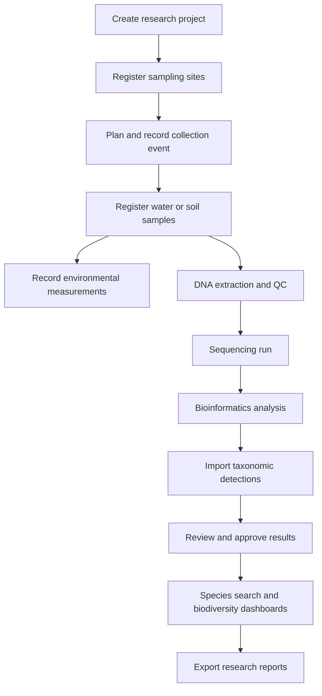
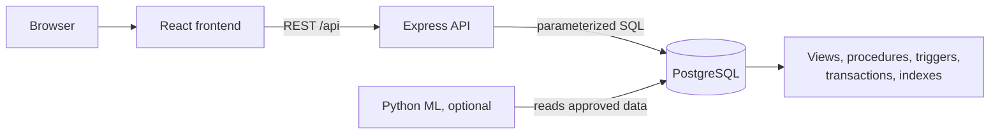
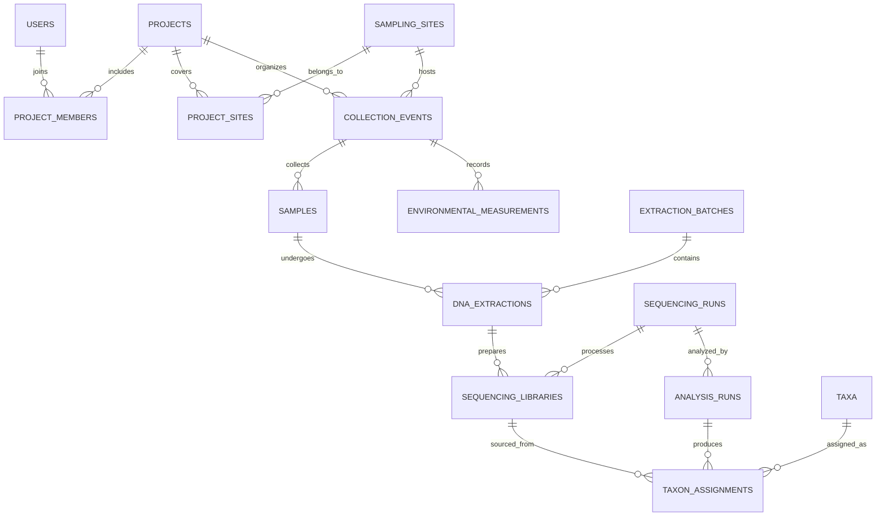

# eBioTrack — eDNA Biodiversity Intelligence Platform

> A research management and biodiversity analytics platform for environmental DNA (eDNA) studies. Track every step from field sample to species detection, with full provenance and an audit trail.


> **Status:** eBioTrack is in early development. The repository contains the project structure, design documents, and ownership plan; the features below describe what the platform is being built to do.

---

## Table of contents

- [What is eBioTrack?](#what-is-ebiotrack)
- [Who is it for?](#who-is-it-for)
- [Key features](#key-features)
- [How it works](#how-it-works)
- [Tech stack](#tech-stack)
- [Architecture](#architecture)
- [Data model](#data-model)
- [Example queries](#example-queries)
- [API overview](#api-overview)
- [Scientific integrity](#scientific-integrity)
- [Data sources](#data-sources)
- [Repository structure](#repository-structure)
- [Local development](#local-development)
- [Documentation](#documentation)
- [Roadmap](#roadmap)
- [Scope and limitations](#scope-and-limitations)

---

## What is eBioTrack?

Environmental DNA studies detect species from traces of DNA in water, soil, or air samples. One study produces linked data across field sampling, laboratory processing, sequencing, taxonomic assignment, and environmental measurements. That data usually ends up scattered across spreadsheets, result files, and notebooks, which makes it hard to:

- trace a species detection back to the sample, site, and date it came from,
- compare sites and time periods consistently,
- see who changed what and when,
- reproduce an analysis.

eBioTrack puts the whole workflow in one relational system. Every detection stays connected to its analysis run, sequencing library, DNA extraction, sample, collection event, and sampling site. Researchers get searchable records, maps, biodiversity dashboards, and exports. Administrators get role-based access and an audit trail.

eBioTrack manages and analyzes the outputs of eDNA work. It is not a sequencing instrument, a bioinformatics pipeline, or a substitute for scientific validation.

## Who is it for?

| User | What they need | What eBioTrack gives them |
|---|---|---|
| **Field researcher** | Register sites, events, and samples | Standardized sample records with unique codes and status history |
| **Lab technician** | Track extraction, QC, and sequencing | A traceable processing history and flagged failures |
| **Bioinformatics analyst** | Import and review taxonomic assignments | Versioned, queryable detection results with an approval step |
| **Principal investigator** | Coordinate projects and collaborators | Project oversight and access control |
| **Conservation researcher** | Compare biodiversity across sites and time | Trend dashboards, maps, and exports |
| **Administrator** | Manage users and permissions | Roles, audit records, and backups |

## Key features

- **Project and site management:** projects with members, study regions, geolocated sampling sites, and a sampling map.
- **Field sample tracking:** collection events and samples with unique identifiers, environmental measurements, and a status timeline.
- **Laboratory workflow:** extraction batches, QC results, sequencing libraries and runs, with failed or contaminated controls flagged.
- **Analysis and taxonomy:** CSV import of taxonomic detections with validation, and review and approval before results appear in dashboards.
- **Species explorer:** search taxa, see where and when they were detected, and trace each detection to its source sample.
- **Biodiversity analytics:** observed taxon richness and detection frequency by site, period, project, or habitat, with filtered CSV export.
- **Provenance and audit:** every change to important records is logged; approved results are protected from silent edits.
- **Role-based access:** administrator, principal investigator, field researcher, lab technician, analyst, and viewer roles, plus per-project permissions.
- **Optional ML insights:** exploratory anomaly detection on richness trends, clearly labelled as exploratory.

## How it works



A sequencing run can contain many libraries, and a sample can be re-extracted or reanalyzed. The data model supports these many-to-many and versioned relationships rather than assuming a single straight pipeline.

## Tech stack

| Layer | Technology | Purpose |
|---|---|---|
| Frontend | React + TypeScript | Web interface |
| Styling | Tailwind CSS | UI styling |
| Charts | Recharts | Trend visualization |
| Maps | Leaflet + OpenStreetMap | Sampling site map |
| API | Node.js + Express | Endpoints, validation, workflows |
| Database | PostgreSQL | Relational storage |
| Geospatial (optional) | PostGIS | Geographic search |
| DB access | `pg` / query builder | Parameterized SQL |
| Auth | Cookie-based sessions | Login and authorization |
| ML (optional) | Python, pandas, scikit-learn | Exploratory modeling |
| Local services | Docker Compose | Development database |

## Architecture



- The frontend talks only to the API.
- Controllers contain no SQL; services call parameterized queries, views, and stored procedures.
- Rules that must always hold (status transitions, approval locking, audit logging) live in the database as constraints, triggers, and procedures, not only in application code.
- Every protected endpoint checks the session and the user's role and project membership on the server.

## Data model

About 25 core tables, grouped by area:

| Area | Tables |
|---|---|
| Access, projects, audit | `users`, `roles`, `user_roles`, `projects`, `project_members`, `project_sites`, `audit_logs` |
| Field and samples | `regions`, `sampling_sites`, `collection_events`, `sample_types`, `samples`, `environmental_measurements`, `sample_status_history` |
| Laboratory and sequencing | `laboratories`, `extraction_batches`, `dna_extractions`, `sequencing_runs`, `sequencing_libraries`, `quality_control_results` |
| Analysis and taxonomy | `dna_markers`, `analysis_runs`, `taxa`, `taxon_assignments`, `data_exports` |



Design points: unique sample codes, valid coordinate ranges, non-negative measurements, composite keys on junction tables, enforced status transitions, and a self-referencing taxonomy hierarchy. A detection can be traced to its site through assignment → library → extraction → sample → event → site.

## Example queries

Taxa detected at a site (approved analyses, passing QC only):

```sql
SELECT DISTINCT t.taxon_id, t.scientific_name
FROM taxa t
JOIN taxon_assignments ta ON ta.taxon_id = t.taxon_id
JOIN sequencing_libraries sl ON sl.library_id = ta.library_id
JOIN dna_extractions de ON de.extraction_id = sl.extraction_id
JOIN samples s ON s.sample_id = de.sample_id
JOIN collection_events ce ON ce.event_id = s.event_id
JOIN analysis_runs ar ON ar.analysis_id = ta.analysis_id
WHERE ce.site_id = $1
  AND ar.status = 'approved'
  AND ta.qc_flag = 'pass';
```

Observed taxon richness by site and year:

```sql
SELECT ce.site_id,
       EXTRACT(YEAR FROM ce.collected_at) AS year,
       COUNT(DISTINCT ta.taxon_id) AS observed_taxa
FROM taxon_assignments ta
JOIN analysis_runs ar ON ar.analysis_id = ta.analysis_id
JOIN sequencing_libraries sl ON sl.library_id = ta.library_id
JOIN dna_extractions de ON de.extraction_id = sl.extraction_id
JOIN samples s ON s.sample_id = de.sample_id
JOIN collection_events ce ON ce.event_id = s.event_id
WHERE ar.status = 'approved'
  AND ta.qc_flag = 'pass'
GROUP BY ce.site_id, EXTRACT(YEAR FROM ce.collected_at)
ORDER BY ce.site_id, year;
```

For scientific comparisons, also control for marker, pipeline, effort, replication, and quality thresholds. Repeated analyses can otherwise inflate richness.

## API overview

| Method | Endpoint | Action |
|---|---|---|
| `POST` | `/api/auth/login` | Authenticate |
| `GET` / `POST` | `/api/projects` | List accessible projects / create project |
| `GET` | `/api/sites` | Filter sampling sites |
| `POST` | `/api/events` | Register collection event |
| `POST` | `/api/samples` | Register sample |
| `GET` | `/api/samples/:id` | Sample detail and history |
| `POST` | `/api/extractions` | Register DNA extraction |
| `POST` | `/api/analyses/import` | Validate a result import |
| `POST` | `/api/analyses/:id/approve` | Approve an analysis (transactional) |
| `GET` | `/api/taxa/:id/detections` | Detection history for a taxon |
| `GET` | `/api/analytics/richness` | Richness by site and period |
| `GET` | `/api/audit` | Authorized audit history |

All endpoints use input validation, parameterized queries, pagination, consistent error responses, and server-side authorization.

## Scientific integrity

eDNA results need careful interpretation, and the platform is designed to say so:

- A detection does not establish abundance.
- A non-detection is not confirmed absence; it may reflect sampling effort, assay sensitivity, or analysis choices.
- Reports show uncertainty, sampling effort, and quality flags.
- Only **approved** analyses with passing QC feed dashboards and exports.
- ML output is labelled exploratory and is never shown as a verified occurrence. Predicted probabilities are not presented as calibrated without validation.

## Data sources

Planned data comes from curated CSV fixtures and synthetic workflow records, and from suitably licensed public datasets:

- [OBIS](https://obis.org/): ocean biodiversity occurrence data, including DNA-derived datasets
- [GBIF](https://www.gbif.org/): biodiversity occurrence and DNA-derived data
- [NCBI SRA](https://www.ncbi.nlm.nih.gov/sra): raw sequencing archives (advanced use)

Every imported record keeps its source attribution, license, and identifiers, and is marked as real or synthetic. Missing metadata is never fabricated.

## Repository structure

```text
ebiotrack/
├── backend/        # Express API: routes, controllers, services, middleware, db helpers
├── frontend/       # React + TypeScript app
├── database/       # migrations, seeds, views, procedures, triggers, queries, indexes, transactions, roles, backup
├── tests/          # integrity, transaction, concurrency, authorization, query, performance, recovery tests
├── ml/             # optional anomaly-detection module
├── datasets/       # starter and sample datasets
├── docs/           # ER diagram, normalization, API reference, user guide, and more
├── planning/       # architecture, ownership, and workflow documents
└── .github/        # CI
```

## Local development

The project is being built in stages, so only some pieces run today. The local database is available now:

```bash
cp .env.example .env
docker compose up -d db
```

Backend, frontend, and migration commands will be documented here as they land.

## Documentation

| Document | Contents |
|---|---|
| [docs/](docs/) | ER diagram, normalization report, API reference, user guide, backup and recovery, and query-plan report |
| [planning/ARCHITECTURE.md](planning/ARCHITECTURE.md) | Architecture and file ownership |
| [planning/WORKFLOW.md](planning/WORKFLOW.md) | Tasks, dependencies, and order of work |
| [planning/TEAM_ROLES.md](planning/TEAM_ROLES.md) | Roles and responsibilities |
| [planning/eBioTrack_README.md](planning/eBioTrack_README.md) | Original project specification |

## Roadmap

1. Requirements, data model, and normalization
2. PostgreSQL schema, constraints, and seed data
3. Authentication, projects, sites, and sample registry APIs
4. Project, site, and sample management UI
5. Extraction, sequencing, and analysis import workflow
6. Complex SQL, views, triggers, transactions, and indexes
7. Species explorer, map, and biodiversity charts
8. Query-plan benchmarks, role tests, and backup/restore
9. Optional: analytical warehouse and ML experiments

**Core first:** the complete relational workflow and at least one meaningful analytics page come before ML or any additional data store.

## Scope and limitations

- eBioTrack records outputs from external bioinformatics workflows. It does not classify sequences or run a sequencing pipeline.
- It does not provide real-time species monitoring without validated live data feeds.
- Biological metadata is complex; imported datasets need cleaning, and repeated analyses must be handled to avoid duplicate detections.

### Possible future work

- Darwin Core-compatible export for data sharing
- Fuller taxonomic reference integration and synonym handling
- Spatial search with PostGIS
- Sample chain-of-custody and barcode support
- Multi-institution collaboration and a public datasets portal
- Carefully validated ML models with explicit uncertainty
