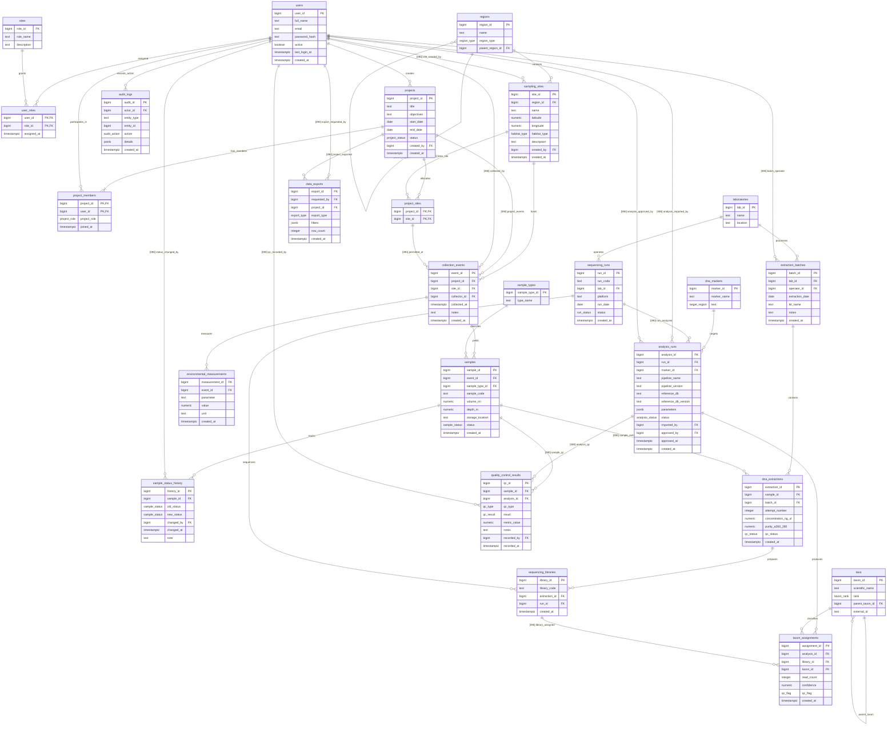

# eBioTrack — Entity-Relationship (ER) Diagram

> **Owner:** Member D (Krishna — Documentation & Demo)  
> **Status:** Finalized (Phase 1 Foundation, Gate G1 Schema Complete)  
> **References:** [CONTRACT.md](../planning/CONTRACT.md) (Sections 4 & 5), [WORKFLOW.md](../planning/WORKFLOW.md) (T07)

---

## 1. Overview and Architecture

The eBioTrack database schema comprises **25 tables** divided across four functional slices and one set of cross-slice relational constraints. The primary keys for all application-generated rows use 64-bit integer identity sequences starting at `1000` (`BIGINT GENERATED BY DEFAULT AS IDENTITY (START WITH 1000)`), reserving IDs below `1000` for deterministic test fixtures and seeds.

### Slice Summaries

* **Access, Projects & Audit (`010`, Owner C):**
  Models user authentication, role-based access control (`roles`, `users`, `user_roles`), research project metadata (`projects`), project team membership with ownership rules (`project_members`), project-authorized sampling locations (`project_sites`), and an immutable system audit trail (`audit_logs`) capturing change provenance.

* **Field & Samples (`020`, Owner D):**
  Models geographic survey territories (`regions`), designated field sites with GPS coordinates (`sampling_sites`), registered biological sample classifications (`sample_types`), timestamped field collection events (`collection_events`), physical environmental sensor readings (`environmental_measurements`), biological specimen inventory with unique deterministic codes (`samples`), and chronological specimen custody history (`sample_status_history`).

* **Laboratory & Sequencing (`030`, Owner B):**
  Models wet-lab facilities (`laboratories`), chemical batch extraction events (`extraction_batches`), DNA extracts with fluorometric concentration and spectrophotometric purity ratios (`dna_extractions`), next-generation sequencing instrument runs (`sequencing_runs`), multiplexed sequencing libraries (`sequencing_libraries`), and rigorous quality control evaluations (`quality_control_results`).

* **Analysis, Taxonomy & Analytics (`040`, Owner A):**
  Models genetic target markers (`dna_markers`), bioinformatic pipeline execution runs with parameter tracking and approval gates (`analysis_runs`), hierarchical biological classification trees (`taxa`), read-count detections and taxonomic classification confidence scores (`taxon_assignments`), and user data export tracking (`data_exports`).

* **Cross-Slice Constraints (`090`, Owner A):**
  Implements 17 foreign key constraints linking entities across slice boundaries (e.g., tying field samples to lab extractions, sequencing runs to bioinformatic analyses, and user accounts to all operational actions).

---

## 2. Complete Entity-Relationship Diagram

---

## 3. Table Catalog by Slice

| # | Slice | Table Name | Primary Key | Description |
|---|---|---|---|---|
| 1 | 010 Access | `roles` | `role_id` | Application authorization roles |
| 2 | 010 Access | `users` | `user_id` | Registered user credentials and profile |
| 3 | 010 Access | `user_roles` | `(user_id, role_id)` | User-to-role assignment junction |
| 4 | 010 Access | `projects` | `project_id` | Research studies and investigations |
| 5 | 010 Access | `project_members` | `(project_id, user_id)` | Project membership and project roles |
| 6 | 010 Access | `project_sites` | `(project_id, site_id)` | Sites permitted for project collection |
| 7 | 010 Access | `audit_logs` | `audit_id` | Security and state change audit records |
| 8 | 020 Field | `regions` | `region_id` | Hierarchical geographic jurisdictions |
| 9 | 020 Field | `sampling_sites` | `site_id` | Coordinates and habitat characteristics |
| 10 | 020 Field | `sample_types` | `sample_type_id` | Biological matrix categories (water, soil, etc.) |
| 11 | 020 Field | `collection_events` | `event_id` | Scheduled field sampling expeditions |
| 12 | 020 Field | `samples` | `sample_id` | Physical biological specimen inventory |
| 13 | 020 Field | `environmental_measurements` | `measurement_id` | Sensor metrics recorded during collection |
| 14 | 020 Field | `sample_status_history` | `history_id` | Longitudinal state transition audit trail |
| 15 | 030 Lab | `laboratories` | `lab_id` | Physical laboratory facilities |
| 16 | 030 Lab | `extraction_batches` | `batch_id` | Grouped chemical DNA extraction protocol runs |
| 17 | 030 Lab | `dna_extractions` | `extraction_id` | Extracted DNA aliquots and concentration/purity |
| 18 | 030 Lab | `sequencing_runs` | `run_id` | High-throughput sequencing instrument runs |
| 19 | 030 Lab | `sequencing_libraries` | `library_id` | Multiplexed DNA libraries mapped to flow cells |
| 20 | 030 Lab | `quality_control_results` | `qc_id` | Quality control verification check results |
| 21 | 040 Analysis | `dna_markers` | `marker_id` | Target gene regions (e.g. 12S, COI) |
| 22 | 040 Analysis | `analysis_runs` | `analysis_id` | Bioinformatic pipeline executions and approvals |
| 23 | 040 Analysis | `taxa` | `taxon_id` | Hierarchical biological taxonomy tree |
| 24 | 040 Analysis | `taxon_assignments` | `assignment_id` | Observed taxon read counts and confidence |
| 25 | 040 Analysis | `data_exports` | `export_id` | Export tracking for filtered datasets |

---

## 4. Cross-Slice Foreign Keys (090 Reference)

All cross-slice relationships are defined in `database/migrations/090_cross_slice_constraints.sql` and marked with `[090]` in the diagram:

| # | Source Table | FK Column(s) | Target Table & Column | Added By | Purpose |
|---|---|---|---|---|---|
| 1 | `project_sites` | `site_id` | `sampling_sites(site_id)` | C | Links project permissions to physical field sites |
| 2 | `sampling_sites` | `created_by` | `users(user_id)` | D | Audits creator of a sampling site |
| 3 | `collection_events` | `project_id` | `projects(project_id)` | D | Associates field collection event with a project |
| 4 | `collection_events` | `collector_id` | `users(user_id)` | D | Records researcher conducting field collection |
| 5 | `collection_events` | `(project_id, site_id)` | `project_sites(project_id, site_id)` | D | Ensures site is permitted for that specific project |
| 6 | `sample_status_history` | `changed_by` | `users(user_id)` | D | Identifies user triggering specimen status update |
| 7 | `extraction_batches` | `operator_id` | `users(user_id)` | B | Tracks technician performing chemical extraction |
| 8 | `dna_extractions` | `sample_id` | `samples(sample_id)` | B | Connects laboratory extract to field specimen |
| 9 | `quality_control_results` | `sample_id` | `samples(sample_id)` | B | Connects QC evaluation to physical specimen |
| 10 | `quality_control_results` | `analysis_id` | `analysis_runs(analysis_id)` | B | Connects QC evaluation to bioinformatic analysis |
| 11 | `quality_control_results` | `recorded_by` | `users(user_id)` | B | Identifies user recording QC findings |
| 12 | `analysis_runs` | `run_id` | `sequencing_runs(run_id)` | A | Connects pipeline analysis to sequencing run data |
| 13 | `analysis_runs` | `imported_by` | `users(user_id)` | A | Records bioinformatician importing pipeline results |
| 14 | `analysis_runs` | `approved_by` | `users(user_id)` | A | Enforces PI/Admin review and sign-off |
| 15 | `taxon_assignments` | `library_id` | `sequencing_libraries(library_id)` | A | Traces detected OTUs to specific sequencing library |
| 16 | `data_exports` | `requested_by` | `users(user_id)` | A | Records researcher requesting data export |
| 17 | `data_exports` | `project_id` | `projects(project_id)` | A | Binds exported dataset to project scope |

---

## 5. Cardinality and Key Notation Legend

* `||--o{` : One-to-many relationship (parent has 0 or more children).
* `||--|{` : One-to-mandatory-many relationship (parent has at least 1 child).
* `PK` : Primary Key attribute (`BIGINT GENERATED BY DEFAULT AS IDENTITY (START WITH 1000)`).
* `FK` : Foreign Key constraint referencing another entity.
* `[090]` : Cross-slice foreign key constraint managed in migration `090_cross_slice_constraints.sql`.
