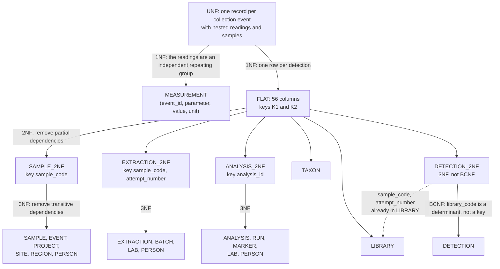
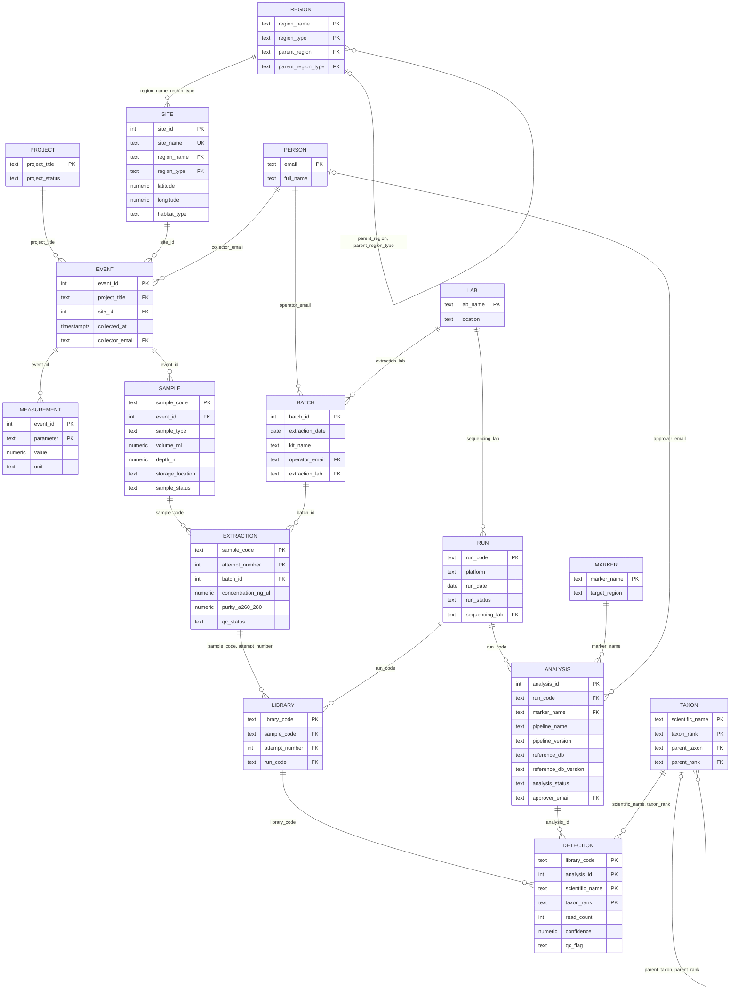
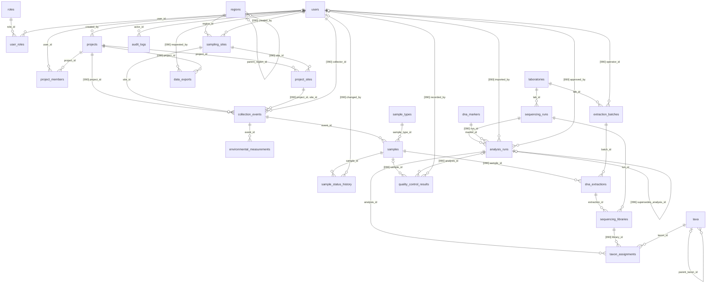

# Normalization report

> **Owner:** D (Docs & Demo)
>
> Normalization report compiled from slice write-ups

This report has two parts. Part 1 takes a flat sample sheet, the kind of spreadsheet a field and laboratory team keeps before it has a database, and decomposes it step by step from unnormalized form to BCNF, listing the functional dependencies at each step. Part 2 compiles the normalization notes of the four slices (`docs/slices/access.md`, `field.md`, `lab.md`, `analysis.md`) table by table in one format, and collects every deliberate denormalization in one place.

**Result.** The flat sheet decomposes, without loss, into 16 relations in BCNF, and those become 17 of the 25 tables (the 17th is the `sample_types` lookup). The other 8 tables hold facts that a sample sheet does not record (roles, project membership, which sites a project may use, the audit trail, status history, QC checks, export requests). All 25 tables are in BCNF under their declared keys. One domain rule is deliberately not enforced (`parameter → unit` in `environmental_measurements`), and a few stored values repeat something that could be derived (a sample's current status next to its history, the sample, run and library codes, the extraction's QC verdict, the `superseded` status, an export's row count); they are listed with their reasons in [section 9](#9-deliberate-denormalizations-and-stored-derived-values).

## Contents

1. [Notation and normal forms](#1-notation-and-normal-forms)
2. [How the dependencies were checked](#2-how-the-dependencies-were-checked)
3. [The flat sample sheet](#3-the-flat-sample-sheet)
4. [Unnormalized form](#4-unnormalized-form)
5. [Step by step to BCNF](#5-step-by-step-to-bcnf)
6. [Lossless join and dependency preservation](#6-lossless-join-and-dependency-preservation)
7. [From the BCNF relations to the 25 tables](#7-from-the-bcnf-relations-to-the-25-tables)
8. [Normalization of every table](#8-normalization-of-every-table)
9. [Deliberate denormalizations and stored derived values](#9-deliberate-denormalizations-and-stored-derived-values)
10. [Rules that are not functional dependencies](#10-rules-that-are-not-functional-dependencies)
11. [Values that are not stored](#11-values-that-are-not-stored)
12. [Free text and enumerations](#12-free-text-and-enumerations)
13. [Known gaps found while compiling](#13-known-gaps-found-while-compiling)
14. [Reproducing the checks](#14-reproducing-the-checks)

## 1. Notation and normal forms

These are the same definitions the four slice write-ups use, so a statement in a slice document and in this report means the same thing.

**Notation.** `{A, B} → {C}` reads "A and B together determine C": two rows with the same A and B always have the same C. A **candidate key** is a minimal set of columns that determines every column of the table; the **primary key** is the one chosen. A column is **prime** if it belongs to some candidate key, otherwise **non-prime**. A **determinant** is the left side of a functional dependency (FD). An FD is **trivial** when its right side is part of its left side. Relations of the flat sheet are written in capitals (`EVENT`, `SAMPLE`); tables of the schema are written in code (`collection_events`, `samples`).

**Normal forms used.**

| Form | Condition |
|---|---|
| 1NF | Every value is atomic and there are no repeating groups. |
| 2NF | 1NF, and no non-prime column depends on only a part of a composite candidate key (no **partial** dependency). |
| 3NF | 2NF, and no non-prime column depends on another non-prime column (no **transitive** dependency). Equivalently: for every non-trivial FD `X → A`, X is a superkey or A is prime. |
| BCNF | Every determinant of every non-trivial FD is a candidate key (or contains one). |

The difference between 3NF and BCNF matters once in this report ([section 5.4](#54-bcnf)): a relation can be in 3NF and not in BCNF when a non-key determinant determines a prime column.

**Words used for the data.** A **collection event** is one visit to a site. A **sample** is one physical container taken during an event. An **extraction** is one attempt to extract DNA from a sample. A **library** is one extraction prepared for one **sequencing run**. An **analysis** is one bioinformatic run over the reads of one sequencing run. A **detection** is one row of an analysis result: a taxon found in a library, with its read count and confidence. A detection is evidence that DNA of the taxon was in the sample; it is not a count of animals, and no detection is not proof of absence.

## 2. How the dependencies were checked

The dependencies were derived from the meaning of the columns and from the constraints in `database/migrations/010_access_projects_audit.sql`, `020_field_samples.sql`, `030_lab_sequencing.sql`, `040_analysis_taxonomy.sql`, `090_cross_slice_constraints.sql` and `096_analysis_supersession.sql`. Data cannot prove an FD, but it can refute one, so two kinds of evidence were used on a freshly reset and seeded database (`npm run db:reset` in `backend/`):

1. **Refutation by query.** For every claimed FD `X → Y`, the query `SELECT X FROM t GROUP BY X HAVING count(DISTINCT row(Y)::text) > 1` was run; it lists every value of X that occurs with two different values of Y. Every claimed FD returned no rows. For every dependency a reader might suspect and that is **not** there, the same query was run, and where the seed contains a counterexample it is quoted.
2. **Rolled-back probes.** The seed is small, so some false dependencies happen to hold in it (each site belongs to one project, for example). For those, a transaction that breaks the dependency was run and rolled back; the database accepting the row shows that the schema does not hold the dependency. The probes are numbered P1 to P17 and referred to by number below. After the probes, the table counts and `audit_logs` (0 rows) were unchanged.

Seeded row counts used as evidence: access 6 roles, 6 users, 6 user roles, 2 projects, 7 members, 5 project sites, 0 audit rows; field 3 regions, 5 sites, 4 sample types, 8 events, 17 samples, 32 measurements, 84 history rows; laboratory 2 laboratories, 3 batches, 17 extractions, 2 runs, 16 libraries, 23 QC results; analysis 2 markers, 4 analyses, 15 taxa, 43 detections, 0 exports. The SQL is in [section 14](#14-reproducing-the-checks).

## 3. The flat sample sheet

The sheet has **one row per detection** and repeats, on every row, everything a team would want to see next to it: where and when the water was collected, how the DNA was extracted, where it was sequenced and how it was analysed. It uses the numbers that appear on the team's forms and logs (site number, event number, batch number, analysis number) and the codes printed on labels (`EB-20250515-0001-001`, `LIB-0001`, `RUN-001`); it does not use the database's internal ids, notes, or creation times.

The sheet is built from the seed with the view in [section 14](#14-reproducing-the-checks). It has 43 rows (the 43 seeded detections, from 16 samples, 16 libraries and 3 analyses) and 56 columns:

| Stage | Columns |
|---|---|
| Project | `project_title`, `project_status` |
| Place | `region_name`, `region_type`, `parent_region`, `parent_region_type`, `site_id`, `site_name`, `latitude`, `longitude`, `habitat_type` |
| Collection | `event_id`, `collected_at`, `collector_email`, `collector_name` |
| Sample | `sample_code`, `sample_type`, `volume_ml`, `depth_m`, `storage_location`, `sample_status` |
| Extraction | `attempt_number`, `concentration_ng_ul`, `purity_a260_280`, `qc_status`, `batch_id`, `extraction_date`, `kit_name`, `operator_email`, `operator_name`, `extraction_lab`, `extraction_lab_location` |
| Sequencing | `library_code`, `run_code`, `platform`, `run_date`, `run_status`, `sequencing_lab`, `sequencing_lab_location` |
| Analysis | `analysis_id`, `marker_name`, `target_region`, `pipeline_name`, `pipeline_version`, `reference_db`, `reference_db_version`, `analysis_status`, `approver_email`, `approver_name` |
| Detection | `scientific_name`, `taxon_rank`, `parent_taxon`, `parent_rank`, `read_count`, `confidence`, `qc_flag` |

A person is identified by an email address and a region by its name together with its type, because that is what the schema treats as unique (`uq_users_email`, `uq_regions_name_type`).

The three rows of event 1 (some columns left out for width):

| `site_name` | `collected_at` | `sample_code` | `concentration_ng_ul` | `library_code` | `run_code` | `analysis_id` | `pipeline_version` | `scientific_name` | `read_count` | `confidence` |
|---|---|---|---|---|---|---|---|---|---|---|
| Dakpathar Barrage | 2025-05-15 08:30 UTC | EB-20250515-0001-001 | 18.420 | LIB-0001 | RUN-001 | 1 | 3.0.1 | Labeo calbasu | 2310 | 0.9340 |
| Dakpathar Barrage | 2025-05-15 08:30 UTC | EB-20250515-0001-001 | 18.420 | LIB-0001 | RUN-001 | 1 | 3.0.1 | Labeo rohita | 18420 | 0.9812 |
| Dakpathar Barrage | 2025-05-15 08:30 UTC | EB-20250515-0001-002 | 15.730 | LIB-0002 | RUN-001 | 1 | 3.0.1 | Labeo rohita | 15210 | 0.9755 |

### Anomalies of the flat sheet

Counted on the 43 seeded rows:

- **Update anomalies.** A fact is stored once per detection, not once. The site name `Sangam Prayagraj` is on 12 rows, `Okhla Barrage` on 10, `Dakpathar Barrage` on 9, `Diamond Harbour` on 7 and `Kakdwip Bay` on 5. The title `Yamuna Biodiversity Survey` is on 31 rows and `Coastal Estuary Pilot` on 12. The collector's name (`Farah Field`) and the operator's name (`Lakshmi Lab`) are each on all 43 rows, the approver's name (`Pranav Investigator`) on 28. The address of `Dehradun eDNA Laboratory` is on 31 rows as the extraction laboratory and on 17 as the sequencing laboratory. Correcting any of these means changing every copy; missing one leaves the sheet contradicting itself.
- **Insertion anomalies.** A row needs a detection, so facts that have none cannot be entered. In the seed: sample 17 (`EB-20250515-0001-003`), whose extraction failed QC (0.350 ng/µL, A260/280 1.32) and which has no library; draft analysis 4, which has no detections yet; 11 of the 15 taxa, which no detection names; the region `India`, which appears only as a parent; and the sample types `soil`, `sediment` and `air`, which no sample uses yet.
- **Deletion anomalies.** Deleting the 15 rows of the imported analysis 3 also deletes the only record that the species `Gambusia affinis` (and its parent genus `Gambusia`) exists, because it is detected only there (7 rows), and the only record of pipeline version `3.1.0`.

## 4. Unnormalized form

Before the sheet is flattened, a natural way to record the work is one record per collection event with nested groups. Event 1:

```text
Event 1: Yamuna Biodiversity Survey (active), site 1 Dakpathar Barrage
         (Yamuna River Basin, basin, in India, country), 30.505000 N 77.795000 E, river,
         collected 2025-05-15 08:30 UTC by field_researcher@ebiotrack.test (Farah Field)
  Readings (repeating group 1):
    temperature_c 24.5 celsius | ph 7.8 pH | dissolved_oxygen_mg_l 6.5 mg/L | turbidity_ntu 12.0 NTU
  Samples (repeating group 2):
    EB-20250515-0001-001  water, 1000.00 mL, 0.50 m, Freezer A-1, analyzed
      Extraction attempt 1: batch 1 (2025-05-20, DNeasy PowerWater Kit, Lakshmi Lab,
                            Dehradun eDNA Laboratory, Dehradun, Uttarakhand), 18.420 ng/µL, 1.86, pass
        Library LIB-0001 on RUN-001 (Illumina MiSeq, 2026-03-25, completed, Dehradun eDNA Laboratory)
          Analysis 1 (12S, OBITools3 3.0.1, MitoFish 2025-06, approved by Pranav Investigator):
            Labeo calbasu (species, in genus Labeo)  2310 reads, 0.9340, pass
            Labeo rohita  (species, in genus Labeo) 18420 reads, 0.9812, pass
    EB-20250515-0001-002  water, 1000.00 mL, 1.00 m, Freezer A-1, analyzed
      Extraction attempt 1: batch 1, 15.730 ng/µL, 1.84, pass
        Library LIB-0002 on RUN-001
          Analysis 1: Labeo rohita 15210 reads, 0.9755, pass
    EB-20250515-0001-003  water, 500.00 mL, 0.50 m, Freezer A-1, failed
      Extraction attempt 1: batch 1, 0.350 ng/µL, 1.32, fail   (no library)
```

This is not in 1NF: a field of the event record holds a list of readings, another holds a list of samples, and each sample holds a list of extractions, each with a list of libraries, each with a list of analyses and detections.

## 5. Step by step to BCNF



### 5.1 First normal form

Two repeating groups hang off an event: the readings and the samples. They are **independent** of each other: a reading is not about one sample, and a sample is not tied to one reading. Flattening both into the same table would pair every reading with every detection of the event, 43 detections times 4 readings = 172 rows, which is the multivalued dependency `event_id ↠ {parameter, value, unit}` (and `event_id ↠` the sample columns) that 4NF forbids. So the readings become their own relation:

- **MEASUREMENT** (`event_id`, `parameter`, `value`, `unit`), key `{event_id, parameter}`: one reading per row, 32 rows.

The sample branch is flattened to one row per detection, giving **FLAT**, the 56-column sheet of [section 3](#3-the-flat-sample-sheet). Every value in FLAT is atomic. Coordinates are two numbers, not one `lat,lon` string; a sample code is one label (the date and event number inside it are discussed in [section 9](#9-deliberate-denormalizations-and-stored-derived-values)).

**Functional dependencies of FLAT.** Each was checked on the 43 rows and none is violated:

| FD | Dependency | Meaning |
|---|---|---|
| F1 | `{project_title} → {project_status}` | A project has one status. |
| F2 | `{region_name, region_type} → {parent_region, parent_region_type}` | A region has at most one parent region. |
| F3 | `{site_id} → {site_name, region_name, region_type, latitude, longitude, habitat_type}` | A site is in one region. |
| F3b | `{region_name, region_type, site_name} → {site_id}` | A site name is unique within its region. |
| F4 | `{event_id} → {project_title, site_id, collected_at, collector_email}` | One visit, one place, one time, one collector. |
| F5 | `{email} → {full_name}` | For the collector, the operator and the approver alike. |
| F6 | `{sample_code} → {event_id, sample_type, volume_ml, depth_m, storage_location, sample_status}` | A sample comes from one event. |
| F7 | `{sample_code, attempt_number} → {batch_id, concentration_ng_ul, purity_a260_280, qc_status}` | One extraction attempt. |
| F8 | `{batch_id} → {extraction_date, kit_name, operator_email, extraction_lab}` | A batch is one day's work of one operator in one laboratory. |
| F9 | `{lab name} → {location}` | For the extraction and the sequencing laboratory alike. |
| F10 | `{run_code} → {platform, run_date, run_status, sequencing_lab}` | A run is on one instrument in one laboratory. |
| F11 | `{library_code} → {sample_code, attempt_number, run_code}` | A library is one extraction on one run. |
| F11b | `{sample_code, attempt_number, run_code} → {library_code}` | An extraction has at most one library per run. |
| F12 | `{analysis_id} → {run_code, marker_name, pipeline_name, pipeline_version, reference_db, reference_db_version, analysis_status, approver_email}` | An analysis reads one run with one marker. |
| F13 | `{marker_name} → {target_region}` | A marker targets one region of the genome. |
| F14 | `{scientific_name, taxon_rank} → {parent_taxon, parent_rank}` | A taxon has at most one parent. |
| F15 | `{library_code, analysis_id, scientific_name, taxon_rank} → {read_count, confidence, qc_flag}` | One detection. |

**Dependencies that do not hold**, with the evidence:

| Suspected FD | Evidence that it does not hold |
|---|---|
| `{pipeline_name} → {pipeline_version}` | `OBITools3` at `3.0.1` (analyses 1, 2) and `3.1.0` (analyses 3, 4). |
| `{reference_db} → {reference_db_version}` | `MitoFish` at `2025-06` (analysis 1) and `2026-01` (analysis 2). |
| `{library_code, scientific_name, taxon_rank} → {read_count}` | `LIB-0009`, `Labeo rohita`: 17 340 reads in analysis 2, 9 120 in analysis 3. |
| `{sample_code} → {analysis_id}` | The samples of run 2 appear in analyses 2 and 3. |
| `{sample_code} → {run_code}` | Holds in the seed; P7 gave extraction 1, already on `RUN-001`, a second library on another run, and it was accepted. |
| `{collector_email} → {project_title}` | `field_researcher@ebiotrack.test` collected in both projects (events 1 to 6 and 7 to 8). |
| `{site_id} → {project_title}` | Holds in the seed; P1 linked site 1 to project 2 and recorded a project 2 event there. |
| `{extraction_lab} → {sequencing_lab}` | Extractions of the Dehradun laboratory were sequenced in both laboratories (run 2 is in Kolkata and holds libraries of batch 2, Dehradun). |
| `{kit_name} → {extraction_lab}` | `DNeasy PowerWater Kit` is used in both laboratories. |
| `{confidence} → {qc_flag}` | Holds in the seed; P8 stored confidence 0.9 with flag `fail` in draft analysis 4. The flag comes from the pipeline file. |
| `{habitat_type} → {region_name}` | Holds in the seed; P15 stored a `river` site in the Hooghly Estuary region. |
| `{parent_taxon} → {taxon_rank}` | In `taxa`, the class `Actinopterygii` is the parent of the order `Cypriniformes` and of the genus `Gambusia`. |

**Candidate keys of FLAT.** Two:

- **K1** `{library_code, analysis_id, scientific_name, taxon_rank}`. F15 gives the detection columns; F11 gives the sample, the attempt and the run; F12 the analysis; F14 the taxon; and F7, F6, F4, F3, F2, F1, F8, F9, F10, F13 and F5 the rest. No column can be dropped: without `analysis_id` the read count is unknown (counterexample above), without `library_code` the sample is unknown, without the taxon pair the detection is unknown.
- **K2** `{sample_code, attempt_number, analysis_id, scientific_name, taxon_rank}`. `analysis_id` gives `run_code` (F12), and with the sample and attempt F11b gives `library_code`, so K2 determines K1. No column can be dropped for the same reasons.

Prime columns: `library_code`, `sample_code`, `attempt_number`, `analysis_id`, `scientific_name`, `taxon_rank`. Every other column of FLAT is non-prime.

**MEASUREMENT** has `{event_id, parameter} → {value, unit}`. The domain also suggests `{parameter} → {unit}` (the seed has one unit per parameter: `temperature_c` in `celsius`, `ph` in `pH`, `dissolved_oxygen_mg_l` in `mg/L`, `turbidity_ntu` in `NTU`). It is followed up at 2NF.

FLAT is in 1NF and not in 2NF: for example `{analysis_id} → {pipeline_name}` makes a non-prime column depend on a part of K1.

### 5.2 Second normal form

Every non-prime column is moved, with the part of a key it depends on, into a new relation. Where a column depends on parts of both keys (`library_code → sample_code → event_id`), it goes with the part that determines it directly.

| Part of a key | Partial dependencies removed | New relation |
|---|---|---|
| `{sample_code}` (of K2) | F6, and through it F4, F3, F2, F1 and F5 for the collector | **SAMPLE_2NF** (21 columns): the sample, its event, project, site, region and collector |
| `{sample_code, attempt_number}` (of K2) | F7, and through it F8, F9 and F5 for the operator | **EXTRACTION_2NF** (12 columns): the extraction, its batch, operator and laboratory |
| `{analysis_id}` (of K1 and K2) | F12, and through it F10, F9, F13 and F5 for the approver | **ANALYSIS_2NF** (16 columns): the analysis, its run, sequencing laboratory, marker and approver |
| `{library_code}` (of K1) | F11 (`run_code` is non-prime) | **LIBRARY** (`library_code`, `sample_code`, `attempt_number`, `run_code`), keys `{library_code}` and `{sample_code, attempt_number, run_code}` |
| `{scientific_name, taxon_rank}` (of K1 and K2) | F14 | **TAXON** (`scientific_name`, `taxon_rank`, `parent_taxon`, `parent_rank`) |

What is left of FLAT is

- **DETECTION_2NF** (`library_code`, `sample_code`, `attempt_number`, `analysis_id`, `scientific_name`, `taxon_rank`, `read_count`, `confidence`, `qc_flag`), with both candidate keys K1 and K2 still inside it. K2 is still a key here because `{sample_code, attempt_number, analysis_id} → {library_code}` follows from F12 and F11b. `sample_code` and `attempt_number` stay, because 2NF only moves non-prime columns and these two are prime.

Each relation is now in 2NF: SAMPLE_2NF and ANALYSIS_2NF have single-column keys; in EXTRACTION_2NF, TAXON and DETECTION_2NF the non-prime columns depend on the whole key; LIBRARY has no non-prime column.

**MEASUREMENT.** If `{parameter} → {unit}` were adopted as a rule, it would be a partial dependency on the key `{event_id, parameter}` and 2NF would split off PARAMETER (`parameter`, `unit`). The schema does not adopt the rule; `unit` stays on each reading. This is a deliberate denormalization, explained in [section 9](#9-deliberate-denormalizations-and-stored-derived-values). Under the dependencies the database does hold, MEASUREMENT is already in BCNF.

### 5.3 Third normal form

The three wide 2NF relations still have chains of non-prime columns. Each chain becomes a relation keyed by its determinant:

**SAMPLE_2NF** (key `sample_code`):

- `sample_code → event_id → {project_title, site_id, collected_at, collector_email}` (F4): **EVENT** (`event_id`, `project_title`, `site_id`, `collected_at`, `collector_email`)
- `event_id → project_title → project_status` (F1): **PROJECT** (`project_title`, `project_status`)
- `event_id → site_id → {site_name, region_name, region_type, latitude, longitude, habitat_type}` (F3, F3b): **SITE**, keys `{site_id}` and `{region_name, region_type, site_name}`
- `site_id → {region_name, region_type} → {parent_region, parent_region_type}` (F2): **REGION** (`region_name`, `region_type`, `parent_region`, `parent_region_type`); the parent is a reference to another REGION row
- `event_id → collector_email → collector_name` (F5): **PERSON** (`email`, `full_name`)
- what is left: **SAMPLE** (`sample_code`, `event_id`, `sample_type`, `volume_ml`, `depth_m`, `storage_location`, `sample_status`)

**EXTRACTION_2NF** (key `{sample_code, attempt_number}`):

- `→ batch_id → {extraction_date, kit_name, operator_email, extraction_lab}` (F8): **BATCH**
- `batch_id → extraction_lab → extraction_lab_location` (F9): **LAB** (`lab_name`, `location`)
- `batch_id → operator_email → operator_name` (F5): into **PERSON**
- what is left: **EXTRACTION** (`sample_code`, `attempt_number`, `batch_id`, `concentration_ng_ul`, `purity_a260_280`, `qc_status`)

**ANALYSIS_2NF** (key `analysis_id`):

- `→ run_code → {platform, run_date, run_status, sequencing_lab}` (F10): **RUN**
- `run_code → sequencing_lab → sequencing_lab_location` (F9): into **LAB**
- `→ marker_name → target_region` (F13): **MARKER** (`marker_name`, `target_region`)
- `→ approver_email → approver_name` (F5): into **PERSON**
- what is left: **ANALYSIS** (`analysis_id`, `run_code`, `marker_name`, `pipeline_name`, `pipeline_version`, `reference_db`, `reference_db_version`, `analysis_status`, `approver_email`)

The collector, the operator and the approver are the same kind of thing with the same dependency (F5), so they share one PERSON relation; the two laboratories share one LAB relation (F9). In the seed this gives 3 people and 2 laboratories.

`pipeline_name` and `pipeline_version` stay on ANALYSIS: no dependency holds between them (`OBITools3` at two versions), and neither determines another column, so there is nothing transitive to remove. The same holds for `reference_db` and its version, for `kit_name` on BATCH and for `platform` on RUN.

DETECTION_2NF has three non-prime columns, `read_count`, `confidence` and `qc_flag`, and none determines another (`confidence ↛ qc_flag`, P8), so it is in 3NF. It is in 3NF even though it has the FD `{library_code} → {sample_code, attempt_number}`, whose determinant is not a key: the right side is prime, which 3NF allows.

### 5.4 BCNF

BCNF removes that exception. In DETECTION_2NF, `{library_code} → {sample_code, attempt_number}` is a non-trivial FD whose determinant is not a candidate key (`library_code` alone does not determine the analysis or the taxon). The consequence is a real anomaly: the sample of `LIB-0009` is written on every detection of that library in every analysis, and changing it on one row would make the library belong to two samples. The two columns are removed; LIBRARY already records them:

- **DETECTION** (`library_code`, `analysis_id`, `scientific_name`, `taxon_rank`, `read_count`, `confidence`, `qc_flag`), key `{library_code, analysis_id, scientific_name, taxon_rank}`.

The FD that K2 relied on, `{sample_code, attempt_number, analysis_id} → {library_code}`, is not lost: it follows from F12 (in ANALYSIS) and F11b (in LIBRARY).

Every other relation was checked determinant by determinant:

| Relation | Candidate keys | Non-trivial determinants | BCNF |
|---|---|---|---|
| PROJECT | `{project_title}` | `project_title` | yes |
| REGION | `{region_name, region_type}` | the key | yes |
| SITE | `{site_id}`, `{region_name, region_type, site_name}` | the two keys | yes |
| PERSON | `{email}` | `email` | yes |
| EVENT | `{event_id}` | `event_id` (`{site_id, collected_at}` is not a key, P2) | yes |
| SAMPLE | `{sample_code}` | `sample_code` | yes |
| MEASUREMENT | `{event_id, parameter}` | the key (`parameter → unit` not adopted) | yes |
| EXTRACTION | `{sample_code, attempt_number}` | the key | yes |
| BATCH | `{batch_id}` | `batch_id` | yes |
| LAB | `{lab_name}` | `lab_name` | yes |
| RUN | `{run_code}` | `run_code` | yes |
| LIBRARY | `{library_code}`, `{sample_code, attempt_number, run_code}` | the two keys (F11, F11b) | yes |
| MARKER | `{marker_name}` | `marker_name` | yes |
| ANALYSIS | `{analysis_id}` | `analysis_id` | yes |
| TAXON | `{scientific_name, taxon_rank}` | the key | yes |
| DETECTION | `{library_code, analysis_id, scientific_name, taxon_rank}` | the key | yes |

The 16 BCNF relations (natural keys, as the sheet knows them):



`||--o{` means the child always has the parent (the referencing columns are never empty) and `|o--o{` that the parent is optional (a region or taxon without a parent, an analysis not yet approved). `UK` on `site_name` stands for the second key `{region_name, region_type, site_name}`.

## 6. Lossless join and dependency preservation

**Lossless join.** Every split above divides a relation into two whose common columns are a key of one of them (for example SAMPLE_2NF into EVENT and the rest on `event_id`, the key of EVENT), which by Heath's theorem loses nothing. As a direct check, the 43-row sheet was projected onto the 15 relations of the sample branch and joined back on their common columns: the join returned 43 rows, with 0 rows missing from and 0 rows added to the sheet (compared with `EXCEPT ALL` in both directions, [section 14](#14-reproducing-the-checks)). The projections hold 2 projects, 2 regions, 5 sites, 3 people, 8 events, 16 samples, 16 extractions, 3 batches, 2 laboratories, 2 runs, 16 libraries, 2 markers, 3 analyses, 4 taxa and 43 detections.

**Dependency preservation.** Each FD of [section 5.1](#51-first-normal-form) lies inside one relation, so each can be enforced by that relation's key alone:

| FD | Relation |
|---|---|
| F1 | PROJECT |
| F2 | REGION |
| F3, F3b | SITE |
| F4 | EVENT |
| F5 | PERSON |
| F6 | SAMPLE |
| F7 | EXTRACTION |
| F8 | BATCH |
| F9 | LAB |
| F10 | RUN |
| F11, F11b | LIBRARY |
| F12 | ANALYSIS |
| F13 | MARKER |
| F14 | TAXON |
| F15 | DETECTION |

**One rule is not an FD and does need two relations.** In FLAT, `run_code` was one column, so an analysis and a library on the same row were always on the same run. After decomposition the run of the analysis (ANALYSIS) and the run of the library (LIBRARY) are separate facts, and a DETECTION row could pair an analysis of `RUN-001` with a library of `RUN-002`; the natural join would then silently drop that detection. "The library of a detection belongs to the run its analysis processed" is an inclusion rule across three relations, not a functional dependency, so no key can hold it. The schema holds it in the trigger `trg_taxon_assignments_immutable` (`fn_taxon_assignments_check_library`) and reports it first in `import_detections`; see [section 10](#10-rules-that-are-not-functional-dependencies).

## 7. From the BCNF relations to the 25 tables

The tables follow the BCNF relations one to one, with three changes that do not alter any FD:

1. **Surrogate keys.** Each table has a numeric primary key (`BIGINT GENERATED BY DEFAULT AS IDENTITY`), and the natural key of the relation is kept as a `UNIQUE` constraint, so it is still a candidate key. Foreign keys use the surrogate, so renaming a project, a laboratory or a marker is one `UPDATE`.
2. **References by id.** A reference by natural key becomes a foreign key column: `project_title` becomes `collection_events.project_id`, `collector_email` becomes `collector_id`, `(sample_code, attempt_number)` becomes `sequencing_libraries.extraction_id`, the parent pairs become `parent_region_id` and `parent_taxon_id`.
3. **A lookup for the sample type.** The text `sample_type` becomes `samples.sample_type_id` referencing `sample_types`, a controlled list with fixed ids from CONTRACT section 3 (`water` 1, `soil` 2, `sediment` 3, `air` 4). No FD requires this (the type has no other attribute); it is a choice of vocabulary, discussed under `sample_types` in [section 8.2](#82-field--samples-migration-020).

| BCNF relation | Table | Natural key kept as |
|---|---|---|
| PROJECT | `projects` | `uq_projects_title` (`title`) |
| REGION | `regions` | `uq_regions_name_type` (`name`, `region_type`) |
| SITE | `sampling_sites` | `pk_sampling_sites` (`site_id`, the site number) and `uq_sampling_sites_region_name` (`region_id`, `name`) |
| PERSON | `users` | `uq_users_email` (`email`) |
| EVENT | `collection_events` | `pk_collection_events` (`event_id`, the event number); no natural key |
| SAMPLE | `samples` and `sample_types` | `samples_sample_code_key` (`sample_code`); `sample_types_type_name_key` (`type_name`) |
| MEASUREMENT | `environmental_measurements` | `uq_environmental_measurements_event_parameter` (`event_id`, `parameter`) |
| EXTRACTION | `dna_extractions` | `uq_dna_extractions_sample_attempt` (`sample_id`, `attempt_number`) |
| BATCH | `extraction_batches` | `pk_extraction_batches` (`batch_id`, the batch number); no natural key |
| LAB | `laboratories` | `uq_laboratories_name` (`name`) |
| RUN | `sequencing_runs` | `uq_sequencing_runs_run_code` (`run_code`) |
| LIBRARY | `sequencing_libraries` | `uq_sequencing_libraries_library_code` (`library_code`) and `uq_sequencing_libraries_extraction_run` (`extraction_id`, `run_id`) |
| MARKER | `dna_markers` | `uq_dna_markers_marker_name` (`marker_name`) |
| ANALYSIS | `analysis_runs` | `pk_analysis_runs` (`analysis_id`, the analysis number); no natural key |
| TAXON | `taxa` | `uq_taxa_scientific_name_rank` (`scientific_name`, `rank`) |
| DETECTION | `taxon_assignments` | `uq_taxon_assignments_analysis_library_taxon` (`analysis_id`, `library_id`, `taxon_id`) |

That is 17 tables. The other 8 hold facts a sample sheet does not record:

| Table | Fact it holds | Why the sheet cannot hold it |
|---|---|---|
| `roles`, `user_roles` | Which global roles exist and who holds which | Access control, not a property of a detection |
| `project_members` | Who works on a project and in which project role | A member need not have collected, extracted or approved anything |
| `project_sites` | Which sites a project may use | The sheet shows only sites where the project did collect |
| `sample_status_history` | Every status a sample went through, by whom and when | The sheet holds only the current status |
| `quality_control_results` | Each QC check (type, result, metric), on a sample or an analysis | The sheet holds only the extraction's verdict |
| `audit_logs` | Every audited change, old and new values | A history of the data, not data about a sample |
| `data_exports` | Export requests | About users and projects, not samples |

17 + 8 = 25. (A 26th table, `session`, created by `095_sessions.sql`, is the login-session store of the web server; it holds no domain facts and is left out of this report.) The relationships of all 25 tables, drawn with the same notation as above (foreign key column as label, `[090]` for the cross-slice keys of `090_cross_slice_constraints.sql`, `[096]` for the one in `096_analysis_supersession.sql`); `docs/er-diagram.md` has the same tables with their columns:



The diagram has the 41 foreign keys of the schema, one line each. `|o--o|` on `analysis_runs` reads "a correction replaces at most one run, and a run is replaced by at most one correction" (`uq_analysis_runs_supersedes_analysis_id`).

## 8. Normalization of every table

The 25 tables in one format: candidate keys, the FDs that hold, the ones a reader might suspect that do not, the normal form reached, and any design choice that could look like a violation. For the access, laboratory and analysis tables this is a summary of the slice write-up, which has the full reasoning (linked at the top of each slice); for the field tables it is the full analysis. Every table is in BCNF under its declared keys.

### 8.1 Access, Projects & Audit (migration `010`)

Full write-up: [docs/slices/access.md, Normalization](slices/access.md#normalization).

#### `roles` (`role_id`, `role_name`, `description`)

- **Candidate keys:** `{role_id}` (primary key) and `{role_name}` (`uq_roles_role_name`).
- **Functional dependencies:** `{role_id} → {role_name, description}`; `{role_name} → {role_id, description}`. `description` determines nothing.
- **Normal form:** single-column keys (2NF), one non-prime column (3NF), both determinants are keys. **Highest form: BCNF.**
- **Design choice:** `role_name` is a second key next to the surrogate, because the API names roles while foreign keys use the id. Roles are rows and not an enumerated type, so an administrator can add one without a migration.

#### `users` (`user_id`, `full_name`, `email`, `password_hash`, `organization`, `job_title`, `phone`, `active`, `last_login_at`, `created_at`)

- **Candidate keys:** `{user_id}` and `{email}` (`uq_users_email`). `full_name` is not a key. `organization`, `job_title` and `phone` are optional facts about the person (NULL when skipped at registration) and depend only on `user_id`.
- **Functional dependencies:** each key determines every other column; no other column determines anything.
- **Does not hold:** equal names, equal `active` values or equal login times say nothing about the rest of the row. A user's roles are rows of `user_roles`, not a column here.
- **Normal form:** single-column keys, no dependency between the non-prime columns. **Highest form: BCNF.**
- **Design choice:** users are deactivated (`active`), not deleted, so history that points at a user never dangles.

#### `user_roles` (`user_id`, `role_id`, `assigned_at`)

- **Candidate keys:** `{user_id, role_id}` only.
- **Functional dependencies:** `{user_id, role_id} → {assigned_at}`, on the whole key (the time this user got this role).
- **Normal form:** the one non-prime column depends on the whole key. **Highest form: BCNF.**
- **Design choice:** the associative entity of users and roles; a user may hold any number of roles.

#### `projects` (`project_id`, `title`, `objectives`, `start_date`, `end_date`, `status`, `created_by`, `created_at`)

- **Candidate keys:** `{project_id}` and `{title}` (`uq_projects_title`).
- **Functional dependencies:** each key determines every other column.
- **Does not hold:** the dates do not determine `status` (a rolled-back test stored a `completed` project with no end date); `created_by` does not determine the owner or anything else.
- **Normal form:** single-column keys, no dependency between non-prime columns. **Highest form: BCNF.**
- **Design choice:** `created_by` and the owner in `project_members` are different facts (ownership can move, the creator never changes), so there is no redundancy. `ck_projects_dates` compares two columns of one row; it is a check, not an FD.

#### `project_members` (`project_id`, `user_id`, `project_role`, `joined_at`)

- **Candidate keys:** `{project_id, user_id}` only.
- **Functional dependencies:** `{project_id, user_id} → {project_role, joined_at}`.
- **Does not hold:** `{user_id} → {project_role}` (the role belongs to the pair, not to the person); `{project_id} → {project_role}`.
- **Normal form:** both non-prime columns depend on the whole key. **Highest form: BCNF.**
- **Design choice:** `uq_project_members_owner` (at most one `owner` row per project) restricts a subset of the rows; it is not an FD and does not change the normal form ([section 10](#10-rules-that-are-not-functional-dependencies)).

#### `project_sites` (`project_id`, `site_id`)

- **Candidate keys:** `{project_id, site_id}`, the whole table.
- **Functional dependencies:** only trivial ones.
- **Normal form:** an all-key table. **Highest form: BCNF.**
- **Design choice:** the associative entity of projects and sites, and the target of `fk_collection_events_project_site`, which restricts events to the sites their project may use.

#### `audit_logs` (`audit_id`, `actor_id`, `entity_type`, `entity_id`, `action`, `details`, `created_at`)

- **Candidate keys:** `{audit_id}` only; the same entity is changed many times.
- **Functional dependencies:** `{audit_id} → {actor_id, entity_type, entity_id, action, details, created_at}`.
- **Does not hold:** `{entity_type, entity_id} → {actor_id, action, details}`.
- **Normal form:** single-column key. **Highest form: BCNF**, with a 1NF remark: `details` is a `jsonb` object treated as one value ([section 9](#9-deliberate-denormalizations-and-stored-derived-values)).
- **Design choice:** (`entity_type`, `entity_id`) is a polymorphic reference with no foreign key, so the trail survives changes and deletions ([section 9](#9-deliberate-denormalizations-and-stored-derived-values)). `actor_id` NULL means a system action.

### 8.2 Field & Samples (migration `020`)

Write-up: [docs/slices/field.md, T40-D](slices/field.md#t40-d-schema-and-normalization-notes). The rolled-back probes are listed in [section 14](#14-reproducing-the-checks).

#### `regions` (`region_id`, `name`, `region_type`, `parent_region_id`)

- **Candidate keys:** `{region_id}` (primary key, `pk_regions`) and `{name, region_type}` (`uq_regions_name_type`). Prime columns: `region_id`, `name`, `region_type`. Non-prime column: `parent_region_id`.
- **Functional dependencies:**
  - `{region_id} → {name, region_type, parent_region_id}`
  - `{name, region_type} → {region_id, parent_region_id}`
  - Dependencies that do **not** hold, and why: `{name} → {region_type}` fails because P3 stored a second `Yamuna River Basin` as a `state` and the database accepted it; `{parent_region_id} → {region_type}` fails because `India` (region 1) is the parent of a `basin` and of an `other` region; `{region_type} → {parent_region_id}` fails because P12 stored a `country` under a basin.
- **1NF:** each column holds one value; `region_type` is an enumerated type. The children of a region are rows that point at it, not a list in the parent.
- **2NF:** the composite candidate key is `{name, region_type}`. The only non-prime column, `parent_region_id`, depends on the pair and not on `name` alone (P3) or on `region_type` alone (P12).
- **3NF:** there is one non-prime column, so it cannot depend on another.
- **BCNF:** the determinants are the two candidate keys. **Highest form: BCNF.**
- **Design choice, adjacency list.** The hierarchy is stored as `parent_region_id`, as `taxa` stores its tree. The flat alternative (`country`, `state`, `basin` columns on every site) would add `{basin} → {country}`, a transitive dependency that repeats a basin's country on every site. `fk_regions_parent_region_id` is `ON DELETE SET NULL`: deleting a parent makes its children top-level regions. Unlike `taxa`, the shape of the tree is not checked ([section 13](#13-known-gaps-found-while-compiling)).
- **Anomalies avoided:** a region's name and type are stored once, and sites point at it, so renaming a region is one `UPDATE`. A region with sites cannot be deleted (`fk_sampling_sites_region_id`, `NO ACTION`).

#### `sampling_sites` (`site_id`, `region_id`, `name`, `latitude`, `longitude`, `habitat_type`, `description`, `created_by`, `created_at`)

- **Candidate keys:** `{site_id}` (primary key) and `{region_id, name}` (`uq_sampling_sites_region_name`). Prime columns: `site_id`, `region_id`, `name`. Non-prime columns: `latitude`, `longitude`, `habitat_type`, `description`, `created_by`, `created_at`.
- **Functional dependencies:**
  - `{site_id} → {region_id, name, latitude, longitude, habitat_type, description, created_by, created_at}`
  - `{region_id, name} → {site_id, latitude, longitude, habitat_type, description, created_by, created_at}`
  - Dependencies that do **not** hold, and why: `{name} → {region_id}` fails because P4 stored a second `Dakpathar Barrage` in the Hooghly Estuary region; `{latitude, longitude} → {site_id}` fails because the same probe used the coordinates of site 1 (coordinates are not unique); `{region_id} → {habitat_type}` fails because P4b stored a `lake` in the Yamuna River Basin and P15 a `river` in the Hooghly Estuary (in the seed each region has one habitat); `{created_by} → ` any column fails because one user created all five seeded sites.
- **1NF:** each column holds one value. The position is two numeric columns, not one text value; `habitat_type` is an enumerated type; `description` is free text.
- **2NF:** the composite candidate key is `{region_id, name}`. The non-prime columns depend on the pair: a name alone does not identify a site (P4).
- **3NF:** no non-prime column determines another. The coordinates do not determine the region in the database: there is no spatial check, the region is chosen when the site is created.
- **BCNF:** the determinants are the two candidate keys. **Highest form: BCNF.**
- **Design choice:** the site's project is not stored. A site can serve several projects (P1), so the pair lives in `project_sites`.
- **Anomalies avoided:** a site's name and position are stored once; events, and through them samples, refer to `site_id`. A site with events cannot be deleted (`fk_collection_events_site_id`, `NO ACTION`).

#### `sample_types` (`sample_type_id`, `type_name`)

- **Candidate keys:** `{sample_type_id}` (primary key) and `{type_name}` (`sample_types_type_name_key`); P9 tried a second `water` and was refused with `23505`.
- **Functional dependencies:** `{sample_type_id} → {type_name}`; `{type_name} → {sample_type_id}`.
- **1NF:** one value per column.
- **2NF, 3NF:** both columns are prime, so there is no non-prime column.
- **BCNF:** both determinants are candidate keys. **Highest form: BCNF.**
- **Design choice, a lookup table.** The type has no attribute besides its name, so no FD requires a table; it is a controlled vocabulary with the fixed ids of CONTRACT section 3. Adding a type is one `INSERT`, not a migration. The laboratory slice made the opposite choice for kits (`kit_name` is free text); both are vocabulary decisions and neither affects the normal form.
- **Anomalies avoided:** a type is spelled once; a type in use cannot be deleted (`fk_samples_sample_type_id`, `NO ACTION`).

#### `collection_events` (`event_id`, `project_id`, `site_id`, `collector_id`, `collected_at`, `notes`, `created_at`)

- **Candidate keys:** `{event_id}` only. No natural key: P2 recorded a second event at site 1 at the same instant as event 1, and it was accepted.
- **Functional dependencies:** `{event_id} → {project_id, site_id, collector_id, collected_at, notes, created_at}`.
- **Dependencies that do not hold, and why:** `{site_id} → {project_id}` holds in the seed (each site is used by one project) but fails in P1; `{collector_id} → {project_id}` fails because user 3 collected events 1 to 6 for project 1 and events 7 and 8 for project 2; `{site_id, collected_at} → {event_id}` fails in P2.
- **1NF:** each column holds one value. The readings and the samples of an event are rows of `environmental_measurements` and `samples`: these are the repeating groups removed at 1NF in [section 5.1](#51-first-normal-form).
- **2NF:** the only candidate key is a single column.
- **3NF:** no non-prime column determines another. The project's title, the site's name and region and the collector's name are not repeated here.
- **BCNF:** the only determinant is `event_id`. **Highest form: BCNF.**
- **Design choice:** both `project_id` and `site_id` are stored, and the pair is also a foreign key to `project_sites` (`fk_collection_events_project_site`). That is not redundancy (the site does not determine the project); the composite key restricts each event to a site its project may use. `ck_collection_events_collected_at` allows at most one day in the future.
- **Anomalies avoided:** an event is stored once for any number of readings and samples; an event with samples or readings cannot be deleted (`NO ACTION`).

#### `samples` (`sample_id`, `event_id`, `sample_type_id`, `sample_code`, `volume_ml`, `depth_m`, `storage_location`, `status`, `created_at`)

- **Candidate keys:** `{sample_id}` (primary key) and `{sample_code}` (`samples_sample_code_key`).
- **Functional dependencies:** `{sample_id} → {event_id, sample_type_id, sample_code, volume_ml, depth_m, storage_location, status, created_at}`; `{sample_code} → {sample_id, event_id, sample_type_id, volume_ml, depth_m, storage_location, status, created_at}`.
- **Dependencies that do not hold, and why:** `{event_id} → ` any sample column fails because event 1 has three samples with different volumes, depths and statuses; `{event_id, sample_type_id} → {sample_id}` fails because the three are all `water`; `{storage_location} → ` anything fails because `Freezer A-1` holds many samples; `{status}` determines nothing.
- **1NF:** each column holds one value. `sample_code` is one label; the database never takes it apart ([section 9](#9-deliberate-denormalizations-and-stored-derived-values)).
- **2NF:** both candidate keys are single columns.
- **3NF:** no non-prime column determines another. The project, the site and the collection time are reached through `event_id` and not stored here.
- **BCNF:** the determinants are the two candidate keys. **Highest form: BCNF.**
- **Design choices:** `status` is stored next to its history, and `sample_code` repeats the collection date and the event number; both are deliberate ([section 9](#9-deliberate-denormalizations-and-stored-derived-values)). `ck_samples_volume` (`volume_ml > 0`) and `ck_samples_depth` (`depth_m >= 0`) are checks on single values.
- **Anomalies avoided:** a sample can be registered before it has any extraction (sample 17 failed QC and has no library), which is the insertion anomaly of the flat sheet removed. A sample with extractions or history cannot be deleted (`NO ACTION`).

#### `environmental_measurements` (`measurement_id`, `event_id`, `parameter`, `value`, `unit`, `created_at`)

- **Candidate keys:** `{measurement_id}` (primary key) and `{event_id, parameter}` (`uq_environmental_measurements_event_parameter`). Prime columns: `measurement_id`, `event_id`, `parameter`. Non-prime columns: `value`, `unit`, `created_at`.
- **Functional dependencies:** `{measurement_id} → {event_id, parameter, value, unit, created_at}`; `{event_id, parameter} → {measurement_id, value, unit, created_at}`.
- **A domain rule the database does not hold:** `{parameter} → {unit}`. It holds in the seed (8 readings of each of 4 parameters, one unit each), but P5 changed the unit of event 4's `ph` reading to `pH units` and was accepted, and P13 stored a parameter outside the standard list. If the rule were adopted, it would be a partial dependency on the key `{event_id, parameter}` and the table would not be in 2NF (and so not in 3NF or BCNF).
- **1NF:** one reading per row. This table is the first repeating group of the unnormalized event record.
- **2NF:** under the dependencies the database holds, `value` and `unit` depend on the whole pair `{event_id, parameter}`.
- **3NF:** `value` does not determine `unit`, and the reverse neither.
- **BCNF:** the determinants are the two candidate keys. **Highest form: BCNF**, under the declared keys and with `parameter → unit` deliberately not enforced ([section 9](#9-deliberate-denormalizations-and-stored-derived-values)).
- **Anomalies avoided:** an event cannot have two readings of the same parameter (`23505`), and readings are not repeated per sample (the 172-row product of [section 5.1](#51-first-normal-form)).

#### `sample_status_history` (`history_id`, `sample_id`, `old_status`, `new_status`, `changed_by`, `changed_at`, `note`)

- **Candidate keys:** `{history_id}` only.
  - `{sample_id, new_status}` is not a key: P6 inserted a second `analyzed` row for sample 1 and it was accepted.
  - `{sample_id, changed_at}` is not a key either, although it is unique in the seed. `changed_at` defaults to `now()`, the start time of the transaction, so every change in one transaction gets the same value: P16 registered a sample, stored it and recorded an extraction in one transaction and got three rows (`collected`, `stored`, `extracted`) with the same `changed_at`. The readers order by `changed_at` and then `history_id` (`backend/src/services/samples.service.js`, `database/queries/field_queries.sql`), which is why the order is still correct.
- **Functional dependencies:** `{history_id} → {sample_id, old_status, new_status, changed_by, changed_at, note}`.
- **1NF:** each column holds one value. `old_status` is NULL in a sample's first row and means "no previous status", not "unknown".
- **2NF:** the only candidate key is a single column.
- **3NF:** no non-prime column determines another: `changed_by` and `new_status` are independent, and `note` is free text.
- **BCNF:** the only determinant is `history_id`. **Highest form: BCNF.**
- **Design choices:** `old_status` repeats the previous row's `new_status`, and the last row repeats `samples.status`; both are deliberate ([section 9](#9-deliberate-denormalizations-and-stored-derived-values)).
- **Anomalies avoided:** the current status can change without losing the earlier ones, which the flat sheet could not record at all.

### 8.3 Laboratory & Sequencing (migration `030`)

Full write-up: [docs/slices/lab.md, Normalization](slices/lab.md#normalization).

#### `laboratories` (`lab_id`, `name`, `location`)

- **Candidate keys:** `{lab_id}` and `{name}` (`uq_laboratories_name`).
- **Functional dependencies:** each key determines the other columns; `location` determines nothing (two laboratories can be in one city).
- **Normal form:** single-column keys, one non-prime column. **Highest form: BCNF.**
- **Anomalies avoided:** a laboratory's address, on 48 rows of the flat sheet for the Dehradun laboratory alone, is stored once.

#### `extraction_batches` (`batch_id`, `lab_id`, `operator_id`, `extraction_date`, `kit_name`, `notes`, `created_at`)

- **Candidate keys:** `{batch_id}` only; one laboratory can run several batches on one day with the same operator and kit.
- **Functional dependencies:** `{batch_id} → {lab_id, operator_id, extraction_date, kit_name, notes, created_at}`.
- **Does not hold:** `{kit_name} → {lab_id}` (one kit in both laboratories); `{operator_id} → {lab_id}`.
- **Normal form:** single-column key, no dependency between non-prime columns. **Highest form: BCNF.**
- **Design choice:** no `kits` table: a kit has no recorded attribute but its name. The cost is that a kit can be spelled two ways.

#### `dna_extractions` (`extraction_id`, `sample_id`, `batch_id`, `attempt_number`, `concentration_ng_ul`, `purity_a260_280`, `qc_status`, `created_at`)

- **Candidate keys:** `{extraction_id}` and `{sample_id, attempt_number}` (`uq_dna_extractions_sample_attempt`).
- **Functional dependencies:** each key determines every other column.
- **Does not hold:** `{sample_id} → {batch_id}` (a re-extraction can be in another batch); `{concentration_ng_ul, purity_a260_280} → {qc_status}` (the verdict is a laboratory decision, not a formula).
- **Normal form:** the non-prime columns depend on the whole pair; none determines another. **Highest form: BCNF.**
- **Design choices:** the laboratory, project and site are not copied here (they are reached through the batch and the sample; copying `lab_id` would add `{batch_id} → {lab_id}` and break 3NF). `qc_status` is a deliberate copy next to `quality_control_results` ([section 9](#9-deliberate-denormalizations-and-stored-derived-values)).

#### `sequencing_runs` (`run_id`, `run_code`, `lab_id`, `platform`, `run_date`, `status`, `created_at`)

- **Candidate keys:** `{run_id}` and `{run_code}` (`uq_sequencing_runs_run_code`).
- **Functional dependencies:** each key determines every other column.
- **Does not hold:** `{platform} → ` anything; the run's laboratory is independent of the laboratory that extracted its DNA (run 2 is in laboratory 2 and holds libraries of batch 2, laboratory 1).
- **Normal form:** single-column keys. **Highest form: BCNF.**
- **Design choice:** `run_code` is written as `RUN-` and the id ([section 9](#9-deliberate-denormalizations-and-stored-derived-values)); it is a candidate key, so it creates no FD with a non-key determinant.

#### `sequencing_libraries` (`library_id`, `library_code`, `extraction_id`, `run_id`, `created_at`)

- **Candidate keys:** `{library_id}`, `{library_code}` (`uq_sequencing_libraries_library_code`) and `{extraction_id, run_id}` (`uq_sequencing_libraries_extraction_run`).
- **Functional dependencies:** each of the three keys determines every other column.
- **Does not hold:** `{extraction_id} → {run_id}` (an extraction can be sequenced again, P7); `{run_id} → {extraction_id}`.
- **Normal form:** the one non-prime column, `created_at`, depends on each whole key. **Highest form: BCNF.** This is LIBRARY of [section 5.4](#54-bcnf).
- **Design choices:** the associative entity of extractions and runs, with a surrogate key because `taxon_assignments` references it. `library_code` is written as `LIB-` and the id ([section 9](#9-deliberate-denormalizations-and-stored-derived-values)). The booking rule (one planned or running run per extraction) is not an FD ([section 10](#10-rules-that-are-not-functional-dependencies)).

#### `quality_control_results` (`qc_id`, `sample_id`, `analysis_id`, `qc_type`, `result`, `metric_value`, `notes`, `recorded_by`, `recorded_at`)

- **Candidate keys:** `{qc_id}` only; a check can be repeated, so `{sample_id, qc_type}` is not a key.
- **Functional dependencies:** `{qc_id} → {sample_id, analysis_id, qc_type, result, metric_value, notes, recorded_by, recorded_at}`.
- **Does not hold:** `{metric_value} → {result}` (thresholds depend on the type and are not stored; some checks have no metric).
- **Normal form:** single-column key. **Highest form: BCNF.**
- **Design choice, either/or target:** `sample_id` and `analysis_id` are both nullable, and `ck_quality_control_results_target` requires at least one. NULL means "does not apply". Two tables would repeat six columns and need a `UNION` to list all QC. A result names the sample, not the extraction attempt ([section 13](#13-known-gaps-found-while-compiling)).

### 8.4 Analysis, Taxonomy & Analytics (migrations `040` and `096`)

Full write-up: [docs/slices/analysis.md, Normalization](slices/analysis.md#normalization).

#### `dna_markers` (`marker_id`, `marker_name`, `target_region`)

- **Candidate keys:** `{marker_id}` and `{marker_name}` (`uq_dna_markers_marker_name`).
- **Functional dependencies:** each key determines the other columns; `target_region` determines nothing.
- **Normal form:** single-column keys, one non-prime column. **Highest form: BCNF.**

#### `analysis_runs` (`analysis_id`, `run_id`, `marker_id`, `pipeline_name`, `pipeline_version`, `reference_db`, `reference_db_version`, `parameters`, `status`, `imported_by`, `approved_by`, `approved_at`, `created_at`, `supersedes_analysis_id`)

- **Candidate keys:** `{analysis_id}` and `{supersedes_analysis_id}` (`uq_analysis_runs_supersedes_analysis_id`), the second a key only among the rows where it is set (NULL means "replaces nothing"). No natural key: a re-run of the same run, marker, pipeline and reference database is allowed.
- **Functional dependencies:** `{analysis_id}` determines every other column; for a correction, `{supersedes_analysis_id}` does too.
- **Does not hold:** `{pipeline_name} → {pipeline_version}`, `{reference_db} → {reference_db_version}` (seed counterexamples in [section 5.1](#51-first-normal-form)); `{run_id, marker_id} → {analysis_id}`; `{status} → {approved_by}`; `{marker_id} → {pipeline_name}`.
- **Normal form:** single-column keys; `approved_by` and `approved_at` depend directly on the analysis, and `status` only constrains when they must be set (`ck_analysis_runs_approved_fields`), so there is no chain through `status`. **Highest form: BCNF**, with the nullable second key stated.
- **Design choices:** pipeline and reference database are name-and-version text on the run, not catalogue tables; `parameters` is `jsonb` treated as one value; the approval columns stay on the run because a run is approved at most once; `status = 'superseded'` repeats what another row says ([section 9](#9-deliberate-denormalizations-and-stored-derived-values)).

#### `taxa` (`taxon_id`, `scientific_name`, `rank`, `parent_taxon_id`, `external_id`)

- **Candidate keys:** `{taxon_id}` and `{scientific_name, rank}` (`uq_taxa_scientific_name_rank`).
- **Functional dependencies:** each key determines the other columns.
- **Does not hold:** `{parent_taxon_id} → {rank}` (`Actinopterygii` is the parent of an order and of a genus). **Not declared, therefore not claimed:** `{external_id} → ` the taxon (no unique constraint; NULL for 7 of 15 taxa) and `{scientific_name} → {rank}` (the key is the pair).
- **Normal form:** the non-prime columns depend on the whole pair; neither determines the other. **Highest form: BCNF.**
- **Design choice, adjacency list:** lineage columns on every species would add `{genus} → {family}` and similar transitive dependencies. `trg_taxa_tree` requires a child to rank below its parent, which also rules out cycles; ranks may be skipped.

#### `taxon_assignments` (`assignment_id`, `analysis_id`, `library_id`, `taxon_id`, `read_count`, `confidence`, `qc_flag`, `created_at`)

- **Candidate keys:** `{assignment_id}` and `{analysis_id, library_id, taxon_id}` (`uq_taxon_assignments_analysis_library_taxon`).
- **Functional dependencies:** each key determines every other column.
- **Does not hold:** `{library_id, taxon_id} → {read_count}` (library 9, taxon 7: 17 340 reads in analysis 2, 9 120 in analysis 3); `{confidence} → {qc_flag}` and `{read_count} → {qc_flag}` (the flag comes from the pipeline file, P8).
- **Normal form:** the measured columns need the analysis, the library and the taxon together; none determines another. **Highest form: BCNF.** This is DETECTION of [section 5.4](#54-bcnf); it holds no sample columns, which is exactly the BCNF step.
- **Design choice:** site, project, year and sample are not stored; they are reached through the library. The run of the library and the run of the analysis must agree, a rule across tables ([section 10](#10-rules-that-are-not-functional-dependencies)).

#### `data_exports` (`export_id`, `requested_by`, `project_id`, `export_type`, `filters`, `row_count`, `created_at`)

- **Candidate keys:** `{export_id}` only; a user can make the same request twice.
- **Functional dependencies:** `{export_id} → {requested_by, project_id, export_type, filters, row_count, created_at}`.
- **Normal form:** single-column key. **Highest form: BCNF.**
- **Design choices:** `filters` is `jsonb` treated as one value; `row_count` is a snapshot of a derived count ([section 9](#9-deliberate-denormalizations-and-stored-derived-values)). The table keeps the request, not the file.

## 9. Deliberate denormalizations and stored derived values

None of these breaks BCNF under the declared keys: each is either a domain rule the database chooses not to declare, or a value that repeats something in **another row or table**, which is outside the scope of a functional dependency inside one table. Rows 1 to 9 are second copies of a fact that something must keep in step; rows 10 and 11 are structural choices that a reader might take for a violation.

| # | Stored value | Repeats | Why it is kept | What keeps it consistent | What can go wrong |
|---|---|---|---|---|---|
| 1 | `environmental_measurements.unit` | The unit implied by `parameter` (`{parameter} → {unit}`, not declared) | The parameter list is open (CONTRACT section 3 names six standard ones, the column accepts any text), so there is no table that could hold one unit per parameter; each reading carries its own | The API requires a non-blank unit; the frontend's standard list (`STANDARD_PARAMETERS` in `frontend/src/domain.ts`) pairs each standard parameter with its unit | One parameter in two unit spellings (P5). A `parameters (parameter, unit)` table would remove the repetition at the cost of a join and a closed list |
| 2 | `samples.sample_code` (`EB-YYYYMMDD-<event_id>-<sequence>`) | The collection date (UTC) and the event number, plus the sample's position in the event | It is printed on the label and must never change, even if the event is edited later | `register_sample()` builds it while it holds a lock on the event; the seed writes the 17 codes directly in the same format (0 malformed) | No check enforces the format, and editing an event's date or moving a sample to another event leaves the old code. That is intended: the code identifies the container |
| 3 | `samples.status` | The `new_status` of the sample's latest `sample_status_history` row | "Where is this sample now?" is one lookup, and every list filters on it | `trg_samples_status_history` writes a history row on every change of `status`, and `register_sample()` writes the first row; in the seed the status equals the latest history row for 17 of 17 samples | A sample inserted with plain SQL gets no first history row ([section 13](#13-known-gaps-found-while-compiling)) |
| 4 | `sample_status_history.old_status` | The previous row's `new_status` | Each row can be read on its own ("from stored to extracted") without a window query | The trigger copies `OLD.status`; 0 broken chains in the seed | A row inserted by hand can break the chain; nothing checks it |
| 5 | `dna_extractions.qc_status` | The verdict of the extraction's concentration check in `quality_control_results` | `trg_sequencing_libraries_qc_pass` and the booking procedures read it on every booking, and "can this be sequenced?" must be one row | `trg_dna_extractions_qc_status` makes the verdict final (`pending` to `pass` or `fail` only); keeping the QC row and the verdict in step is the application's job | The two can disagree; no constraint ties them, and a QC row names the sample, not the attempt |
| 6 | `sequencing_runs.run_code` (`RUN-<run_id>`) | The run's id | The identifier people use; it is a candidate key | `create_sequencing_run` writes it (`fn_lab_code`) | A run inserted with plain SQL may use any unique, non-blank code; nothing relies on the format |
| 7 | `sequencing_libraries.library_code` (`LIB-<library_id>`) | The library's id | As for `run_code`; it is how the detection CSV names a library | The booking procedures write it | As for `run_code` |
| 8 | `analysis_runs.status = 'superseded'` | That an approved correction names this run in `supersedes_analysis_id` | The read-only rules and the views filter on `status` alone | `approve_analysis` writes both in one transaction; `trg_analysis_runs_status` refuses `superseded` without an approved correction | Setting a correction to `approved` with plain SQL leaves the old run `approved` (analysis slice, Design decisions) |
| 9 | `data_exports.row_count` | The number of rows the export had when it was requested | The record of the request; the file is regenerated at download | Written once by `backend/src/services/exports.service.js`; `ck_data_exports_row_count` refuses a negative count | A later download can have another count; it reports its own in `X-Row-Count` |
| 10 | `audit_logs.details`, `analysis_runs.parameters`, `data_exports.filters` (`jsonb`) | Structured content in one column (a 1NF remark, not a repeated fact) | Each is a snapshot (the change, the settings, the request), stored and read whole; no view, query, procedure or trigger reads a key inside `parameters` or `filters`, and the audit trail reads only the top-level keys of `details` | `ck_audit_logs_details_object` requires an object; the others are not validated | The database cannot check or index their content |
| 11 | `audit_logs` (`entity_type`, `entity_id`) | A reference to any row of any table, with no foreign key | The trail must outlive the rows it describes, across slices | Only the audit trigger writes it | A row can point at nothing (a rolled-back test inserted one for `samples` 999999) |

**Looks like redundancy, is not.** These were checked and each is an independent fact:

- `projects.created_by` and the owner in `project_members`: the owner can change, the creator cannot.
- `sequencing_runs.lab_id` and `extraction_batches.lab_id`: DNA is extracted in one laboratory and can be sequenced in another (`{extraction_lab} ↛ {sequencing_lab}`).
- `collection_events.project_id` next to `site_id`: a site can serve several projects (P1).
- `analysis_runs.approved_by` and `approved_at` next to `status`: `status` constrains when they must be set but does not determine them.
- `quality_control_results.sample_id` and `analysis_id`: an either/or target, not two copies of one reference.
- Free text instead of catalogue tables (`kit_name`, `platform`, `pipeline_name` and `pipeline_version`, `reference_db` and `reference_db_version`, `target_region`, `laboratories.location`): no other attribute of a kit, platform, pipeline or database is recorded, so no FD is broken; the cost is spelling ([section 12](#12-free-text-and-enumerations)).

## 10. Rules that are not functional dependencies

These involve a subset of rows, another row, or another table, so no key can hold them. Each is held by something else:

| Rule | Why it is not an FD | Held by |
|---|---|---|
| The library of a detection belongs to the sequencing run that the analysis processed | Involves `taxon_assignments`, `analysis_runs` and `sequencing_libraries` ([section 6](#6-lossless-join-and-dependency-preservation)) | `trg_taxon_assignments_immutable` (`fn_taxon_assignments_check_library`) for any write; `import_detections` reports it first, naming the row |
| An event happens at a site its project may use | A pair must exist in another table | Composite foreign key `fk_collection_events_project_site` |
| At most one `owner` per project | Restricts a subset of the rows | Partial unique index `uq_project_members_owner` |
| A project has at least one owner | Cannot be written as a key or index | `create_project_with_owner()` at creation; not afterwards (access slice, known limitations) |
| An extraction is on at most one `planned` or `running` run | Depends on `sequencing_runs.status` | `create_sequencing_run` and `assign_extraction_to_run`, with a row lock; a plain `INSERT` is not checked (P17) |
| Only an extraction with `qc_status = 'pass'` can become a library | Depends on another table | `trg_sequencing_libraries_qc_pass` |
| A run is `superseded` only by an approved correction | Depends on another row | `trg_analysis_runs_status`, `approve_analysis` |
| A child taxon ranks below its parent | Compares two rows | `trg_taxa_tree` |
| Status transitions (samples, runs, extractions, analyses) | Compare the old and the new value of one row | `trg_samples_status_transition`, `trg_sequencing_runs_status`, `trg_dna_extractions_qc_status`, `trg_analysis_runs_status` |

## 11. Values that are not stored

Counts and joined values are computed in views and queries, so there is no second copy to keep in step:

- **Access:** `member_count`, `manager_count`, `contributor_count`, `viewer_count`, `site_count`, `event_count`, `sample_count` and `owner_name` (`v_project_summary`); `access_via` and `can_edit` (`v_user_project_access`).
- **Field:** `event_count`, `total_samples`, the count per status and `latest_collection_date` (`v_site_sample_summary`); the sample's type, site, project and collection time (`v_sample_registry`).
- **Laboratory:** `extraction_attempts`, the `latest_*` columns and `pipeline_stage` (`v_lab_pipeline_status`); `source`, `severity` and `reason` (`v_failed_qc`); an extraction's laboratory (through its batch) and its project and site (through its sample).
- **Analysis:** `observed_taxa`, `sample_count` and `event_count` per project, site and year (`v_site_richness`); the detection counts of an analysis (`GET /api/analyses/:id`); a taxon's lineage (recursive query); which detections are approved (a filter on `analysis_runs.status` and `qc_flag`); a detection's site, project, sample code and library code (`v_approved_detections`).

## 12. Free text and enumerations

- **Enumerated types** (a misspelt value is rejected with `22P02`): `project_status`, `project_role`, `audit_action`, `region_type`, `habitat_type`, `sample_status`, `qc_status`, `run_status`, `qc_type`, `qc_result`, `analysis_status`, `taxon_rank`, `qc_flag`, `export_type`.
- **Lookup tables with fixed ids:** `roles`, `sample_types`, `dna_markers`.
- **Free text, treated as one value:** names and titles (`users.full_name`, `projects.title`, `regions.name`, `sampling_sites.name`, `laboratories.name`, `taxa.scientific_name`), descriptions and notes, `environmental_measurements.parameter` and `unit`, `storage_location`, `kit_name`, `platform`, `pipeline_name`, `pipeline_version`, `reference_db`, `reference_db_version`, `target_region`, `laboratories.location`, `audit_logs.entity_type`. None holds a list that the database or the application splits.

## 13. Known gaps found while compiling

Recorded here, not fixed in this change; none changes a normal form.

- **The region tree has no shape check.** `regions` accepts a region as its own parent (P10), two regions as each other's parent (P11), and any type under any type, such as a country under a basin (P12). `taxa` has `ck_taxa_not_own_parent` and `trg_taxa_tree` for the same problems.
- **Field text columns accept blank values.** `regions.name` (P14), `sampling_sites.name`, `sample_types.type_name`, `samples.sample_code`, `environmental_measurements.parameter` and `unit` have no not-blank check, unlike the text keys of the other three slices (`ck_roles_role_name_not_blank`, `ck_laboratories_name_not_blank`, `ck_taxa_scientific_name_not_blank` and others). The API rejects blank site names, parameters and units; regions and sample types have no write route, and sample codes are generated.
- **The parameter list is not enforced.** Any parameter text is accepted (P13), and a parameter can appear in two unit spellings (P5).
- **Two unique constraints do not follow the naming rule.** `sample_types_type_name_key` and `samples_sample_code_key` are PostgreSQL's default names; every other unique constraint is named `uq_<table>_<columns>`.
- **A sample inserted with plain SQL has no first history row.** `trg_samples_status_history` fires on `UPDATE` only; `register_sample()` (used by the API) and the seed write the first row themselves.
- **The `session` table is outside the analysis.** It is infrastructure (session id, serialized session data, expiry) managed by the session middleware, so no dependencies were derived for it.
- **A QC result names the sample, not the extraction attempt** (laboratory slice), so for a re-extracted sample it does not say which attempt was checked.

## 14. Reproducing the checks

All of this runs against a freshly reset and seeded development database (`cd backend && npm run db:reset`, then `psql -h localhost -U postgres ebiotrack`). The probes change nothing: each runs in a transaction that ends with `ROLLBACK`.

<details>
<summary>The flat sheet as a temporary view</summary>

```sql
CREATE TEMP VIEW flat_sheet AS
SELECT p.title AS project_title, p.status AS project_status,
       r.name AS region_name, r.region_type, pr.name AS parent_region, pr.region_type AS parent_region_type,
       si.site_id, si.name AS site_name, si.latitude, si.longitude, si.habitat_type,
       e.event_id, e.collected_at, uc.email AS collector_email, uc.full_name AS collector_name,
       s.sample_code, st.type_name AS sample_type, s.volume_ml, s.depth_m, s.storage_location, s.status AS sample_status,
       x.attempt_number, x.concentration_ng_ul, x.purity_a260_280, x.qc_status,
       b.batch_id, b.extraction_date, b.kit_name, uo.email AS operator_email, uo.full_name AS operator_name,
       lb.name AS extraction_lab, lb.location AS extraction_lab_location,
       l.library_code, sr.run_code, sr.platform, sr.run_date, sr.status AS run_status,
       lr.name AS sequencing_lab, lr.location AS sequencing_lab_location,
       a.analysis_id, m.marker_name, m.target_region, a.pipeline_name, a.pipeline_version,
       a.reference_db, a.reference_db_version, a.status AS analysis_status,
       ua.email AS approver_email, ua.full_name AS approver_name,
       t.scientific_name, t.rank AS taxon_rank, pt.scientific_name AS parent_taxon, pt.rank AS parent_rank,
       ta.read_count, ta.confidence, ta.qc_flag
FROM taxon_assignments ta
JOIN analysis_runs a        ON a.analysis_id = ta.analysis_id
JOIN dna_markers m          ON m.marker_id = a.marker_id
LEFT JOIN users ua          ON ua.user_id = a.approved_by
JOIN taxa t                 ON t.taxon_id = ta.taxon_id
LEFT JOIN taxa pt           ON pt.taxon_id = t.parent_taxon_id
JOIN sequencing_libraries l ON l.library_id = ta.library_id
JOIN sequencing_runs sr     ON sr.run_id = l.run_id
JOIN laboratories lr        ON lr.lab_id = sr.lab_id
JOIN dna_extractions x      ON x.extraction_id = l.extraction_id
JOIN extraction_batches b   ON b.batch_id = x.batch_id
JOIN laboratories lb        ON lb.lab_id = b.lab_id
JOIN users uo               ON uo.user_id = b.operator_id
JOIN samples s              ON s.sample_id = x.sample_id
JOIN sample_types st        ON st.sample_type_id = s.sample_type_id
JOIN collection_events e    ON e.event_id = s.event_id
JOIN users uc               ON uc.user_id = e.collector_id
JOIN projects p             ON p.project_id = e.project_id
JOIN sampling_sites si      ON si.site_id = e.site_id
JOIN regions r              ON r.region_id = si.region_id
LEFT JOIN regions pr        ON pr.region_id = r.parent_region_id;

SELECT count(*) FROM flat_sheet;  -- 43
```

</details>

<details>
<summary>Checking one FD</summary>

Replace the determinant and the dependent columns; a result of 0 means the FD is not refuted by the data. F12 as an example:

```sql
SELECT count(*) AS violating_groups
FROM (SELECT analysis_id
      FROM flat_sheet
      GROUP BY analysis_id
      HAVING count(DISTINCT row(run_code, marker_name, pipeline_name, pipeline_version,
                                reference_db, reference_db_version, analysis_status, approver_email)::text) > 1) v;
-- 0. The same query with pipeline_name as the determinant and pipeline_version as the
-- dependent column returns 1 (OBITools3 at two versions).
```

</details>

<details>
<summary>Lossless join</summary>

Each relation of [section 5.4](#54-bcnf) is a `SELECT DISTINCT` of its columns from `flat_sheet` (PERSON and LAB as the `UNION` of the three people and the two laboratories). Joining the 15 sample-branch relations back on their common columns, starting from DETECTION, and comparing with `flat_sheet` gives:

| Check | Rows |
|---|---|
| `flat_sheet` | 43 |
| Joined back | 43 |
| In `flat_sheet` and not in the join (`EXCEPT ALL`) | 0 |
| In the join and not in `flat_sheet` (`EXCEPT ALL`) | 0 |

The join of ANALYSIS with LIBRARY includes `run_code`, their common column; leaving it out would be the cross-relation rule of [section 6](#6-lossless-join-and-dependency-preservation).

</details>

**Probes** (each accepted by the database, then rolled back, unless the table says otherwise):

| Probe | Statement | Shows |
|---|---|---|
| P1 | Link site 1 to project 2 in `project_sites` and record a project 2 event there | `{site_id} → {project_id}` does not hold |
| P2 | A second event at site 1 at 2025-05-15 08:30 UTC | `{site_id, collected_at}` is not a key |
| P3 | Region `Yamuna River Basin` again, as a `state` | `{name}` alone is not a key of `regions` |
| P4 | A site `Dakpathar Barrage` at site 1's coordinates in the Hooghly Estuary region | Neither the name nor the coordinates identify a site |
| P4b | A `lake` site in the Yamuna River Basin | `{region_id} → {habitat_type}` does not hold |
| P5 | Change event 4's `ph` unit to `pH units` | `{parameter} → {unit}` is not enforced |
| P6 | A second `analyzed` history row for sample 1 | `{sample_id, new_status}` is not a key |
| P7 | A library for extraction 1 on a second run | An extraction can be on several runs |
| P8 | A detection with confidence 0.9 and flag `fail` in draft analysis 4 | `{confidence} → {qc_flag}` does not hold |
| P9 | A second sample type `water` | Refused with `23505` (`sample_types_type_name_key`): `type_name` is a key |
| P10 | Region 1 as its own parent | Accepted ([section 13](#13-known-gaps-found-while-compiling)) |
| P11 | Regions 1 and 2 as each other's parent | Accepted ([section 13](#13-known-gaps-found-while-compiling)) |
| P12 | A `country` under the Yamuna River Basin | `{region_type} → {parent_region_id}` does not hold; accepted ([section 13](#13-known-gaps-found-while-compiling)) |
| P13 | Parameter `chlorophyll_ug_l` on event 1 | The parameter list is not enforced |
| P14 | A region with an empty name | Accepted ([section 13](#13-known-gaps-found-while-compiling)) |
| P15 | A `river` site in the Hooghly Estuary region | `{habitat_type} → {region_id}` does not hold |
| P16 | `register_sample()`, then status `stored`, then an extraction, in one transaction | Three history rows with the same `changed_at`: `{sample_id, changed_at}` is not a key |
| P17 | Libraries for extraction 1 on two `planned` runs with plain `INSERT` | The booking rule is held by the procedures only |
