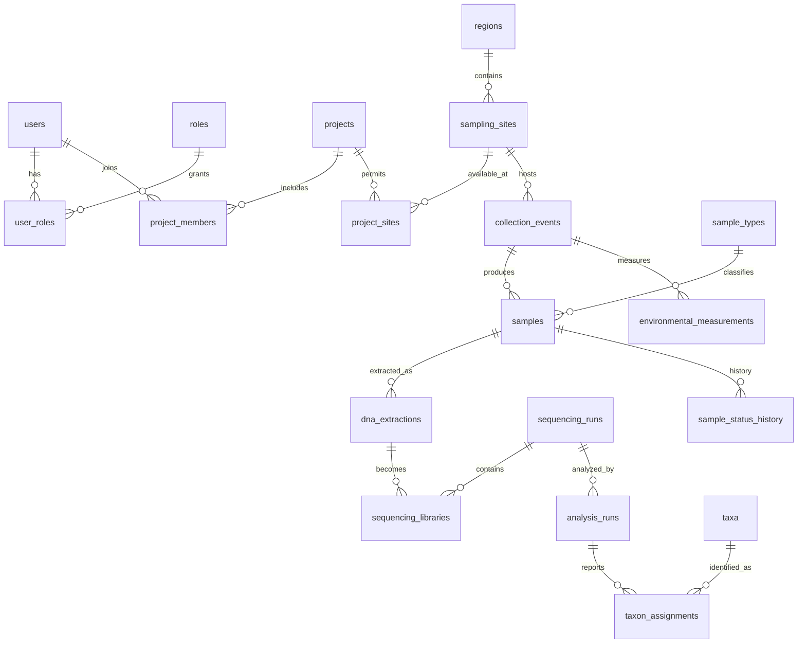

# Database normalization report

> **Owner:** D (Docs & Demo)  
> **Task:** T41 · issue #64  
> **Scope:** the four T40 slices, using the declared schema keys and constraints.

## 1. Worked example: collection and sequencing flat sheet

Suppose a spreadsheet has one row per sample/library/detection:

| project_title | site_name | region_name | event_id | collected_at | sample_code | sample_type | lab_name | extraction_id | run_code | library_code | analysis_id | taxon_name | read_count |
|---|---|---|---|---|---|---|---|---|---|---|---|---|---:|
| River Survey | Okhla | Delhi | 81 | 2026-05-02 | EB-20260502-81-001 | water | Central Lab | 501 | RUN-22 | LIB-7 | 901 | Taxon A | 120 |
| River Survey | Okhla | Delhi | 81 | 2026-05-02 | EB-20260502-81-001 | water | Central Lab | 501 | RUN-22 | LIB-7 | 901 | Taxon B | 35 |
| River Survey | Okhla | Delhi | 81 | 2026-05-02 | EB-20260502-82-001 | soil | Central Lab | 502 | RUN-22 | LIB-8 | 901 | Taxon A | 18 |

This is illustrative, not a production table. Repeating project, site, event, sample, lab, run and analysis facts creates update, insertion and deletion anomalies. A correction to a site name would need every matching row updated; a project could not be recorded before a sample exists; deleting the only detection could erase unrelated sample metadata.

### 1NF — atomic values, no repeating groups

The sheet is made into one row per detection, with atomic values and a composite key such as `(analysis_id, library_id, taxon_id)`. The row-level dependency is:

`(analysis_id, library_id, taxon_id) → read_count, confidence, qc_flag`

But the key does not determine the repeated descriptive columns. Other dependencies include:

- `project_id → project_title, objectives, dates, status`
- `site_id → region_id, site_name, coordinates, habitat`
- `event_id → project_id, site_id, collector_id, collected_at`
- `sample_id → event_id, sample_type_id, sample_code, status, sample measurements`
- `library_id → extraction_id, run_id, library_code` (where the schema's library/run constraints apply)
- `analysis_id → run_id, marker_id, pipeline/version, reference database, parameters`
- `taxon_id → scientific_name, rank, parent_taxon_id`

Values are atomic, but sample/event/project/site/lab/run/analysis/taxon facts are still repeated. 1NF alone does not remove those anomalies.

### 2NF — remove partial dependencies

For the composite detection key, detection-specific values depend on the whole key. Descriptive facts such as `taxon_id → scientific_name, rank` depend on only part of it, and analysis metadata depends on `analysis_id), not on the full detection key. Split the sheet into entity relations and a detection relation:

- `taxa(taxon_id, scientific_name, rank, parent_taxon_id, ...)`
- `analysis_runs(analysis_id, ...)`
- `taxon_assignments(analysis_id, library_id, taxon_id, read_count, confidence, qc_flag)`

The other entity facts similarly move to their owning relations (projects, sites, events, samples, libraries). This removes partial dependencies; transitive dependencies between non-key descriptive attributes may remain if they are still stored together.

### 3NF / BCNF — remove transitive dependencies

For example, keeping `site_id, site_name, region_id, region_name` together gives `site_id → region_id` and `region_id → region_name`; `region_id) is not a key of that combined relation. Decompose into `sampling_sites(site_id, region_id, site_name, ...)` and `regions(region_id, region_name, ...)`. Likewise, keep sample type vocabulary in `sample_types), project membership in its link relation, and laboratory, batch, extraction, run and analysis facts in their respective tables.

The final design uses separate relations connected by foreign keys. For each relation below, the listed non-trivial dependencies have a candidate key on the left, so the relation is BCNF under the declared constraints. This is a schema-level claim; an additional business rule not enforced by a key/constraint can change the result.

## 2. Final schema by T40 slice

### Access, Projects & Audit

Relations: `users`, `roles`, `user_roles`, `projects`, `project_members`, `project_sites`, `audit_logs`.

- `users`: `user_id →` user attributes; email is an alternate unique key.
- `roles`: `role_id → role attributes`; role name is unique.
- `user_roles`: `(user_id, role_id) →` assignment attributes.
- `projects`: `project_id →` project attributes; title is a candidate key where declared unique.
- `project_members`: `(project_id, user_id) → project_role`; this does **not** imply `user_id → project_role).
- `project_sites`: `(project_id, site_id) →` link attributes.
- `audit_logs`: `audit_id →` event fields.

Global user roles and project-specific roles are distinct facts and remain separate. Audit `details) is JSONB, a deliberate flexible payload/1NF exception for recorded change details; it is not treated as a normalized set of queryable columns. The polymorphic `(entity_type, entity_id)` reference cannot be a conventional FK to every audited table.

### Field & Samples

Relations: `regions`, `sampling_sites`, `sample_types`, `collection_events`, `samples`, `environmental_measurements`, `sample_status_history`.

- `regions`: `region_id → name, region_type, parent_region_id`; alternate `(name, region_type)) is unique.
- `sampling_sites`: `site_id → region_id, name, coordinates, habitat, description, creator, created_at`; alternate `(region_id, name)) is unique.
- `sample_types`: `sample_type_id ↔ type_name).
- `collection_events`: `event_id → project_id, site_id, collector_id, collected_at, notes, created_at).
- `samples`: `sample_id → event_id, sample_type_id, sample_code, volume_ml, depth_m, storage_location, status, created_at`; `sample_code) is unique.
- `environmental_measurements`: `measurement_id → event_id, parameter, value, unit, created_at`; alternate `(event_id, parameter)) is unique.
- `sample_status_history`: `history_id → sample_id, old_status, new_status, changed_by, changed_at, note).

The domain may suggest `parameter → unit` (for example, pH is unitless), but that dependency is not enforced by the schema; unit is stored with each reading. Under declared dependencies the measurements relation is BCNF. A future controlled parameter/unit vocabulary could normalize this if the rule is adopted. `samples.status` stores current state while `sample_status_history` stores the audit trail: deliberate duplication for distinct current-state and historical purposes. `sample_code` repeats date/event/sequence in a stable, human-readable label; it is deliberately retained because labels must remain stable if event metadata changes. Views are computed, not stored duplicate facts.

### Laboratory & Sequencing

Relations: `laboratories`, `extraction_batches`, `dna_extractions`, `quality_control_results`, `sequencing_libraries`, `sequencing_runs`.

- `laboratories`: `lab_id →` lab attributes.
- `extraction_batches`: `batch_id →` lab, operator, date, kit and batch attributes.
- `dna_extractions`: `extraction_id →` sample, batch, attempt number, concentration/purity and extraction attributes; sample/attempt is the declared alternate key.
- `quality_control_results`: `qc_result_id →` target, result, recorder and timestamp; the schema permits an either/or target.
- `sequencing_libraries`: `library_id →` extraction, run, library code and library attributes; library code is a candidate key.
- `sequencing_runs`: `run_id →` lab, run code, dates and status; run code is a candidate key.

The stored extraction `qc_status` alongside QC result rows is deliberate: it is the current decision used by the workflow, while result rows retain the underlying checks. Run/library codes are deliberate stable business identifiers. QC's either/or target is a modeled choice, not a dependency between the target columns.

### Analysis, Taxonomy & Analytics

Relations include `analysis_runs`, `dna_markers`, `taxa`, `taxon_assignments`, and `data_exports).

- `analysis_runs`: `analysis_id →` run, marker, pipeline/version, reference database, parameters, status and approval metadata; the schema also has a nullable candidate key for `supersedes_analysis_id).
- `dna_markers`: `marker_id →` marker attributes; marker name is unique.
- `taxa`: `taxon_id →` scientific name, rank and parent; declared taxonomy constraints govern rank/parent relationships.
- `taxon_assignments`: `assignment_id →` analysis, library, taxon, read count, confidence and QC flag; the declared unique detection key prevents duplicate taxon/library assignments within an analysis.
- `data_exports`: `export_id →` project, requester, request parameters/status and timestamps.

A correction is a new immutable analysis run linked through `supersedes_analysis_id`; it is not an update that overwrites approved results. Analytics views select approved runs and passing detections rather than storing duplicate aggregates.

## 3. Cross-slice relationship diagram

## 4. Deliberate denormalization and boundaries

1. **Current status plus history:** `samples.status` is a current-state read field; history rows are immutable events. They are not interchangeable.
2. **Stable sample/run/library codes:** human-facing codes encode useful context and are retained as unique business identifiers; they are generated through controlled write paths.
3. **Extraction QC verdict:** the current `qc_status` coexists with detailed QC observations to support workflow decisions without recomputing every result.
4. **Audit JSONB and polymorphic target:** audit details preserve changed values flexibly, and `entity_type/entity_id` identifies records across tables; these are intentional audit-log modeling tradeoffs.
5. **Measurement unit:** repeated units are accepted because no parameter dictionary currently declares `parameter → unit`; normalize if that rule becomes an enforced requirement.
6. **Derived views and analytics:** views/approved-result queries compute summaries at read time; no persistent aggregate is introduced here.

No other repeated descriptive parent facts are intentionally copied into child tables. Foreign keys express cross-slice relationships; the ER diagram is a relationship overview, not a substitute for the keys and constraints above.

## References

Slice-level schema details and constraints: `docs/slices/access.md`, `docs/slices/field.md`, `docs/slices/lab.md`, and `docs/slices/analysis.md`. See also `CONTRACT.md` §4.
