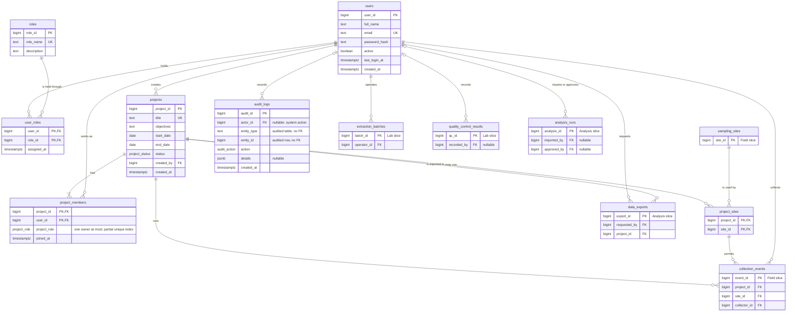

# access

> **Owner:** C (Testing & QA)
>
> Slice write-up and normalization notes: Access, Projects & Audit

## Overview

The Access, Projects & Audit slice answers four questions for the whole application:

1. **Who may sign in, and with which global role?** `users` holds the people (a bcrypt hash, never a password), `roles` the six global roles, and `user_roles` which user holds which role.
2. **Which research projects exist?** `projects` holds them, with a title, objectives, dates and a status (`planned`, `active`, `completed`, `archived`).
3. **Who works on a project, in which project role, and where may it collect?** `project_members` links a user to a project with a project role (`owner`, `manager`, `contributor`, `viewer`); `project_sites` links a project to the sampling sites it may use.
4. **Who changed what, and when?** `audit_logs` is an append-only trail that a trigger fills after every insert, update and delete on an audited table.

Data flow: a user signs in, the application reads the user's global roles (`user_roles` -> `roles`), and finds the projects the user may open: an administrator sees all of them, everyone else only those in `project_members` (`access_user_projects`, `v_user_project_access`). Every write by the other slices then passes through `audit_row_change()`, which records the acting user (`app.current_user_id`), the table, the row and the changed columns in `audit_logs`.

**Who uses it.** The administrator manages users and roles and reads the whole audit trail. The principal investigator creates and owns projects (`create_project_with_owner()`) and reads the audit entries of their own projects. Every other role (field researcher, lab technician, analyst, viewer) is a member of the projects they work on and has no access to the audit trail (CONTRACT 9).

**Connections to the other slices.** This slice is built first because every other slice points at it.

| Direction | Table or column | Slice | Constraint |
| --- | --- | --- | --- |
| This slice references | `sampling_sites` (`project_sites.site_id`) | Field & Samples | `fk_project_sites_site_id` |
| Referenced by | `projects` (`collection_events.project_id`) | Field & Samples | `fk_collection_events_project_id` |
| Referenced by | `project_sites` (`collection_events.project_id`, `collection_events.site_id`) | Field & Samples | `fk_collection_events_project_site` |
| Referenced by | `projects` (`data_exports.project_id`) | Analysis, Taxonomy & Analytics | `fk_data_exports_project_id` |
| Referenced by | `users` (`collection_events.collector_id`, `sampling_sites.created_by`, `sample_status_history.changed_by`) | Field & Samples | `fk_collection_events_collector_id`, `fk_sampling_sites_created_by`, `fk_sample_status_history_changed_by` |
| Referenced by | `users` (`extraction_batches.operator_id`, `quality_control_results.recorded_by`) | Laboratory & Sequencing | `fk_extraction_batches_operator_id`, `fk_quality_control_results_recorded_by` |
| Referenced by | `users` (`analysis_runs.imported_by`, `analysis_runs.approved_by`, `data_exports.requested_by`) | Analysis, Taxonomy & Analytics | `fk_analysis_runs_imported_by`, `fk_analysis_runs_approved_by`, `fk_data_exports_requested_by` |
| Used by | `audit_row_change()` | every slice | 16 `trg_<table>_audit` triggers, 5 of them in this slice |

These foreign keys are added in `database/migrations/090_cross_slice_constraints.sql`, so `010_access_projects_audit.sql` applies on its own. The audit trigger function is defined in this slice (`database/triggers/access_triggers.sql`) and has to exist before the other slices attach it, which is why that file must sort first.

**Seeded data** (`database/seeds/010_seed_access.sql`, plus `project_sites` from `020_seed_field.sql`): 6 roles (`administrator`, `principal_investigator`, `field_researcher`, `lab_technician`, `analyst`, `viewer`), 6 users (user *n* holds role *n*), 6 `user_roles`, 2 `projects` (both `active`, both owned by user 2), 7 `project_members` (5 in project 1, 2 in project 2), 5 `project_sites` (sites 1-3 for project 1, sites 4-5 for project 2) and an empty `audit_logs`. `v_user_project_access` returns 9 rows and `v_project_summary` 2.

## Schema

All seven tables are in `database/migrations/010_access_projects_audit.sql` (CONTRACT 4.1). Identity columns are `GENERATED BY DEFAULT AS IDENTITY (START WITH 1000)`, so seed rows use explicit ids below 1000 and the application gets 1000 and up (D6). The two foreign keys of `user_roles` are written `ON DELETE RESTRICT`. Every other foreign key has no `ON DELETE` clause, which in PostgreSQL means `NO ACTION`: deleting the referenced row is refused as well, and the two differ only when a constraint is deferred. Users and projects are never hard-deleted (D19).

### `roles`

One row is one global application role. It is a lookup table that administrators may extend, so `role_name` is not restricted to the six seeded names.

| Column | Type | Null? | Default | Rule / notes |
| --- | --- | --- | --- | --- |
| `role_id` | bigint | no | identity from 1000 | Primary key |
| `role_name` | text | no | | Unique; lower case; not blank. The stable identifier the API uses |
| `description` | text | yes | | Free text |

**Keys.** Primary key `pk_roles` (`role_id`). Candidate key `uq_roles_role_name` (`role_name`). No foreign keys. Referenced by `fk_user_roles_role_id`.

**Constraints.** `ck_roles_role_name_lower`: `role_name = lower(role_name)`. `ck_roles_role_name_not_blank`: `btrim(role_name) <> ''`.

### `users`

One row is one person who can sign in. A user is deactivated (`active = false`), never deleted.

| Column | Type | Null? | Default | Rule / notes |
| --- | --- | --- | --- | --- |
| `user_id` | bigint | no | identity from 1000 | Primary key |
| `full_name` | text | no | | Not blank |
| `email` | text | no | | Unique; lower case; one `@` with text on both sides |
| `password_hash` | text | no | | bcrypt hash computed by the API (D12); not blank. The database never sees a password |
| `active` | boolean | no | `true` | `false` blocks sign-in |
| `last_login_at` | timestamptz | yes | | Set by a successful sign-in |
| `created_at` | timestamptz | no | `now()` | |

**Keys.** Primary key `pk_users` (`user_id`). Candidate key `uq_users_email` (`email`). No foreign keys. Referenced by `fk_user_roles_user_id`, `fk_projects_created_by`, `fk_project_members_user_id`, `fk_audit_logs_actor_id` and the cross-slice keys in the Overview.

**Constraints.** `ck_users_full_name_not_blank`: `btrim(full_name) <> ''`. `ck_users_email_lower`: `email = lower(email)`. `ck_users_email_format`: `email ~ '^[^@[:space:]]+@[^@[:space:]]+$'`, a light shape check (full validation is in the API). `ck_users_password_hash_not_blank`: `btrim(password_hash) <> ''`.

### `user_roles`

One row says that a user holds a global role. A role is revoked by deleting the row.

| Column | Type | Null? | Default | Rule / notes |
| --- | --- | --- | --- | --- |
| `user_id` | bigint | no | | Part of the primary key; references `users` |
| `role_id` | bigint | no | | Part of the primary key; references `roles` |
| `assigned_at` | timestamptz | no | `now()` | When the role was granted |

**Keys.** Primary key `pk_user_roles` (`user_id`, `role_id`), the only candidate key. Foreign keys `fk_user_roles_user_id` (`users`, `ON DELETE RESTRICT`) and `fk_user_roles_role_id` (`roles`, `ON DELETE RESTRICT`). The index `idx_user_roles_role_id` serves "which users hold role X"; the primary key already serves lookups by user.

**Constraints.** None beyond the keys.

### `projects`

One row is one research project.

| Column | Type | Null? | Default | Rule / notes |
| --- | --- | --- | --- | --- |
| `project_id` | bigint | no | identity from 1000 | Primary key |
| `title` | text | no | | Unique; not blank |
| `objectives` | text | yes | | Free text |
| `start_date` | date | yes | | |
| `end_date` | date | yes | | Not before `start_date` when both are set |
| `status` | project_status | no | `'planned'` | `planned`, `active`, `completed` or `archived` |
| `created_by` | bigint | no | | References `users`; the user who created the project |
| `created_at` | timestamptz | no | `now()` | |

**Keys.** Primary key `pk_projects` (`project_id`). Candidate key `uq_projects_title` (`title`). Foreign key `fk_projects_created_by` (`users`, no `ON DELETE` clause, so `NO ACTION`). The index `idx_projects_created_by` supports the foreign key (PostgreSQL does not create one). Referenced by `fk_project_members_project_id`, `fk_project_sites_project_id`, `fk_collection_events_project_id` and `fk_data_exports_project_id`.

**Constraints.** `ck_projects_title_not_blank`: `btrim(title) <> ''`. `ck_projects_dates`: `end_date IS NULL OR start_date IS NULL OR end_date >= start_date` (also checked on `UPDATE`). The enumerated type `project_status` limits `status` to its four values.

### `project_members`

One row says that a user works on a project in a project role. The project role is independent of the user's global role.

| Column | Type | Null? | Default | Rule / notes |
| --- | --- | --- | --- | --- |
| `project_id` | bigint | no | | Part of the primary key; references `projects` |
| `user_id` | bigint | no | | Part of the primary key; references `users` |
| `project_role` | project_role | no | | `owner`, `manager`, `contributor` or `viewer` |
| `joined_at` | timestamptz | no | `now()` | |

**Keys.** Primary key `pk_project_members` (`project_id`, `user_id`), the only candidate key. Foreign keys `fk_project_members_project_id` (`projects`) and `fk_project_members_user_id` (`users`), both `NO ACTION`.

**Constraints.** The partial unique index `uq_project_members_owner` on (`project_id`) `WHERE project_role = 'owner'` allows at most one owner per project. It is an index, not a table constraint, so it does not appear in `pg_constraint`. The other half of the rule, at least one owner, is enforced only by `create_project_with_owner()`. The enumerated type `project_role` limits `project_role` to its four values. The index `idx_project_members_user_id_project_id` (the reverse access path) is a graded deliverable of T19 and is applied by hand (see Indexes).

### `project_sites`

One row says that a project may collect at a sampling site. The table has no attributes of its own.

| Column | Type | Null? | Default | Rule / notes |
| --- | --- | --- | --- | --- |
| `project_id` | bigint | no | | Part of the primary key; references `projects` |
| `site_id` | bigint | no | | Part of the primary key; references `sampling_sites` (FK added in 090) |

**Keys.** Primary key `pk_project_sites` (`project_id`, `site_id`), the only candidate key. Foreign keys `fk_project_sites_project_id` (`projects`) and `fk_project_sites_site_id` (`sampling_sites`, added in `090_cross_slice_constraints.sql` because `sampling_sites` is created later). Both `NO ACTION`. The index `idx_project_sites_site_id` serves "which projects use site X". The pair is referenced by `fk_collection_events_project_site`, so an event can only be recorded at a site its project may use.

**Constraints.** None beyond the keys.

### `audit_logs`

One row records one change (or one event such as a sign-in) made by a user or by the system. Rows are only ever inserted.

| Column | Type | Null? | Default | Rule / notes |
| --- | --- | --- | --- | --- |
| `audit_id` | bigint | no | identity from 1000 | Primary key |
| `actor_id` | bigint | yes | | References `users`. `NULL` means a system action with no signed-in user |
| `entity_type` | text | no | | Name of the audited table, for example `samples`. Not blank |
| `entity_id` | bigint | no | | Key of the audited row. For composite-key link tables, the parent id (`project_id` or `user_id`) |
| `action` | audit_action | no | | `insert`, `update`, `delete`, `approve`, `reject`, `login` or `export` |
| `details` | jsonb | yes | | `NULL` or a JSON object of changed columns (see the decision on `details` below) |
| `created_at` | timestamptz | no | `now()` | |

**Keys.** Primary key `pk_audit_logs` (`audit_id`), the only candidate key. Foreign key `fk_audit_logs_actor_id` (`users`, `NO ACTION`). There is **no** foreign key for (`entity_type`, `entity_id`): it refers to a row of any table (see the design decisions).

**Constraints.** `ck_audit_logs_entity_type_not_blank`: `btrim(entity_type) <> ''`. `ck_audit_logs_details_object`: `details IS NULL OR jsonb_typeof(details) = 'object'`. The enumerated type `audit_action` limits `action` to its seven values. Append-only is enforced by grants, not by a constraint: `ebiotrack_app` has `INSERT` and `SELECT` but not `UPDATE` or `DELETE` (`42501`). The index `idx_audit_logs_entity_type_entity_id_created_at` is a graded deliverable of T19 and is applied by hand (see Indexes).

## ER diagram

Tables of the other slices appear as stubs with their key only (and `site_id` or `project_id` where a stub holds a key into this slice). Cross-slice relationships are the ones added in 090. `audit_logs` points at the audited row by (`entity_type`, `entity_id`), which is not a foreign key and is therefore not drawn as a relationship: every audited table of every slice can be the target.



Cardinalities: a user holds zero or more roles and a role is held by zero or more users (`user_roles` is the associative entity). A project has one or more members, because the procedure always inserts the owner, and exactly one of them is the `owner` (`uq_project_members_owner` allows at most one, the procedure creates the first). A project may use zero or more sites, and a site may be used by zero or more projects. An audit entry has zero or one actor (`|o`), because a system action has none. `sampling_sites` draws the key `site_id` of `project_sites`; the composite pair (`project_id`, `site_id`) of `project_sites` is what `collection_events` references.

## Normalization

**Notation.** `{A, B} → {C}` reads "A and B together determine C": two rows with the same A and B always have the same C. A **candidate key** is a minimal set of columns that determines every column of the table; the **primary key** is the one chosen. A column is **prime** if it belongs to some candidate key, otherwise **non-prime**. A **determinant** is the left side of a functional dependency (FD). `{key} → {all other columns}` is written out in full for each table.

**Normal forms used.** 1NF: every value is atomic and there are no repeating groups. 2NF: 1NF and no non-prime column depends on only a part of a composite candidate key. 3NF: 2NF and no non-prime column depends on another non-prime column. BCNF: every determinant of every non-trivial FD is a candidate key.

**How the FDs were checked.** They were derived from the meaning of the columns and the constraints in `database/migrations/010_access_projects_audit.sql`. Data cannot prove an FD but can refute one, so the seeded database (6 roles, 6 users, 6 user roles, 2 projects, 7 members, 5 project sites, 0 audit rows) was queried for violations of each claimed FD; none was found. Because the seed is small, the claims that matter were also tested with a rolled-back transaction that tried to break them: the same user was given different project roles in different projects, a project creator was made different from its owner, a completed project was stored without an end date, and an audit row was written for a row that does not exist. Each of these is accepted by the database, which confirms that the dependency in question is not there.

**Result.** All seven tables are in BCNF. Five design choices that a reader might take for a violation (the second candidate key `projects.title`, `created_by` next to the owner, the stored `status`, the `details` JSON value, the (`entity_type`, `entity_id`) pair) are explained under their tables.

### `roles` (`role_id`, `role_name`, `description`)

- **Candidate keys:** `{role_id}` (primary key) and `{role_name}` (`uq_roles_role_name`).
- **Functional dependencies:** `{role_id} → {role_name, description}`; `{role_name} → {role_id, description}`. `description` determines nothing: two roles may have the same text.
- **1NF:** each column holds one value. `description` is free text, not a list of permissions; the permissions of a role live in the application (the permission matrix), not in this table.
- **2NF:** both candidate keys are single columns, so no partial dependency is possible.
- **3NF:** the only non-prime column is `description`, and it determines no other column.
- **BCNF:** the determinants are `role_id` and `role_name`, both candidate keys. **Highest form: BCNF.**
- **Design choice:** `role_name` is a second candidate key kept next to a surrogate `role_id`, because the API addresses roles by name while foreign keys use the numeric id. Roles are a table and not an enumerated type so that an administrator can add a role without a migration; the cost is that the six seeded names are a convention, not a constraint.
- **Anomalies avoided:** a role is described once, however many users hold it, and it cannot be deleted while a user holds it (`ON DELETE RESTRICT` on `fk_user_roles_role_id`).

### `users` (`user_id`, `full_name`, `email`, `password_hash`, `active`, `last_login_at`, `created_at`)

- **Candidate keys:** `{user_id}` (primary key) and `{email}` (`uq_users_email`). `full_name` is not a key: two people can share a name.
- **Functional dependencies:** `{user_id} → {full_name, email, password_hash, active, last_login_at, created_at}`; `{email} → {user_id, full_name, password_hash, active, last_login_at, created_at}`. No other column determines anything: equal `full_name` values, equal `password_hash` values (impossible in practice, because bcrypt salts every hash) or equal `active` values say nothing about the rest of the row.
- **1NF:** each column holds one value. `password_hash` is one opaque string (the algorithm, cost and salt are packed inside it by bcrypt; the database never reads them). `email` holds one address; a second address would need another table.
- **2NF:** both candidate keys are single columns, so no partial dependency is possible.
- **3NF:** the non-prime columns are `full_name`, `password_hash`, `active`, `last_login_at` and `created_at`. None of them determines another. In particular `password_hash` does not determine the user's role or status: roles are in `user_roles`, which is why they are not columns here.
- **BCNF:** the determinants are `user_id` and `email`, both candidate keys. **Highest form: BCNF.**
- **Design choice:** `email` is a candidate key and the sign-in identifier; `user_id` is the surrogate that every foreign key uses, so changing an email touches one row. `active` is stored, not derived, because deactivation is an administrative decision with no other source.
- **Anomalies avoided:** a person's name and email are stored once, whatever the number of roles, projects, samples or audit entries that mention them. Because users are deactivated and not deleted, history that points at a user (`created_by`, `collector_id`, `actor_id`) never dangles.

### `user_roles` (`user_id`, `role_id`, `assigned_at`)

- **Candidate keys:** `{user_id, role_id}` (primary key). It is the only candidate key: a user can hold several roles and a role can be held by several users, so neither column alone is unique.
- **Functional dependencies:** `{user_id, role_id} → {assigned_at}`. `assigned_at` is the time this user received this role, so it depends on the whole key and on neither column alone: user 3 received role 3 when the account was created and, in a rolled-back test, role 6 at a different time.
- **1NF:** each column holds one value; the several roles of a user are several rows, not a list in `users`.
- **2NF:** the only non-prime column is `assigned_at`, and it depends on both key columns together, not on `user_id` or `role_id` alone.
- **3NF:** there is one non-prime column, so it cannot depend on another.
- **BCNF:** the only non-trivial determinant is `{user_id, role_id}`, the candidate key. **Highest form: BCNF.**
- **Design choice:** this is the associative entity of a many-to-many relationship between users and roles. The schema allows a user to hold any number of roles, although the seed gives each user one. Revoking a role deletes the row, so the table keeps no history of past grants; the audit trail does (`trg_user_roles_audit`).
- **Anomalies avoided:** a role granted to a user is one row, so there is no update anomaly from a user with several roles, no insertion anomaly for a user with no role yet, and no deletion anomaly when the last user of a role is removed (the role stays in `roles`).

### `projects` (`project_id`, `title`, `objectives`, `start_date`, `end_date`, `status`, `created_by`, `created_at`)

- **Candidate keys:** `{project_id}` (primary key) and `{title}` (`uq_projects_title`). The title is unique because a project is known by it in lists and exports.
- **Functional dependencies:** `{project_id} → {title, objectives, start_date, end_date, status, created_by, created_at}`; `{title} → {project_id, objectives, start_date, end_date, status, created_by, created_at}`. Dependencies that look plausible and are **not** there: `created_by` does not determine `status`, the dates or the owner; the dates do not determine `status`; `status` determines nothing.
- **1NF:** each column holds one value. `objectives` is free text and `status` is one of four enumerated values. The several members and sites of a project are rows in `project_members` and `project_sites`, not repeated columns.
- **2NF:** both candidate keys are single columns, so no partial dependency is possible.
- **3NF:** the non-prime columns are `objectives`, `start_date`, `end_date`, `status`, `created_by` and `created_at`. None determines another. `status` is a human decision (a project with no end date can be `completed`, and a project that has ended can still be `active`), so it is not a function of the dates; the probe above stored a `completed` project with a `NULL` end date and the database accepted it. `created_by` is a foreign key to `users`, and the user's name or email are not repeated here.
- **BCNF:** the determinants are `project_id` and `title`, both candidate keys. **Highest form: BCNF.**
- **Design choice:** `created_by` and the owner in `project_members` are different facts. `create_project_with_owner()` makes them the same user at creation, but ownership can move and `created_by` never does, so there is no dependency between them and no redundancy to remove (the probe changed the owner to another user and the creator stayed). `title` as a second candidate key is a business rule (no two projects with the same name) written as `UNIQUE`; the surrogate `project_id` is what foreign keys use, so a project can be renamed without touching other tables. The constraint `ck_projects_dates` compares two columns of the same row; it is a `CHECK` on the values, not a functional dependency.
- **Anomalies avoided:** project facts are stored once and the people, sites and events of a project are reached through key columns, so adding or removing a member or site cannot change the project row. A project that has members or events cannot be deleted (`NO ACTION` on the foreign keys that point at it).

### `project_members` (`project_id`, `user_id`, `project_role`, `joined_at`)

- **Candidate keys:** `{project_id, user_id}` (primary key). It is the only candidate key: a project has several members and a user is a member of several projects.
- **Functional dependencies:** `{project_id, user_id} → {project_role, joined_at}`. There is **no** dependency `user_id → project_role`: user 3 is a `contributor` in both seeded projects and was a `viewer` in a rolled-back test project, so the role belongs to the (project, user) pair and not to the user. There is none from `project_id` either, since a project has members in all four roles.
- **1NF:** each column holds one value; `project_role` is a single enumerated value, and a user who holds two roles in one project is not possible (one row per pair).
- **2NF:** both non-prime columns, `project_role` and `joined_at`, depend on the whole key and not on `project_id` or `user_id` alone, as shown above.
- **3NF:** `project_role` does not determine `joined_at` or the other way round.
- **BCNF:** the only non-trivial determinant is `{project_id, user_id}`, the candidate key. **Highest form: BCNF.**
- **Design choice:** the partial unique index `uq_project_members_owner` (at most one row with `project_role = 'owner'` per project) is a restriction on a subset of the rows, not a functional dependency: it does not say that `project_id` determines the owner's `user_id` for every row, only that at most one row per project has the value `owner`. It therefore does not change the normal form. The matching rule "at least one owner" cannot be written as an index; `create_project_with_owner()` establishes it at creation, and nothing in the schema stops a later demotion of the last owner (see the known limitations).
- **Anomalies avoided:** a membership is one row, so a user can be added to or removed from one project without touching the others, and a user's name is not repeated in each membership. Removing the last member leaves the project row in place.

### `project_sites` (`project_id`, `site_id`)

- **Candidate keys:** `{project_id, site_id}` (primary key), the whole table.
- **Functional dependencies:** none beyond the trivial ones. The table has no column outside its key, so there is nothing for the key to determine.
- **1NF:** each column holds one value; the several sites of a project are several rows.
- **2NF:** there is no non-prime column, so no partial dependency is possible.
- **3NF:** there is no non-prime column, so no transitive dependency is possible.
- **BCNF:** the only determinants are subsets of the key, and the dependencies they carry are trivial. **Highest form: BCNF** (an all-key table is in BCNF).
- **Design choice:** the table is the associative entity of the many-to-many relationship between projects and sampling sites; it holds only the fact "this project may use this site". The site's name, location and coordinates stay in `sampling_sites` and are not repeated here. The pair is referenced by `collection_events` (`fk_collection_events_project_site`), so the table is also what restricts where each project may record events.
- **Anomalies avoided:** a site can be added to or removed from one project without changing any other project, and a site with no project is still stored in `sampling_sites`.

### `audit_logs` (`audit_id`, `actor_id`, `entity_type`, `entity_id`, `action`, `details`, `created_at`)

- **Candidate keys:** `{audit_id}` (primary key). No other column set is unique: the same entity is changed many times, so the pair (`entity_type`, `entity_id`) repeats (in the rolled-back probe, `project_members` with entity id 1000 had 4 rows).
- **Functional dependencies:** `{audit_id} → {actor_id, entity_type, entity_id, action, details, created_at}`. Nothing else determines anything: `{entity_type, entity_id}` does not determine `actor_id`, `action` or `details`, because an entity can be changed many times by different users; `actor_id` determines nothing about the entity.
- **1NF:** every column except `details` holds one atomic value. `details` is a `jsonb` object of changed columns (`{"status": {"old": "planned", "new": "active"}}`). For the database it is one value that is stored and returned whole, never updated by part, and the structure inside it (column name, old value, new value) is not a relational attribute. It is honest to call it a deliberate exception: strictly relational design would have an `audit_changes` table with one row per changed column (`audit_id`, `column_name`, `old_value`, `new_value`), which would cost one row for each changed column of every audited write. A snapshot of the change is what an audit record is, and it is never queried by its parts in the application; `changed_fields` in the trail query reads the top-level keys. The check `ck_audit_logs_details_object` guarantees that the value is a JSON object, and the nullable column allows the events without details (`login`, `export`).
- **2NF:** the key is a single column, so no partial dependency is possible.
- **3NF:** the non-prime columns do not determine each other. `action` does not determine `details`, and `entity_type` does not determine `entity_id`.
- **BCNF:** the only determinant is `audit_id`, the candidate key. **Highest form: BCNF**, with the 1NF remark about `details` above.
- **Design choice:** the reference to the audited row is the pair `entity_type` (text) and `entity_id` (bigint), which can point at any table of any slice. A foreign key cannot do that, so there is none; the pair is a polymorphic reference, checked by nobody. The database accepts an audit row for a row that does not exist (a rolled-back probe inserted one for `samples` with id 999999). That is intended: the trail must keep rows about records after they change or disappear, and the trigger is the only normal writer. The pair determines nothing, so it does not create a dependency that would break a normal form; the cost is a join that the database cannot verify, and the index `idx_audit_logs_entity_type_entity_id_created_at` supports the lookup. `actor_id` is nullable: `NULL` means a system action (a seed, a job, a script) with no signed-in user, and it is not a missing value to repair.
- **Anomalies avoided:** the trail records the old and new values at the time of the change, so renaming a user or a site later does not rewrite history. Rows are never updated or deleted by the application role, so there is no update or deletion anomaly in the trail itself.

### Values that are not stored

Counts and flags that could be derived from these tables are computed in the views and queries, not stored, because a stored copy would be a second fact to keep in step: `member_count`, `manager_count`, `contributor_count`, `viewer_count`, `site_count`, `event_count` and `sample_count` (`v_project_summary`), the owner's name (`owner_name`, from `project_members` and `users`), `can_edit` (from the project role or the global role) and `access_via` (from `user_roles` and `project_members`) in `v_user_project_access`. A user's "highest" role is not stored either; the application takes the set of rows in `user_roles`.

### Free text and enumerations

`roles.description`, `projects.objectives`, `projects.title` and `users.full_name` are free text and are treated as single values; none contains a list that the database or application splits. `project_status`, `project_role` and `audit_action` are enumerated types, so a misspelt value is rejected with `22P02` and a value can not be given two spellings. `entity_type` is free text, not an enumerated type, because audited tables are added by other slices; the application reads the value as the table name.

## Business rules and where they are enforced

The slice uses all four layers: the schema (keys, `CHECK`), triggers, stored procedures and the application. A rule is put in the lowest layer that can express it, because that layer also protects plain SQL.

| Rule | Enforced by | Object | Raises |
| --- | --- | --- | --- |
| Role names are unique, lower case and not blank | Schema | `uq_roles_role_name`, `ck_roles_role_name_lower`, `ck_roles_role_name_not_blank` | `23505`, `23514` |
| An email is unique, lower case and has the shape `x@y` | Schema | `uq_users_email`, `ck_users_email_lower`, `ck_users_email_format` | `23505`, `23514` |
| A user has a name and a password hash | Schema | `ck_users_full_name_not_blank`, `ck_users_password_hash_not_blank` | `23514` |
| A password is never stored; the hash is bcrypt | Application | `backend/src/utils/passwordHash.js` (D12); the database only checks that the hash is not blank | n/a |
| A user holds a given role at most once | Schema | `pk_user_roles` | `23505` |
| A project title is unique and not blank | Schema | `uq_projects_title`, `ck_projects_title_not_blank` | `23505`, `23514` |
| A project does not end before it starts | Schema | `ck_projects_dates` | `23514` |
| Project status, project role and audit action take only listed values | Schema (enumerated types) | `project_status`, `project_role`, `audit_action` | `22P02` |
| A user is a member of a project at most once | Schema | `pk_project_members` | `23505` |
| A project has at most one owner | Schema | `uq_project_members_owner` (partial unique index) | `23505` |
| A project has at least one owner when it is created | Procedure | `create_project_with_owner` | n/a |
| Only an active administrator or principal investigator owns a new project | Procedure | `create_project_with_owner` | `EB002` |
| A new project has a unique, non-blank title, an existing owner, and the owner's membership is created with it | Procedure | `create_project_with_owner` | `23514`, `23505`, `23503` |
| A site is linked to a project at most once, and only a real site | Schema | `pk_project_sites`, `fk_project_sites_site_id` | `23505`, `23503` |
| The audit actor, the entity type and the entity id are always recorded; `details` is a JSON object or null | Schema | `ck_audit_logs_entity_type_not_blank`, `ck_audit_logs_details_object`, `fk_audit_logs_actor_id` | `23514`, `23503` |
| Users and projects are never hard-deleted; a referenced row cannot be removed | Schema and roles | `ON DELETE RESTRICT` on the two `user_roles` keys, `NO ACTION` on every other foreign key; the application role has `DELETE` only on `user_roles`, `project_members` and `project_sites` (`database/roles/grants.sql`) | `23503`, `42501` |
| The audit trail is append-only | Roles | `UPDATE` and `DELETE` on `audit_logs` are revoked from `ebiotrack_app` (`database/roles/grants.sql`) | `42501` |
| Every insert, update and delete of the audited tables writes an audit row with the acting user; `password_hash` is never logged | Trigger | `trg_users_audit`, `trg_user_roles_audit`, `trg_projects_audit`, `trg_project_members_audit`, `trg_project_sites_audit`, all calling `audit_row_change`; the user comes from `app.current_user_id` | `23503` for an unknown actor |
| Roles are not audited | Design | no trigger on `roles` (a fixed lookup, changed by migration only) | n/a |
| A deactivated user cannot sign in, and an open session stops working | Application | `backend/src/services/auth.service.js` (login), `backend/src/middleware/auth.js` (every request) | HTTP 401 |
| A user sees only the projects they belong to; an administrator sees all | Application and view | `backend/src/services/projectAccess.js`, `access_user_projects`, `v_user_project_access` | HTTP 403, 404 |
| A principal investigator reads the audit entries of their own projects only; other roles cannot read the audit trail | Application | `backend/src/routes/audit.routes.js`, `backend/src/services/audit.service.js` | HTTP 403 |
| Who may do what | Application | CONTRACT 9 permission matrix, applied by `backend/src/middleware/authorize.js` | HTTP 403 |

Two rules cannot live in the lowest layer. "At least one owner" cannot be an index or a `CHECK`, because it is a statement about a set of rows of one project, and a constraint on one row or a unique index cannot require that a row exists; the procedure checks it for a new project and nothing checks it later. "A principal investigator sees only their own audit entries" needs the mapping from an audited row to its project, which differs for each entity type, so it is application code.

## Queries and open decisions (T14-C)

Queries live in `database/queries/access_queries.sql`; expected results for the seed are in the file and in `tests/fixtures/README.md`.

| Statement                   | Parameters                                                  | Used by                                                  |
| --------------------------- | ----------------------------------------------------------- | -------------------------------------------------------- |
| `access_user_projects`      | `$1` user_id, `$2` project_status or NULL                   | `GET /api/projects` (T20), `v_user_project_access` (T15) |
| `access_project_members`    | `$1` project_id or NULL                                     | `GET /api/projects/:id` (T20), `v_project_summary` (T15) |
| `access_entity_audit_trail` | `$1` entity_type, `$2` entity_id, `$3`/`$4` from/to or NULL | `GET /api/audit` (T20)                                   |

### 1. Inactive users (decision for A / Arvind)

`access_user_projects` returns zero rows for an unknown or `users.active = false` user. `authorize.js` does not check `active` (login does), so a deactivated user with an open session still passes `requireProjectAccess`. Proposed fix, in A's files (not changed here): reject inactive users where the session is loaded, or add `AND u.active` to the membership lookup in `requireProjectAccess` and to `accessibleProjectIds`:

```sql
SELECT pm.project_role
  FROM projects p
  JOIN project_members pm ON pm.project_id = p.project_id AND pm.user_id = $2
  JOIN users u ON u.user_id = pm.user_id AND u.active
 WHERE p.project_id = $1
```

Until then the middleware is more permissive than the query; the query is the safer reference.

**Status.** Resolved in the backend: `backend/src/middleware/auth.js` re-reads the user on every request and rejects an inactive one, and `backend/src/services/auth.service.js` rejects inactive users at sign-in (`tests/authorization/session-auth.test.js`). The text above records the decision as it was taken in T14-C.

### 2. Audit "own" scoping (T20)

`access_entity_audit_trail` is unscoped. For a `principal_investigator` the caller must first check that the entity belongs to one of their projects (`accessibleProjectIds(user)` gives the project ids; map the entity to its project, for example `samples` via `collection_events.project_id`, `projects` directly) and return 404 otherwise. Administrators are unrestricted; other roles cannot read audit (CONTRACT 9).

**Status.** Implemented in the backend: `backend/src/routes/audit.routes.js` and `backend/src/services/audit.service.js` limit a principal investigator to the audit entries of their own projects with a CTE and answer 403 to the other roles (`tests/authorization/data-scope.test.js`). The query itself is still unscoped.

### 3. `audit_logs.details` shape (decided in T17-C)

CONTRACT 4.1 only says `details` is a JSON object of changed columns with old and new values. Decision, implemented by `audit_row_change()`:

| Action                                 | `details`                                                                                              |
| -------------------------------------- | ------------------------------------------------------------------------------------------------------ |
| `insert`                               | `{ "<column>": { "new": v }, ... }` for the inserted columns                                           |
| `update`                               | `{ "<column>": { "old": v1, "new": v2 }, ... }` for **changed** columns only                           |
| `delete`                               | `{ "<column>": { "old": v }, ... }`                                                                    |
| `login`, `export`, `approve`, `reject` | `NULL` or a small object chosen by the caller (written by procedures or the app, never by the trigger) |

Top-level keys are column names, so the trail query's `changed_fields` is exactly the set of changed columns. Rules: `password_hash` is never logged, and neither are columns passed as extra trigger arguments; an update that changes nothing (after those exclusions) writes no row; for composite-key link tables `entity_id` is the parent id and the whole row is in `details`.

## Views (T15-C)

Defined in `database/views/access_views.sql` (`CREATE OR REPLACE VIEW`, read-only, no `password_hash`). Installed by `migrate.js` (views and procedures after the migrations, triggers after the seeds, re-applied on every run); to apply by hand, `psql -f database/views/access_views.sql`. Views have no order; consumers add `ORDER BY`. If a column list changes later, `DROP VIEW` first.

### `v_user_project_access`

One row per (user, project) the user can access. `SELECT ... FROM v_user_project_access WHERE user_id = $1` returns the same rows as `access_user_projects($1, NULL)` (checked for users 1-6 and 999; Query 1 columns `title`/`status` are `project_title`/`project_status` here).

| Column                            | Type                 | Meaning / source                                                             |
| --------------------------------- | -------------------- | ---------------------------------------------------------------------------- |
| `user_id`, `full_name`, `email`   | bigint, text, text   | `users`; active users only                                                   |
| `project_id`                      | bigint               | `projects.project_id`                                                        |
| `project_title`, `project_status` | text, project_status | `projects.title`, `projects.status`                                          |
| `access_via`                      | text                 | `'administrator'` (global role) or `'membership'`                            |
| `project_role`                    | project_role         | `project_members.project_role`; NULL for an administrator with no membership |
| `can_edit`                        | boolean              | administrator, or project role owner/manager                                 |

Rules: administrators see every project; others only their memberships; an administrator who is also a member appears once, as `administrator`; inactive users have no rows. **Contains emails**: keep behind `authorize` (administrator, or the caller's own `user_id`). Seed: 9 rows (user 1: projects 1, 2; users 2, 3: 1, 2; users 4, 5, 6: project 1).

```sql
SELECT project_id, project_title, access_via, project_role, can_edit
  FROM v_user_project_access WHERE user_id = 3 ORDER BY project_id;
```

### `v_project_summary`

One row per project, including projects with no members, sites or events (counts are 0, owner NULL). Each child table is aggregated separately, so counts are not multiplied.

| Column                                                                  | Type         | Meaning / source                                                                              |
| ----------------------------------------------------------------------- | ------------ | --------------------------------------------------------------------------------------------- |
| `project_id`, `title`, `status`, `start_date`, `end_date`, `created_by` |              | `projects`                                                                                    |
| `owner_id`, `owner_name`                                                | bigint, text | the member with role `owner`; NULL if none                                                    |
| `member_count`, `manager_count`, `contributor_count`, `viewer_count`    | bigint       | `project_members` (owner counted in `member_count` only); agree with `access_project_members` |
| `site_count`                                                            | bigint       | `project_sites`                                                                               |
| `event_count`                                                           | bigint       | `collection_events.project_id`                                                                |
| `sample_count`                                                          | bigint       | `samples` of those events                                                                     |

Seed: project 1: 5 members (0 manager, 3 contributor, 1 viewer), 3 sites, 6 events, 13 samples; project 2: 2 members (0, 1, 0), 2 sites, 2 events, 4 samples (17 in total).

```sql
SELECT project_id, title, owner_name, member_count, sample_count
  FROM v_project_summary ORDER BY project_id;
```

### Installation and grants

`migrate.js` applies `database/views/*.sql` right after the migrations, so a freshly migrated database and the test database have the views. `ebiotrack_readonly` has SELECT on both views. `ebiotrack_app` has SELECT only: `grants.sql` revokes the INSERT/UPDATE/DELETE that table-level grants would give it, and neither view is automatically updatable anyway. Default privileges give new views write rights again, so re-run `database/roles/grants.sql` after views are created or re-created. Both views are owned by `ebiotrack`, the role named in the default privileges.

## Procedure (T16-C)

`create_project_with_owner(p_title text, p_objectives text, p_start_date date, p_owner_id bigint) RETURNS bigint` in `database/procedures/access_procedures.sql` (installed by `migrate.js`, `SECURITY INVOKER`, no dynamic SQL). It inserts a `planned` project (`created_by` = owner) and the `owner` membership, and returns the new `project_id` (ids start at 1000 and can have gaps). Every project must be created through it: `uq_project_members_owner` only guarantees at most one owner, this function guarantees at least one.

Checks run in this order and stop at the first problem:

| Problem                                                          | SQLSTATE | API mapping             |
| ---------------------------------------------------------------- | -------- | ----------------------- |
| Title `NULL` or blank                                            | `23514`  | 422 `validation_error`  |
| Title already used (also a concurrent duplicate)                 | `23505`  | 409 `duplicate`         |
| `p_owner_id` `NULL`                                              | `EB002`  | 422 `rule_violation`    |
| Owner does not exist                                             | `23503`  | 422 `invalid_reference` |
| Owner deactivated (`users.active = false`)                       | `EB002`  | 422 `rule_violation`    |
| Owner holds neither `administrator` nor `principal_investigator` | `EB002`  | 422 `rule_violation`    |

**Role check is an interpretation** (CONTRACT 9 says who may create projects; the signature has one `p_owner_id`, which is both creator and owner). `authorize('create_project')` must stay on the route. To drop the check, delete the "Allowed to create projects" block in the function.

All or nothing holds as long as the caller's transaction ends in `COMMIT` or `ROLLBACK` (a failed membership insert aborts the transaction; no `EXCEPTION` block swallows errors). Concurrent calls with the same title: the second blocks on `uq_projects_title`, then fails with `23505` if the first committed, or succeeds if it rolled back. The owner row is locked `FOR SHARE` so the checks and the insert see the same user. If `app.current_user_id` is not set, the owner is recorded as the actor. That is done by the helper `fn_access_set_actor(p_actor_id bigint) RETURNS void`, which sets `app.current_user_id` for the transaction only when it is unset or empty and leaves an existing value alone.

```sql
SELECT create_project_with_owner('New survey', 'Objectives', DATE '2026-06-01', 2);  -- new project_id
```

From the backend: `callProcedure('create_project_with_owner', [title, objectives, startDate, req.user.user_id], client)` inside `withTransaction`.

## Audit trigger (T17-C)

`audit_row_change()` in `database/triggers/access_triggers.sql` is an `AFTER INSERT OR UPDATE OR DELETE ... FOR EACH ROW` trigger function (`SECURITY INVOKER`, no dynamic SQL). It writes one `audit_logs` row per changed row: `entity_type` = table name, `entity_id` = the key column named by `TG_ARGV[0]`, `action` = `insert`/`update`/`delete`, `actor_id` from `app.current_user_id`, `details` as decided above. Attached here to `users` (leaving out `last_login_at`), `user_roles`, `projects`, `project_members` and `project_sites`. It is attached to 16 tables in all: these five and `sampling_sites`, `collection_events`, `samples`, `dna_extractions`, `sequencing_runs`, `sequencing_libraries`, `quality_control_results`, `dna_markers`, `analysis_runs`, `taxa` and `data_exports` (`trg_<table>_audit`, each defined in its own slice's trigger file).

**Attach it from your slice** (A, B, D), after the table's own status-transition trigger:

```sql
CREATE OR REPLACE TRIGGER trg_<table>_audit
    AFTER INSERT OR UPDATE OR DELETE ON <table>
    FOR EACH ROW EXECUTE FUNCTION audit_row_change('<pk_column>');
```

Optional extra arguments are columns to leave out of the log (a noisy timestamp). For a composite key pass the parent id column. Never attach it to `audit_logs`, `schema_migrations`, `schema_seeds` or `session`. `access_triggers.sql` must sort first (the runner applies triggers alphabetically); do not rename it.

Behaviour and traps:

- **Actor:** unset or empty `app.current_user_id` gives `actor_id` NULL (system action); digits give that user; anything else gives NULL plus a `WARNING`. A well-formed id that is not a user (for example `99999`) fails with `23503` and rolls back the business write, on purpose.
- **Seeds:** triggers are installed after the seeds, so a fresh `db:reset --seed` leaves `audit_logs` empty. `reseed()` (tests) re-runs seeds with the triggers present, so it truncates `audit_logs` (restarting the identity) at the end.
- **Append-only:** the trigger runs as the caller; `ebiotrack_app` can insert audit rows but `UPDATE`/`DELETE` on `audit_logs` fail with `42501`.
- **Volume data:** `generate-volume-data.js` disables the audit triggers while loading and cleaning (and re-enables them), so synthetic rows are not audited. Performance runs (T35) should measure with the triggers present and absent.
- **Misuse** (no key argument, key column missing, statement-level trigger) raises `22023` naming the table.


## Transaction scenario (T18-C)

`database/transactions/access_transaction.sql` is a demonstration script (not a migration, not a test; the runner never executes it). Scenario: **project onboarding**. User 2 creates a project with its owner (`create_project_with_owner()`), adds users 3 and 4 as contributors and user 6 as viewer, and links sites 1 and 4, in one transaction that either commits completely or leaves no trace, audit rows included.

Run it by hand (`ON_ERROR_STOP` stays off because the script fails on purpose):

```bash
docker compose exec -T db psql -U ebiotrack -d ebiotrack -f - < database/transactions/access_transaction.sql
psql "$DATABASE_URL" -f database/transactions/access_transaction.sql
psql "$TEST_DATABASE_URL" -v keep=1 -f database/transactions/access_transaction.sql   # test database only
```

Every transaction ends in `ROLLBACK`, so the default run leaves the database unchanged and can be repeated (generated ids move on, which is normal). With `-v keep=1` the Part 1 transaction ends in `COMMIT` to show durability; a second `keep=1` run stops in Part 0 because the project exists. Remove it by resetting the test database; never use `keep=1` on the development database. Isolation is the default `READ COMMITTED`, like the backend; each transaction starts with `SET LOCAL app.current_user_id = '2'`, like `withTransaction`.

| Part | What it shows |
|---|---|
| 0 | Preflight (objects, fixtures, no leftover demo project) and the baseline counts, including the highest `audit_id` |
| 1 | Commit path: project, 4 members (one owner), 2 sites, **7 audit rows** all with actor 2 and the project id as `entity_id`; `ROLLBACK` by default, `COMMIT` with `keep=1` |
| 2 | Rollback A: after project, members and a site succeeded, a second owner fails with `23505` on `uq_project_members_owner`; the next statement fails with `25P02`; after `ROLLBACK` nothing remains, not even audit rows |
| 3 | Rollback B (five transactions): viewer as owner `EB002`, seeded title `23505`, blank title `23514`, unknown site `23503` on `fk_project_sites_site_id` (the project created one statement earlier disappears too), and B5: unknown member 999 without a savepoint, `23503` on `fk_project_members_user_id`, no project or members remain |
| 4 | `SAVEPOINT`: unknown member 999 fails (`23503`), `ROLLBACK TO SAVEPOINT`, user 3 is added; the failed insert left no audit row |
| 5 | Two-session protocol in comments: duplicate title blocks on `uq_projects_title`, uncommitted work is invisible, `FOR SHARE` on the owner blocks `UPDATE users SET active = false` |

| Property | Where shown |
|---|---|
| Atomicity | Part 1 (7 audit rows with 1 project), Parts 2 and 3 (nothing remains after the failure) |
| Consistency | Part 3 (constraints and procedure rules, CONTRACT 7 codes) |
| Isolation | Part 5 (blocking on the unique index, invisibility of uncommitted work, `FOR SHARE` on the owner) |
| Durability | Part 1 with `keep=1` (committed project survives the session; reset removes it) |

Excerpt of a default run (26 checks, 0 failed):

```
PASS: 7 audit rows (1 project, 4 members, 2 sites), all actor 2, all entity_id = the project
ROLLBACK
PASS: projects, members, sites and audit rows are back at the baseline
Caught SQLSTATE 23505 duplicate key value violates unique constraint "uq_project_members_owner"
PASS: the aborted transaction refused the next statement with 25P02
PASS: B4 raised 23503 on fk_project_sites_site_id
PASS: the project created before the failing statement is gone
Summary: 26 checks passed, 0 checks failed.
```

Notes:

- Part 2 adds user 5 as a second owner, not user 3 again: re-adding an existing member fails first on the primary key `pk_project_members`, so only a non-member reaches `uq_project_members_owner`.
- B2 checks the SQLSTATE; the constraint name `uq_projects_title` is printed by the verbose error (the procedure raises it with that constraint field), not by `LAST_ERROR_MESSAGE`.
- With `keep=1`, Parts 2 to 4 use the title `T18 onboarding demo project (after commit)` because the first title is taken by then.
- T32 (`tests/transactions/project-create.test.js`) automates the Part 2 and 3 assertions; the Part 5 duplicate-title race becomes the project-creation case of T34.

## Indexes (T19-C)

`database/indexes/access_indexes.sql` (applied by hand, safe to run twice) creates two indexes. The full `EXPLAIN (ANALYZE, BUFFERS)` evidence, the variants tried and the write cost are in the comment block above each `CREATE INDEX`; the exact statements are labelled `BQ1` to `BQ6` in `tests/performance/explain-benchmarks.sql`. All figures: `ebiotrack_test`, `npm run volume:load -- --scale medium` (20 007 memberships, 500 000 audit rows), median of 5 runs after one warm-up, baseline taken before the indexes.

| Index | Table | Serves | Size | Before -> after |
|---|---|---|---|---|
| `idx_project_members_user_id_project_id` (user_id, project_id) | `project_members` | `authorize.js` membership lookup (BQ1), Query 1 for one user (BQ2) | 632 kB | BQ1 0.429 ms (Seq Scan, 148 buffers) -> 0.006 ms (Index Only Scan, 3 buffers); BQ2 1.198 -> 0.707 ms |
| `idx_audit_logs_entity_type_entity_id_created_at` (entity_type, entity_id, created_at) | `audit_logs` | Query 3 and `GET /api/audit?entity_type&entity_id` (BQ3, BQ4) | 24 MB | cold entity 16.216 -> 0.019 ms; hot entity 19.439 -> 3.789 ms; one month of the hot entity 17.132 -> 1.582 ms; largest trail (21 551 rows) 19.123 -> 6.704 ms |

Write cost (bulk insert into a temporary copy, median of 5): `project_members` 2.274 -> 8.697 ms for 20 007 rows (+282%, about 0.3 microseconds a row); `audit_logs` 18.425 -> 93.980 ms for 100 000 rows (+410%, about 0.76 microseconds a row). `audit_logs` receives one row per audited write, so this is the cost that matters; T35 should repeat it with the triggers enabled.

Findings:

- **Query 1 is helped, but only a little.** The primary key `(project_id, user_id)` cannot serve a lookup by `user_id`, and the per-project subqueries (owner, member count, site count) dominate the plan, so the new index only turns the one `project_members` scan into a bitmap scan (35 buffers instead of 148). The index is justified by the `authorize.js` lookup (BQ1), which becomes index-only (`Heap Fetches: 0` after `VACUUM`).
- **The extra `audit_id` column did not pay off.** The four-column variant (28 MB) removed the Sort node only for tiny trails and gave the same times for every other query; leading with `entity_id` also changed nothing. For large trails the planner prefers a bitmap scan plus a Sort whichever column list is used, because the rows of one entity are scattered over the whole table.
- **Not indexed, with numbers:** `audit_logs (actor_id)` (the `actor_id` filter: 11.272 ms, 0.168 ms with a test index) and `audit_logs (created_at)`. The second one matters: the dashboard's "newest 5 audit rows" (BQ6) scans all 500 000 rows in 65.066 ms and would take 0.004 ms with an 11 MB index on `created_at`. It is reported as the recommended third index for the dashboard owner rather than added here, because T19 asks for two.
- Results are unchanged by the indexes: the row sets of Queries 1 and 3 and the audit lookups hashed identically with and without them.

## Database roles and grants

`database/roles/grants.sql` creates three `NOLOGIN` roles and is the single source of truth for privileges. It is idempotent and is **not** run by `migrate.js`; run it by hand after the migrations (and after views are created or re-created), and `restore.sh` re-applies it after a restore.

| Role | Tables of this slice | Views | Functions |
| --- | --- | --- | --- |
| `ebiotrack_readonly` | `SELECT` | `SELECT` | no `EXECUTE` |
| `ebiotrack_app` | `SELECT`, `INSERT`, `UPDATE`; `DELETE` only on `user_roles`, `project_members`, `project_sites` | `SELECT` only | `EXECUTE` |
| `ebiotrack_admin` | `ALL` (migration and maintenance) | `ALL` | `EXECUTE` |

Specific points:

- **No hard delete.** `ebiotrack_app` has no `DELETE` on `users`, `roles`, `projects` and `audit_logs` (D19); a delete fails with `42501`. The three link tables are the exception because revoking a role, removing a member and unlinking a site are real deletions of a fact.
- **Append-only audit.** On `audit_logs` the application role can `SELECT` and `INSERT` but `UPDATE` and `DELETE` are revoked (`42501`). The trigger runs as the caller, so it still inserts.
- **Views are read-only** for the application role: table-level grants would give the views `INSERT`, `UPDATE` and `DELETE` through the default privileges, and the script revokes them.
- **Functions.** `EXECUTE` is revoked from `PUBLIC` and `ebiotrack_readonly` and given to `ebiotrack_app` and `ebiotrack_admin`, so the read-only role cannot call `create_project_with_owner()`.
- **Default privileges** are set `FOR ROLE ebiotrack`, the owner of the objects, so objects created later by the migrations get the same grants. `ebiotrack_admin` is meant for migrations and maintenance; the docker-compose user `ebiotrack` owns the objects.
- The roles have no password and no login; a real deployment adds `LOGIN` and a password outside this repository.

Tests: `tests/integrity/access.integrity.test.js` (append-only and `42501`, no hard delete) and `tests/authorization/permission-matrix.test.js`.

## Backup and restore

A backup is a snapshot of the whole database, taken and restored with `database/backup/backup.sh` and `database/backup/restore.sh` (see `database/backup/README.md` for every option and exit code).

- **Back up:** `database/backup/backup.sh [--url <postgres-url>] [--out-dir <dir>] [--keep <N>] [--quiet] [--help]` writes a custom-format dump with a `.sha256` file, using `pg_dump --no-owner --no-acl`, so it holds no role names or grants.
- **Restore:** `database/backup/restore.sh <dump-file> --url <target-postgres-url> [--create] [--drop-existing --confirm <target-db-name>] [--allow-dev-target] [--skip-grants] [--quiet] [--help]` restores in a single transaction into an empty database and then runs `database/roles/grants.sql`, so the three roles above are back.
- **For this slice:** `users`, `user_roles`, `projects`, `project_members`, `project_sites` and `audit_logs` come back with their identity sequences checked against the restored rows, so a new project or audit row does not collide with a restored id. `password_hash` values are in the dump; protect the file like a password store.
- **Limit:** snapshot only, with no point-in-time recovery; changes made after the backup started are lost.
- **Tests:** `tests/recovery/restore.test.js` and `tests/recovery/disaster.test.js` restore the test database into a scratch database and compare it, including the audit trail and the grants.

## Object inventory

Every database object of the slice, with the file that defines it.

| Type | Name | File | Purpose |
| --- | --- | --- | --- |
| Table | `roles` | `database/migrations/010_access_projects_audit.sql` | Global application roles |
| Table | `users` | `database/migrations/010_access_projects_audit.sql` | People who can sign in, with a bcrypt hash |
| Table | `user_roles` | `database/migrations/010_access_projects_audit.sql` | User holds role (associative entity) |
| Table | `projects` | `database/migrations/010_access_projects_audit.sql` | Research projects |
| Table | `project_members` | `database/migrations/010_access_projects_audit.sql` | User works on a project in a project role |
| Table | `project_sites` | `database/migrations/010_access_projects_audit.sql` | Project may use a sampling site (associative entity) |
| Table | `audit_logs` | `database/migrations/010_access_projects_audit.sql` | Append-only trail of changes |
| Enumerated type | `project_status`, `project_role`, `audit_action` | `database/migrations/010_access_projects_audit.sql` | Allowed values of the three status-like columns |
| Index | `idx_user_roles_role_id`, `idx_projects_created_by`, `idx_project_sites_site_id` | `database/migrations/010_access_projects_audit.sql` | Foreign-key support indexes |
| Index | `uq_project_members_owner` | `database/migrations/010_access_projects_audit.sql` | At most one owner per project (partial unique index) |
| Cross-slice constraint | `fk_project_sites_site_id` | `database/migrations/090_cross_slice_constraints.sql` | Site of a project must exist |
| Seed | access fixture world | `database/seeds/010_seed_access.sql` | 6 roles, 6 users, 6 user roles, 2 projects, 7 members (the 5 project sites come from `database/seeds/020_seed_field.sql`) |
| Query | `access_user_projects` | `database/queries/access_queries.sql` | Projects a user can access, optionally by status |
| Query | `access_project_members` | `database/queries/access_queries.sql` | Members of one project or of all projects |
| Query | `access_entity_audit_trail` | `database/queries/access_queries.sql` | Audit trail of one entity, optionally in a date range |
| View | `v_user_project_access` | `database/views/access_views.sql` | One row per user and accessible project |
| View | `v_project_summary` | `database/views/access_views.sql` | One row per project with owner and counts |
| Procedure | `create_project_with_owner` | `database/procedures/access_procedures.sql` | Creates a project and its owner membership |
| Helper function | `fn_access_set_actor` | `database/procedures/access_procedures.sql` | Sets the acting user for the audit trigger when none is set |
| Trigger function | `audit_row_change` | `database/triggers/access_triggers.sql` | Writes the audit row for every attached table |
| Trigger | `trg_users_audit`, `trg_user_roles_audit`, `trg_projects_audit`, `trg_project_members_audit`, `trg_project_sites_audit` | `database/triggers/access_triggers.sql` | Audit rows for the slice's tables |
| Transaction scenario | project onboarding with rollback, savepoint and locking | `database/transactions/access_transaction.sql` | Atomicity, rollback cases and the two-session protocol |
| Index | `idx_project_members_user_id_project_id` | `database/indexes/access_indexes.sql` | Membership lookup by user (applied by hand) |
| Index | `idx_audit_logs_entity_type_entity_id_created_at` | `database/indexes/access_indexes.sql` | Audit trail of one entity (applied by hand) |
| Roles | `ebiotrack_readonly`, `ebiotrack_app`, `ebiotrack_admin` | `database/roles/grants.sql` | Privileges of the three database roles |
| Backup | `backup.sh`, `restore.sh` | `database/backup/` | Snapshot backup and restore |

Slice totals: 7 tables, 3 enumerated types, 3 queries, 2 views, 1 procedure (and 1 helper function), 1 trigger function, 5 audit triggers, 1 transaction scenario, 2 graded indexes (and 3 foreign-key indexes plus 1 partial unique index). Tests of these objects are in `tests/integrity/access.integrity.test.js`, `tests/integrity/audit-trigger.test.js`, `tests/queries/access.queries.test.js`, `tests/transactions/project-create.test.js`, `tests/concurrency/other-races.test.js`, `tests/authorization/` and `tests/recovery/`.

## Design decisions and known limitations

- **Project role and global role are separate.** `user_roles` says what a user may do anywhere; `project_members.project_role` says what the user may do in one project. The same user can be a `contributor` in one project and a `viewer` in another, which is why there is no dependency from `user_id` to `project_role`.
- **"At least one owner" holds only at creation.** `uq_project_members_owner` allows at most one owner, and `create_project_with_owner()` inserts the first. Plain SQL can create a project with no owner, delete the owner's membership, or demote the last owner; no constraint or trigger prevents it. `v_project_summary` shows `owner_id` as `NULL` in that case.
- **`created_by` is not the owner.** The procedure sets both to the same user, but they are independent columns; ownership can move and the creator stays.
- **`project_status` is set by hand.** It is not derived from the dates, and there is no status-transition trigger in this slice: any status can follow any other.
- **`audit_logs` has no foreign key for the audited row.** (`entity_type`, `entity_id`) can name any table; the database does not check that the row exists, and a row for a table that is dropped or renamed stays. The trade-off is intended: a foreign key cannot point at many tables, and a trail must outlive the rows it describes.
- **`details` is a JSON value, not a table.** It is one `jsonb` object (see Normalization); a relational `audit_changes` table was rejected because every changed column of every audited write would become a row.
- **`entity_id` is the parent id for composite-key link tables.** An audit row for `user_roles` has the user id as `entity_id`; for `project_members` and `project_sites` the project id. The whole row is in `details`, so the changed member is still known.
- **Roles are not audited.** `roles` has no audit trigger: it is a lookup that changes only with a migration.
- **The audit trail is only as complete as the trigger attachments.** The trigger is attached to 16 tables, 5 of them here. A table added without the trigger is silently unaudited.
- **The actor comes from the session setting.** `app.current_user_id` is set by `withTransaction`; a write outside it is recorded as a system action (`actor_id` `NULL`). A malformed id gives `NULL` and a `WARNING`; a well-formed id that is not a user fails with `23503`.
- **Foreign keys use `NO ACTION`**, except the two on `user_roles`, which use `RESTRICT`. The effect (the delete is refused) is the same; they differ only when a constraint is deferred.
- **Users are deactivated, never deleted.** The backend checks `active` at sign-in and on every request, so a deactivation takes effect at once. The database itself does not stop an inactive user from being added to a project or from being an owner of an existing one (the procedure checks it for a new owner only).
- **Emails are lower case by constraint**, so the unique key behaves case-insensitively without `citext`; the shape check is deliberately light and the API validates properly.
- **Two graded indexes are applied by hand.** The migration runner does not run `database/indexes/`, so `ebiotrack_test` has the unindexed baseline for benchmarks; applying them to the running application is open for the backend owner. The recommended third index, `audit_logs (created_at)`, is described under Indexes.
- **`grants.sql` is also applied by hand**, and again after views are re-created, because default privileges give new views write rights.
- **No point-in-time recovery.** Backups are snapshots (see Backup and restore).
