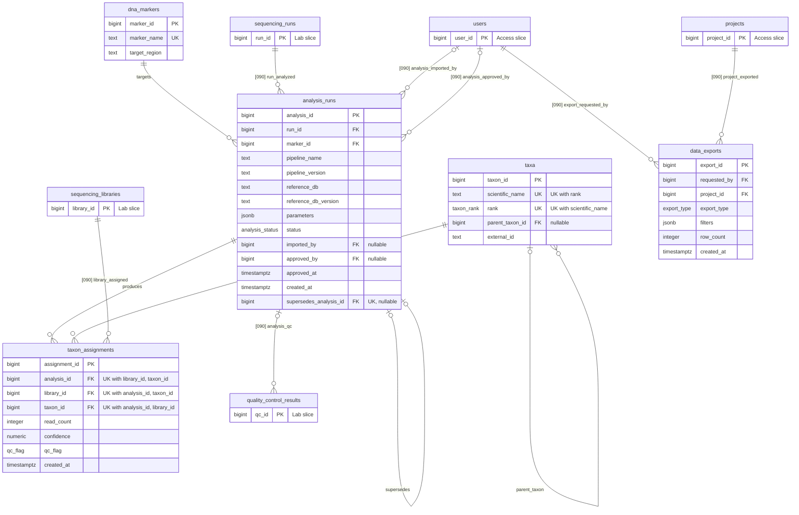

# analysis

> **Owner:** A (Backend)
>
> Slice write-up and normalization notes: Analysis, Taxonomy & Analytics

## Overview

The Analysis, Taxonomy & Analytics slice turns sequencing output into biodiversity results that a second person has checked:

1. After a sequencing run, a bioinformatician creates an **analysis run** (`analysis_runs`): one pipeline, with its version, reference database and parameters, applied to one sequencing run for one DNA marker (`dna_markers`, for example 12S or COI). A new run is a `draft`.
2. The bioinformatician imports a **detection file** (CSV) into the draft. Each row says that a **taxon** (`taxa`) was assigned to a **library** with a read count, a confidence and a QC flag (`pass`, `warn` or `fail`). Rows are stored as **detections** (`taxon_assignments`) and the run becomes `imported`. The import is all or nothing.
3. A second person (a principal investigator or an administrator, never the importer) **approves** the run, or **rejects** it with a reason. Only approved runs count.
4. Analytics use **approved runs and `pass` detections only**. A detection is evidence that DNA of a taxon was present: it does not indicate abundance, and no detection does not indicate absence.
5. An approved result is never edited. A **correction** is a new run that names the approved run it replaces (`supersedes_analysis_id`). Approving the correction moves the old run to `superseded` in the same transaction.
6. A user can request a CSV **export** (`data_exports`). The table records the request, not the file.

Data flow: `sequencing_runs` → `analysis_runs` (marker, pipeline, reference database) → `taxon_assignments` (library, taxon, read count, confidence, QC flag) → views and analytics (`v_approved_detections`, `v_site_richness`) → `data_exports`.

**Who uses it** (CONTRACT 9). Creating an analysis and importing detections: the administrator, and the principal investigator and analyst for their own projects. Approving or rejecting: the administrator, and the principal investigator for their own projects. Reading approved detections, analytics and exports: every role, for their own projects. Reading analyses that are not approved: the administrator, and the principal investigator and analyst for their own projects; for every other role such an analysis does not exist (404). The procedures check the global role again (`import_detections`: administrator, principal_investigator or analyst; `approve_analysis` and `reject_analysis`: administrator or principal_investigator), and the importer can never approve their own import. The `/api/analyses`, `/api/taxa`, `/api/analytics`, `/api/dashboard` and `/api/exports` routes work on these tables.

**Connections to the other slices.**

| Direction | Table or column | Slice | Constraint |
| --- | --- | --- | --- |
| This slice references | `sequencing_runs` (`analysis_runs.run_id`) | Laboratory & Sequencing | `fk_analysis_runs_run_id` |
| This slice references | `sequencing_libraries` (`taxon_assignments.library_id`) | Laboratory & Sequencing | `fk_taxon_assignments_library_id` |
| This slice references | `users` (`analysis_runs.imported_by`, `analysis_runs.approved_by`, `data_exports.requested_by`) | Access, Projects & Audit | `fk_analysis_runs_imported_by`, `fk_analysis_runs_approved_by`, `fk_data_exports_requested_by` |
| This slice references | `projects` (`data_exports.project_id`) | Access, Projects & Audit | `fk_data_exports_project_id` |
| Referenced by | `analysis_runs` (`quality_control_results.analysis_id`) | Laboratory & Sequencing | `fk_quality_control_results_analysis_id` |
| Used by | `audit_row_change()` | Access, Projects & Audit | 4 `trg_<table>_audit` triggers in this slice |

The foreign keys from this slice are added in `database/migrations/090_cross_slice_constraints.sql`, so `040_analysis_taxonomy.sql` applies on its own. The views also read the Field & Samples tables (`samples`, `collection_events`, `sampling_sites`) and `dna_extractions`, reaching them through the library; no foreign key of this slice points at them directly.

**Seeded data** (`database/seeds/040_seed_analysis.sql`, counted in a freshly built database): 2 markers (12S, COI); 15 taxa (1 kingdom, 1 phylum, 1 class, 1 order, 1 family, 4 genera, 6 species); 4 analysis runs (analyses 1 and 2 `approved`, analysis 3 `imported`, analysis 4 `draft`); 43 detections (36 `pass`, 3 `warn`, 4 `fail`, split per analysis in the table below); no exports. `v_approved_detections` returns 24 rows (14 from analysis 1, 10 from analysis 2) and `v_site_richness` returns 8 rows.

| `analysis_id` | `status` | `pass` | `warn` | `fail` | Total |
| --- | --- | --- | --- | --- | --- |
| 1 | approved | 14 | 2 | 1 | 17 |
| 2 | approved | 10 | 0 | 1 | 11 |
| 3 | imported | 12 | 1 | 2 | 15 |
| 4 | draft | 0 | 0 | 0 | 0 |

## Schema

The five tables are in `database/migrations/040_analysis_taxonomy.sql` (CONTRACT 4.4). `analysis_runs` is defined by 040 **plus** `database/migrations/096_analysis_supersession.sql`, which adds the column `supersedes_analysis_id` and its three constraints as a follow-up migration (CONTRACT 1.3); the column is therefore last in the table, after `created_at`. Identity columns are `GENERATED BY DEFAULT AS IDENTITY (START WITH 1000)`, so seed rows use explicit ids below 1000 (D6). Every foreign key inside the slice is `ON DELETE RESTRICT`: scientific records are never hard-deleted (D19). The six foreign keys added in 090 for this slice are also written `ON DELETE RESTRICT`; the one foreign key that points into the slice (`fk_quality_control_results_analysis_id`, owned by the Lab slice) has no `ON DELETE` clause, which in PostgreSQL means `NO ACTION`. In both cases deleting the referenced row is refused.

### `dna_markers`

One row is one genetic target region that a pipeline amplifies and reads, for example 12S.

| Column | Type | Null? | Default | Rule / notes |
| --- | --- | --- | --- | --- |
| `marker_id` | bigint | no | identity from 1000 | Primary key |
| `marker_name` | text | no | | Unique; not blank |
| `target_region` | text | yes | | Free text description of the region |

**Keys.** Primary key `pk_dna_markers` (`marker_id`). Candidate key `uq_dna_markers_marker_name` (`marker_name`). No foreign keys. Referenced by `analysis_runs.marker_id`.

**Constraints.** `ck_dna_markers_marker_name_not_blank`: `length(btrim(marker_name)) > 0`.

### `analysis_runs`

One row is one execution of a pipeline on one sequencing run for one marker, with its review status.

| Column | Type | Null? | Default | Rule / notes |
| --- | --- | --- | --- | --- |
| `analysis_id` | bigint | no | identity from 1000 | Primary key |
| `run_id` | bigint | no | | Sequencing run that is analysed; FK added in 090 |
| `marker_id` | bigint | no | | Marker that was read |
| `pipeline_name` | text | no | | Pipeline, for example `OBITools3`; free text; not blank |
| `pipeline_version` | text | no | | Pipeline version; free text; not blank |
| `reference_db` | text | no | | Reference database, for example `MitoFish`; free text; not blank |
| `reference_db_version` | text | yes | | Version or release of the reference database |
| `parameters` | jsonb | yes | `'{}'` | Pipeline parameters, stored and read as one value |
| `status` | analysis_status | no | `'draft'` | `draft`, `imported`, `approved`, `rejected` or `superseded` |
| `imported_by` | bigint | yes | | User who imported the detections; NULL while `draft`; FK added in 090 |
| `approved_by` | bigint | yes | | Approving user; FK added in 090 |
| `approved_at` | timestamptz | yes | | When it was approved |
| `created_at` | timestamptz | no | `now()` | Row creation time |
| `supersedes_analysis_id` | bigint | yes | | The approved run this correction replaces; NULL for ordinary runs (migration 096) |

**Keys.** Primary key `pk_analysis_runs` (`analysis_id`). Candidate key `uq_analysis_runs_supersedes_analysis_id` (`supersedes_analysis_id`, nullable: many NULLs are allowed, each non-NULL value at most once, so a run is replaced by at most one correction). Foreign keys: `fk_analysis_runs_marker_id` (`marker_id` → `dna_markers`, `ON DELETE RESTRICT`); `fk_analysis_runs_supersedes_analysis_id` (`supersedes_analysis_id` → `analysis_runs`, `ON DELETE RESTRICT`, migration 096); `fk_analysis_runs_run_id` (`run_id` → `sequencing_runs`), `fk_analysis_runs_imported_by` (`imported_by` → `users`) and `fk_analysis_runs_approved_by` (`approved_by` → `users`), all added in 090 with `ON DELETE RESTRICT`. Referenced by `taxon_assignments.analysis_id`, `quality_control_results.analysis_id` and by itself.

**Constraints.** `ck_analysis_runs_approved_fields`: `status <> 'approved' OR (approved_by IS NOT NULL AND approved_at IS NOT NULL)`, an approved run has an approver and a time (the check does not forbid an approver on a run that is not approved). `ck_analysis_runs_pipeline_name_not_blank`, `ck_analysis_runs_pipeline_version_not_blank` and `ck_analysis_runs_reference_db_not_blank`: `length(btrim(column)) > 0`. `ck_analysis_runs_supersedes_not_self` (096): `supersedes_analysis_id IS NULL OR supersedes_analysis_id <> analysis_id`. That the replaced run is `approved` is a status rule enforced when the correction is approved (see Business rules), not a constraint.

### `taxa`

One row is one taxon at one rank. The table is a tree: each taxon points at its parent.

| Column | Type | Null? | Default | Rule / notes |
| --- | --- | --- | --- | --- |
| `taxon_id` | bigint | no | identity from 1000 | Primary key |
| `scientific_name` | text | no | | Not blank |
| `rank` | taxon_rank | no | | `domain`, `kingdom`, `phylum`, `class`, `order`, `family`, `genus` or `species` |
| `parent_taxon_id` | bigint | yes | | Parent taxon; NULL for a root |
| `external_id` | text | yes | | Identifier in an outside taxonomy, for example an NCBI taxon id; 8 of the 15 seeded taxa have one |

**Keys.** Primary key `pk_taxa` (`taxon_id`). Candidate key `uq_taxa_scientific_name_rank` (`scientific_name`, `rank`). Foreign key `fk_taxa_parent_taxon_id` (`parent_taxon_id` → `taxa`, `ON DELETE RESTRICT`: a parent cannot be deleted while it has children). Referenced by `taxon_assignments.taxon_id`.

**Constraints.** `ck_taxa_not_own_parent`: `parent_taxon_id IS NULL OR parent_taxon_id <> taxon_id`. `ck_taxa_scientific_name_not_blank`: `length(btrim(scientific_name)) > 0`. Acyclicity beyond "not its own parent" is **not** enforced by a constraint or a trigger: the only trigger on the table is the audit trigger. A cycle of two or more taxa is accepted (checked in a rolled-back transaction: setting the parent of taxon 6 to its own child 7 succeeded). The recursive queries protect themselves instead: both carry the visited ids in a `path` array and stop with `NOT taxon_id = ANY(path)`. No rule that a child's rank is lower than its parent's is enforced either (a `kingdom` row under a species was accepted in the same kind of test), and ranks may be skipped (the seeded genus `Gambusia` sits directly under a class).

### `taxon_assignments`

One row is one detection: in one analysis run, a taxon was found in one library.

| Column | Type | Null? | Default | Rule / notes |
| --- | --- | --- | --- | --- |
| `assignment_id` | bigint | no | identity from 1000 | Primary key |
| `analysis_id` | bigint | no | | Analysis run that produced the detection |
| `library_id` | bigint | no | | Library in which the taxon was found; FK added in 090 |
| `taxon_id` | bigint | no | | Assigned taxon |
| `read_count` | integer | no | | Raw sequencing reads, not abundance; at least 0 |
| `confidence` | numeric(5,4) | no | | Assignment confidence from 0 to 1 |
| `qc_flag` | qc_flag | no | | `pass`, `warn` or `fail`; supplied with the file |
| `created_at` | timestamptz | no | `now()` | Row creation time |

**Keys.** Primary key `pk_taxon_assignments` (`assignment_id`). Candidate key `uq_taxon_assignments_analysis_library_taxon` (`analysis_id`, `library_id`, `taxon_id`). Foreign keys: `fk_taxon_assignments_analysis_id` (`analysis_id` → `analysis_runs`, `ON DELETE RESTRICT`); `fk_taxon_assignments_taxon_id` (`taxon_id` → `taxa`, `ON DELETE RESTRICT`); `fk_taxon_assignments_library_id` (`library_id` → `sequencing_libraries`, added in 090, `ON DELETE RESTRICT`).

**Constraints.** `ck_taxon_assignments_read_count`: `read_count >= 0`. `ck_taxon_assignments_confidence`: `confidence BETWEEN 0 AND 1` (PostgreSQL stores it as `confidence >= 0 AND confidence <= 1`; `numeric(5,4)` keeps four decimals). One detection per analysis, library and taxon is the unique key above. That the library belongs to the sequencing run of the analysis is **not** a constraint (see Business rules).

### `data_exports`

One row is one request for a CSV export: who asked, for which project, of what type and with which filters.

| Column | Type | Null? | Default | Rule / notes |
| --- | --- | --- | --- | --- |
| `export_id` | bigint | no | identity from 1000 | Primary key |
| `requested_by` | bigint | no | | Requesting user; FK added in 090 |
| `project_id` | bigint | no | | Project that is exported; FK added in 090 |
| `export_type` | export_type | no | | `samples_csv`, `detections_csv` or `richness_csv` |
| `filters` | jsonb | yes | `'{}'` | The filters of the request, stored and read as one value |
| `row_count` | integer | yes | | Number of data rows at the time of the request; at least 0 |
| `created_at` | timestamptz | no | `now()` | Request time |

**Keys.** Primary key `pk_data_exports` (`export_id`). No other candidate key. There is no foreign key inside the slice; both foreign keys come from 090: `fk_data_exports_requested_by` (`requested_by` → `users`, `ON DELETE RESTRICT`) and `fk_data_exports_project_id` (`project_id` → `projects`, `ON DELETE RESTRICT`).

**Constraints.** `ck_data_exports_row_count`: `row_count IS NULL OR row_count >= 0` (NULL, a count not recorded, passes). The table is not seeded.

## ER diagram

Tables of the other slices (`sequencing_runs`, `sequencing_libraries`, `users`, `projects`, `quality_control_results`) appear as stubs with their key only. Cross-slice relationships carry the `[090]` label used in `docs/er-diagram.md`, the ones added in `090_cross_slice_constraints.sql`.



Two lines are self-references. `taxa |o--o{ taxa` reads "a taxon has zero or one parent and zero or more children". `analysis_runs |o--o| analysis_runs` reads "a correction replaces zero or one run, and a run is replaced by zero or one correction" (`uq_analysis_runs_supersedes_analysis_id`). `docs/er-diagram.md` does not yet show the column `supersedes_analysis_id` or this second self-reference; every other table, column and relationship above is the same as there.

## Normalization

**Notation.** `{A, B} → {C}` reads "A and B together determine C": two rows with the same A and B always have the same C. A **candidate key** is a minimal set of columns that determines every column of the table; the **primary key** is the one chosen. A column is **prime** if it belongs to some candidate key, otherwise **non-prime**. A **determinant** is the left side of a functional dependency (FD). `{key} → {all other columns}` is written out in full for each table.

**Normal forms used.** 1NF: every value is atomic and there are no repeating groups. 2NF: 1NF and no non-prime column depends on only a part of a composite candidate key. 3NF: 2NF and no non-prime column depends on another non-prime column. BCNF: every determinant of every non-trivial FD is a candidate key.

**How the FDs were checked.** They were derived from the meaning of the columns and from the constraints in `database/migrations/040_analysis_taxonomy.sql` and `096_analysis_supersession.sql`. The FDs of the candidate keys hold because the key constraints enforce them. Every other FD that a reader might suspect is listed as "does not hold" with the evidence: a counterexample in the seeded database (2 markers, 4 analysis runs, 15 taxa, 43 detections) or a statement that a rolled-back test accepted. Data cannot prove an FD but can refute one.

**Result.** All five tables are in BCNF. One point needs a stated reading: `analysis_runs` has a nullable candidate key (`supersedes_analysis_id`), which is a key only for the rows where it is set. Three design choices that a reader might take for a violation (the run-level pipeline and reference database text, the approval columns on the run, the adjacency-list taxonomy) are explained under their tables, and two stored values that are not functions of their own row (`status = 'superseded'` and `data_exports.row_count`) are discussed where they occur.

### `dna_markers` (`marker_id`, `marker_name`, `target_region`)

- **Candidate keys:** `{marker_id}` (primary key) and `{marker_name}` (`uq_dna_markers_marker_name`).
- **Functional dependencies:** `{marker_id} → {marker_name, target_region}`; `{marker_name} → {marker_id, target_region}`. `target_region` determines nothing: two markers can target the same region.
- **1NF:** `marker_name` and `target_region` are single text values. `target_region` is a free text description, not a list.
- **2NF:** both candidate keys are single columns, so no partial dependency is possible.
- **3NF:** the only non-prime column is `target_region`, and it determines no other column.
- **BCNF:** the determinants are `marker_id` and `marker_name`, both candidate keys. **Highest form: BCNF.**
- **Anomalies avoided:** a marker's name and region are stored once, so renaming a marker is one `UPDATE` and the analyses cannot show two spellings of it. A marker used by an analysis cannot be deleted (`ON DELETE RESTRICT` on `fk_analysis_runs_marker_id`).

### `analysis_runs` (`analysis_id`, `run_id`, `marker_id`, `pipeline_name`, `pipeline_version`, `reference_db`, `reference_db_version`, `parameters`, `status`, `imported_by`, `approved_by`, `approved_at`, `created_at`, `supersedes_analysis_id`)

- **Candidate keys:** `{analysis_id}` (primary key) and `{supersedes_analysis_id}` (`uq_analysis_runs_supersedes_analysis_id`). The second is a key only among rows where it is not NULL: `UNIQUE` allows many NULLs, and NULL here means "this run replaces nothing", not an unknown value. No natural key exists: the same pipeline, version and reference database can be applied again to the same sequencing run and marker (a re-run).
- **Functional dependencies:** `{analysis_id} → {run_id, marker_id, pipeline_name, pipeline_version, reference_db, reference_db_version, parameters, status, imported_by, approved_by, approved_at, created_at, supersedes_analysis_id}`; for a run that is a correction, `{supersedes_analysis_id} → {analysis_id, run_id, marker_id, pipeline_name, pipeline_version, reference_db, reference_db_version, parameters, status, imported_by, approved_by, approved_at, created_at}`.
- **Dependencies that do not hold, and why:**
  - `{pipeline_name} → {pipeline_version}` fails: the seed has `OBITools3` at versions `3.0.1` (analyses 1 and 2) and `3.1.0` (analyses 3 and 4).
  - `{reference_db} → {reference_db_version}` fails: the seed has `MitoFish` at `2025-06` (analysis 1) and `2026-01` (analysis 2).
  - `{run_id, marker_id} → {analysis_id}` fails: a re-run is allowed, and nothing forbids two analyses of the same run and marker.
  - `{status} → {approved_by}` and `{approved_by} → {approved_at}` fail: a person approves many runs at different times.
  - `{marker_id} → {pipeline_name}` fails: one marker is read by many pipelines.
- **1NF:** all columns are atomic. `status` is an enumerated type. `parameters` is addressed below.
- **2NF:** both candidate keys are single columns.
- **3NF:** no non-prime column determines another non-prime column. `approved_by` and `approved_at` are facts about the approval event, and each depends directly on `analysis_id`; `status` does not determine them (it only constrains when they must be set), so there is no chain `analysis_id → status → approved_by`.
- **BCNF:** the determinants are `analysis_id` and `supersedes_analysis_id`, both candidate keys (the second for the rows where it applies). **Highest form: BCNF.**
- **Design choice, pipeline and reference database as text on the run.** `pipeline_name` with `pipeline_version`, and `reference_db` with `reference_db_version`, are stored on each run and not in `pipelines` or `reference_databases` tables. The two could break 3NF only if a pair determined some other column of the run, for example a pipeline version determining its parameters or a vendor. No such column is recorded: the pipeline and the database appear only as a name and a version, and the pair describes this run (what was executed), not a catalogue entry. The counterexamples above show that name does not determine version, so there is no hidden dependency between the two columns of a pair. The cost is spelling: `OBITools3` and `obitools3` are two values, no object lists the legitimate pipelines or databases, and the only check is that the text is not blank. If catalogue-level attributes (vendor, licence, default parameters) are needed later, each pair becomes a foreign key.
- **Design choice, `parameters` as `jsonb`.** A `jsonb` object is not atomic if you look inside it. It is treated as one opaque value: the record of the settings the pipeline ran with, written when the run is created and never edited after approval (`trg_analysis_runs_immutable` compares it as a whole). No view, query, procedure or trigger of the slice reads a key inside it (searched in `database/`), so no FD between the parameters and another column is used or claimed. The cost is that the database cannot validate its content or index by it; the seed uses `min_length`, `min_quality` and `identity_cutoff` by convention only.
- **Design choice, approval columns on the run.** `imported_by`, `approved_by` and `approved_at` are NULL until the event happens. They could be a separate `analysis_approvals` table with `analysis_id` as its key. They stay on the run because there is at most one approval per run (an approved run can only become `superseded`, so it is never approved a second time) and every read of a run wants them. `ck_analysis_runs_approved_fields` ties them to `status` in one direction only (`approved` needs both); it is a multi-column rule, not an FD. The rejection reason is not on this table: it is in the `details` of the `reject` entry in `audit_logs`.
- **Stored copy of a derivable fact: `status = 'superseded'`.** A run is superseded exactly when an approved correction names it, so the status repeats what `supersedes_analysis_id` of another row says. This is a dependency between rows, not an FD inside the row, so it does not change the normal form. It is kept as a status because the read-only rules and the views filter on `status` alone. `approve_analysis` writes both in one transaction and `trg_analysis_runs_status` refuses `approved → superseded` unless an approved correction exists. The reverse is not enforced: a correction set to `approved` with plain SQL leaves the old run `approved` (see Design decisions).
- **Anomalies avoided:** a correction cannot name the same run twice (`23505`) or itself (`23514`); a run with detections cannot be deleted (`ON DELETE RESTRICT` on `fk_taxon_assignments_analysis_id`).

### `taxa` (`taxon_id`, `scientific_name`, `rank`, `parent_taxon_id`, `external_id`)

- **Candidate keys:** `{taxon_id}` (primary key) and `{scientific_name, rank}` (`uq_taxa_scientific_name_rank`). Prime columns: `taxon_id`, `scientific_name`, `rank`. Non-prime columns: `parent_taxon_id`, `external_id`.
- **Functional dependencies:**
  - `{taxon_id} → {scientific_name, rank, parent_taxon_id, external_id}`
  - `{scientific_name, rank} → {taxon_id, parent_taxon_id, external_id}`
  - Dependencies that do **not** hold, and why: `{parent_taxon_id} → {rank}` fails because a parent has children of different ranks (the seeded class `Actinopterygii` is the parent of the order `Cypriniformes` and of the genus `Gambusia`) and because siblings share a rank anyway; `{parent_taxon_id} → {scientific_name}` fails because a parent has many children; `{rank} → ` any other column fails because many taxa share a rank.
  - **Not declared, therefore not claimed:** `{external_id} → {scientific_name, rank, parent_taxon_id}`. With a real NCBI id this would hold, but `external_id` has no unique constraint and is NULL for 7 of the 15 seeded taxa, so the database does not know it as a key. Likewise `{scientific_name} → {rank}` is not declared: the unique constraint is on the pair, so one name can exist at two ranks (it does not happen in the seed).
- **1NF:** all columns are atomic. `rank` is an enumerated type. `external_id` holds one identifier.
- **2NF:** the composite candidate key is `{scientific_name, rank}`. The non-prime columns depend on the whole pair: a name alone does not identify a taxon (the same name may exist at two ranks) and a rank alone identifies nothing. Through the single-column key `{taxon_id}` no partial dependency is possible.
- **3NF:** no non-prime column determines the other: `parent_taxon_id` does not determine `external_id` and the reverse is not declared.
- **BCNF:** the determinants are the two candidate keys. **Highest form: BCNF.**
- **Design choice, adjacency list and no lineage columns.** The hierarchy is stored as `parent_taxon_id`. The flat alternative (columns `kingdom`, `phylum`, `class`, `order`, `family`, `genus` on every species row) would add dependencies such as `{genus} → {family}` and `{family} → {order}`: transitive dependencies that break 3NF and repeat a genus's ancestors on every species. The tree needs a recursive query to read a lineage (`analysis_taxon_lineage`) or a subtree (`analysis_taxon_detection_history`), which is the price.
- **`rank` is not derivable from the parent.** It is an independent fact of the taxon: the parent says nothing certain about it (see the class example above). The database does not enforce that a child's rank is lower than its parent's, and does not enforce that ranks are not skipped; both were checked by reading the code (`taxa` has no trigger besides the audit trigger) and by a rolled-back insert.
- **Anomalies avoided:** a taxon is recorded once per name and rank (`23505` on a second copy); a taxon with children or detections cannot be deleted (`ON DELETE RESTRICT`).

### `taxon_assignments` (`assignment_id`, `analysis_id`, `library_id`, `taxon_id`, `read_count`, `confidence`, `qc_flag`, `created_at`)

- **Candidate keys:** `{assignment_id}` (primary key) and `{analysis_id, library_id, taxon_id}` (`uq_taxon_assignments_analysis_library_taxon`). Prime columns: `assignment_id`, `analysis_id`, `library_id`, `taxon_id`. Non-prime columns: `read_count`, `confidence`, `qc_flag`, `created_at`.
- **Functional dependencies:**
  - `{assignment_id} → {analysis_id, library_id, taxon_id, read_count, confidence, qc_flag, created_at}`
  - `{analysis_id, library_id, taxon_id} → {assignment_id, read_count, confidence, qc_flag, created_at}`
  - Dependencies that do **not** hold, and why: `{library_id, taxon_id} → {read_count}` fails because two analyses of the same library give different counts (library 9, taxon 7: 17 340 reads in analysis 2 and 9 120 in analysis 3); `{analysis_id, library_id} → {taxon_id}` fails because a library has many taxa; `{confidence} → {qc_flag}` and `{read_count} → {qc_flag}` do not hold (see below); `{taxon_id} → {confidence}` fails because the same taxon has a different confidence in every library.
- **1NF:** all columns are atomic. `qc_flag` is an enumerated type.
- **2NF:** the composite candidate key is `{analysis_id, library_id, taxon_id}`. No non-prime column depends on a part of it. `read_count`, `confidence` and `qc_flag` need the analysis (another pipeline gives another count, example above), the library (they are measured per library) and the taxon (they are measured per taxon). `created_at` is the time of this row.
- **3NF:** no non-prime column determines another. `qc_flag` is not a function of `confidence` or `read_count` (below), and `created_at` determines nothing.
- **BCNF:** every determinant above is a candidate key. **Highest form: BCNF.** This follows from listing the determinants, not from the table having a surrogate key.
- **`qc_flag` is not derived from `confidence` or `read_count`.** The flag is supplied by the pipeline in the file. `import_detections` only checks that it is `pass`, `warn` or `fail`; no constraint, trigger, view or procedure holds a threshold, and a rolled-back import accepted `confidence` 0.9 with `qc_flag` `fail`. In the seed the flag happens to follow the confidence (`pass` 0.8310 to 0.9901, `warn` 0.5210 to 0.7100, `fail` 0.3510 to 0.4710), but that is how the fixture was written, not a rule. The column therefore records a fact the database cannot compute.
- **Cross-table dependency, not an FD of this table.** `{analysis_id} → run_id` (in `analysis_runs`) and `{library_id} → run_id` (in `sequencing_libraries`) must agree: a detection's library belongs to the sequencing run that the analysis processed. This involves two other tables, so no key or FD here can express it; `import_detections` checks it and the table does not (see Design decisions).
- **Site, project, year and sample are not stored.** They follow from `library_id` through `sequencing_libraries`, `dna_extractions`, `samples` and `collection_events`. `v_approved_detections` and the queries join to them. Storing them here would add the dependency `{library_id} → {sample_id, site_id, project_id}` in the wrong table.
- **Anomalies avoided:** the triple is a key, so a detection is not duplicated within an analysis (`23505`); the analysis, library and taxon cannot be deleted while a detection uses them (`ON DELETE RESTRICT`).

### `data_exports` (`export_id`, `requested_by`, `project_id`, `export_type`, `filters`, `row_count`, `created_at`)

- **Candidate keys:** `{export_id}` only. A user can make the same request twice, so no combination of the other columns is unique.
- **Functional dependencies:** `{export_id} → {requested_by, project_id, export_type, filters, row_count, created_at}`. No other FD holds: a user exports from many projects, a project is exported by many users, and the type says nothing about the filters.
- **1NF:** all columns are atomic except `filters`, addressed below.
- **2NF:** the only candidate key is a single column.
- **3NF:** no non-prime column determines another non-prime column.
- **BCNF:** the only determinant is `export_id`. **Highest form: BCNF.**
- **Design choice, `filters` as `jsonb`.** It is the record of what was asked for (date range, site, taxon and so on, depending on the type). No SQL object reads a key inside it; the export service parses the whole object when it regenerates the file at download. As with `parameters`, it is one opaque value, and the cost is that the database cannot validate it.
- **`row_count` is stored but derived.** It is the number of rows the export had when it was requested. That count is a function of the type, the project, the filters and the state of other tables at that time, not of the other columns of this row, so it creates no FD in the table. It is kept as the snapshot of the request: the file is regenerated at download, can differ, and the download reports its own count in the `X-Row-Count` header.
- **No file is stored.** The table keeps the request, not the CSV (see Design decisions).
- **Anomalies avoided:** a user or project with exports cannot be deleted (`ON DELETE RESTRICT` on the two 090 foreign keys); a negative row count is refused (`23514`).

### Values that are not stored

Counts and aggregates that could be derived from these tables are computed in views, queries and the API, not stored, because a stored copy would be a second fact to keep in step: observed richness (`observed_taxa`), sampling effort (`sample_count`, `event_count`) per project, site and year (`v_site_richness`); detection counts per analysis and per QC flag (`assignment_counts` of `GET /api/analyses/:id`, counted from `taxon_assignments`); `total_reads`, `detection_count`, `first_detected` and `last_detected` of a taxon at a site (`analysis_taxa_at_site`); the lineage of a taxon (recursive query); which detections are "approved" (a filter on `analysis_runs.status` and `qc_flag`, not a flag on the detection); and the site, project, year, sample code and library code of a detection (joined through the library). The only stored values that repeat something derivable are the ones named above: `status = 'superseded'` and `data_exports.row_count`.

### Free text and enumerations

`pipeline_name`, `pipeline_version`, `reference_db`, `reference_db_version`, `marker_name`, `target_region` and `scientific_name` are free text and are treated as single values. `analysis_status`, `taxon_rank`, `qc_flag` and `export_type` are enumerated types, so a misspelt value is rejected with `22P02` and a value cannot have two spellings. Which pipelines and reference databases are legitimate is not controlled by the database.

## Business rules and where they are enforced

The slice uses all four layers: the schema (keys, `CHECK`), triggers, stored procedures and the application. A rule is put in the lowest layer that can express it, because that layer also protects plain SQL. Error codes are from CONTRACT 7: `EB001` → 409 `invalid_transition`, `EB002` → 422 `rule_violation`, `EB003` → 409 `conflict`, `23505` → 409 `duplicate`, `23503` → 422 `invalid_reference`, `23514` → 422 `validation_error`.

| Rule | Enforced by | Object | Raises |
| --- | --- | --- | --- |
| An approved analysis has an approver and an approval time | Schema | `ck_analysis_runs_approved_fields` | `23514` |
| Pipeline name and version, reference database, marker name and scientific name are not blank | Schema | `ck_analysis_runs_pipeline_name_not_blank`, `ck_analysis_runs_pipeline_version_not_blank`, `ck_analysis_runs_reference_db_not_blank`, `ck_dna_markers_marker_name_not_blank`, `ck_taxa_scientific_name_not_blank` | `23514` |
| Marker names are unique | Schema | `uq_dna_markers_marker_name` | `23505` |
| A taxon is unique per rank | Schema | `uq_taxa_scientific_name_rank` | `23505` |
| A taxon is not its own parent | Schema | `ck_taxa_not_own_parent` | `23514` |
| Longer cycles in the taxonomy and the order of ranks are not checked | Nothing; the recursive queries stop on a repeated id | `analysis_taxon_detection_history`, `analysis_taxon_lineage` (`NOT ... = ANY (path)`) | n/a |
| One detection per analysis, library and taxon | Schema | `uq_taxon_assignments_analysis_library_taxon`; the import reports it first, naming the row | `23505`; `EB002` from the import |
| `read_count` is at least 0 and `confidence` is from 0 to 1 | Schema | `ck_taxon_assignments_read_count`, `ck_taxon_assignments_confidence`; the import checks the same ranges first | `23514`; `EB002` from the import |
| `qc_flag`, `status`, `rank` and `export_type` take only listed values | Schema (enumerated types) | `qc_flag`, `analysis_status`, `taxon_rank`, `export_type` | `22P02` |
| A run is replaced by at most one correction, and never by itself | Schema | `uq_analysis_runs_supersedes_analysis_id`, `ck_analysis_runs_supersedes_not_self` | `23505`, `23514` |
| Export row counts are not negative | Schema | `ck_data_exports_row_count` | `23514` |
| Referenced rows are not deleted | Schema | `ON DELETE RESTRICT` on the in-slice and the six 090 foreign keys; `NO ACTION` on `fk_quality_control_results_analysis_id` | `23503` |
| An analysis changes status only along `draft` → `imported` or `rejected`, `imported` → `approved` or `rejected`, `approved` → `superseded`, `rejected` → `draft` | Trigger | `trg_analysis_runs_status` (`fn_analysis_runs_status`) | `EB001` |
| An approved analysis can only become `superseded`, and only when an approved correction names it | Trigger | `trg_analysis_runs_status`, `trg_analysis_runs_immutable` | `EB001` |
| **Approved and superseded analyses are read-only:** no column can change (an approved one may change only `status`, to `superseded`) and neither can be deleted | Trigger | `trg_analysis_runs_immutable` (`fn_analysis_runs_immutable`), naming the first changed column | `EB002` |
| `supersedes_analysis_id` cannot be changed once a run has left `draft` or `rejected` | Trigger | `trg_analysis_runs_immutable` | `EB002` |
| **Detections of approved and superseded analyses are read-only:** no insert, update, move or delete | Trigger | `trg_taxon_assignments_immutable` (`fn_taxon_assignments_immutable`, `fn_taxon_assignments_check_parent`); the parent row is read `FOR SHARE`, so a concurrent approval cannot be overtaken | `EB002` |
| Only an active administrator, principal investigator or analyst imports; only an active administrator or principal investigator approves or rejects | Procedure | `fn_analysis_check_actor`, called by the three procedures | `EB002` |
| **Four eyes:** the importer cannot approve their own import, and an analysis with no recorded importer cannot be approved | Procedure and trigger | `approve_analysis`; the status trigger repeats it for `imported` → `approved` as defence in depth | `EB002` |
| Approval needs at least one detection; an analysis whose detections all have `qc_flag` `fail` may be approved (CONTRACT 1.3) | Procedure | `approve_analysis` counts rows and applies no flag rule | `EB002` for none |
| An analysis is approved, imported or rejected once; the loser of a race gets a precise error | Procedure with a row lock | `fn_analysis_lock` (`SELECT ... FOR UPDATE`, status read after the lock) | `EB003` |
| Approving a correction supersedes the old run in the same transaction; the old run must still be approved | Procedure | `approve_analysis`: locks the correction, then the old run, approves the correction first, then supersedes the old run | `EB001` |
| **Import is all or nothing:** every row is checked, one `INSERT` writes all rows, the first failure raises and nothing is stored | Procedure | `import_detections`, `fn_analysis_check_row`, `fn_analysis_row_error` | `EB002` |
| The API reports every bad row of a file (dry run and real import), up to 100 listed | Application | `importDetections` in `backend/src/services/analyses.service.js`; the procedure stays the final authority | HTTP 422 |
| A detection's library exists and belongs to the sequencing run of the analysis; an unknown taxon is rejected, never created (D16) | Procedure only | `import_detections` (steps 4 and 5). Plain SQL is not checked: `fk_taxon_assignments_library_id` only requires that the library exists | `EB002` |
| A reject needs a reason, and only a `draft` or `imported` analysis can be rejected | Procedure | `reject_analysis`; the detections are kept (D19) | `EB002`, `EB001`, `EB003` |
| An approved result is corrected by a new run, never reopened | Procedure and service | `reject_analysis` refuses `approved`; `POST /api/analyses` accepts `supersedes_analysis_id` of an approved analysis only (`backend/src/services/analyses.service.js`) | `EB001`, HTTP 422 |
| **Analytics use approved analyses and `qc_flag = 'pass'` only** | View, queries and services | `v_approved_detections`, `v_site_richness`, the three queries; `taxa.service.js`, `analytics.service.js`, `exports.service.js` | n/a |
| Analyses that are not approved or superseded are visible only to the administrator, principal investigator and analyst, and only inside their projects | Application | `authorizeAnalysis` in `backend/src/services/analyses.service.js`, `backend/src/services/projectAccess.js` | HTTP 404, 403 |
| Who may create, import, approve and reject | Application | `createRole` and `decideRole` in `backend/src/routes/analyses.routes.js` (CONTRACT 9) | HTTP 403 |
| An export records the request; the file is regenerated at download for the requester only, at most 200 000 rows | Application | `backend/src/services/exports.service.js` | HTTP 404, 422 |
| Changes to analyses, taxa, markers and exports are audited with the acting user; approval and rejection also write an explicit entry | Trigger and procedure | `trg_analysis_runs_audit`, `trg_taxa_audit`, `trg_dna_markers_audit`, `trg_data_exports_audit`; `approve_analysis`, `reject_analysis`; the user comes from `app.current_user_id` | n/a |

**Status transitions** (CONTRACT 3), as the trigger allows them and who makes them:

| From | To | Made by |
| --- | --- | --- |
| `draft` | `imported` | `import_detections` |
| `draft` | `rejected` | `reject_analysis` |
| `imported` | `approved` | `approve_analysis` |
| `imported` | `rejected` | `reject_analysis` |
| `approved` | `superseded` | `approve_analysis` on the correction |
| `rejected` | `draft` | allowed by the trigger and by CONTRACT 3, but no procedure and no API route makes it |
| `superseded` | none | |

Detections are not audited row by row: `taxon_assignments` has no audit trigger on purpose (measured on a bulk insert, the row trigger made it about three times slower and added about 470 bytes of `audit_logs` per row). Approved detections are immutable, and `import_detections` writes no explicit audit entry of its own; the draft → imported update is logged by `trg_analysis_runs_audit` as one `update` entry.

## Queries

`database/queries/analysis_queries.sql` (T14-A). Each is a `PREPARE` with explicit parameter types; run one with `EXECUTE name(args)`. Optional parameters take NULL for "no filter", and dates are compared in UTC. Expected results for the seed are in the file. Every query applies the governing rule (CONTRACT 10): approved analyses and `qc_flag = 'pass'` only.

| Name | Question | Parameters |
| --- | --- | --- |
| `analysis_taxa_at_site` | Which taxa were detected at a site: samples, events, detections, first and last date, highest confidence, total reads, and whether the taxon is known at other sites | `site_id`, `project_id`, `from`, `to` (all but the site optional) |
| `analysis_richness_by_site_year` | Observed species per site and year next to sampling effort, with the change from the previous year (window function `LAG`) | `project_id`, `site_id`, `from_year`, `to_year` (all optional) |
| `analysis_taxon_detection_history` | Every detection of a taxon and all its descendants over time and by site (recursive CTE downwards; a genus rolls up its species) | `taxon_id`, `project_id`, `from`, `to` |
| `analysis_taxon_lineage` (3b, optional) | The ancestors of a taxon up to the root, root first (recursive CTE upwards, window function) | `taxon_id` |

The richness query counts species-rank taxa only and counts a site-year with samples and no passing detection as 0 ("no detections", never "absent"). The history query returns nothing, with no error, for a taxon without passing approved detections.

## Views

`database/views/analysis_views.sql` (T15-A). Names fixed by CONTRACT 7; the column lists below are the owner's (the contract leaves them open). Read-only: nothing writes through a view, and there is no `ORDER BY` (consumers sort). Installed by the migration runner on every run. Caveat for every consumer: a detection is evidence that DNA of a taxon was present, not abundance.

### `v_approved_detections`

One row per approved, passing detection, with the taxon, the analysis, the library and sample, and where and when it was collected already joined. Filter: `analysis_runs.status = 'approved'` and `taxon_assignments.qc_flag = 'pass'`. Nothing else is filtered: `draft`, `imported`, `rejected` and `superseded` analyses, and `warn` and `fail` detections, contribute no rows. `qc_flag` stays in the column list (always `pass`) so the shape matches the CONTRACT 11 example. All nine joins (`taxon_assignments`, `analysis_runs`, `dna_markers`, `taxa`, `sequencing_libraries`, `dna_extractions`, `samples`, `collection_events`, `sampling_sites`) are inner joins; the NOT NULL columns and foreign keys guarantee a full chain, so no detection is dropped. Read by `taxa.service.js`, `exports.service.js` and `analytics.service.js`, and by the species explorer and `GET /api/taxa/:id/detections`.

| Column | Type | Meaning |
| --- | --- | --- |
| `assignment_id` | bigint | Detection (`taxon_assignments`) |
| `read_count` | integer | Raw sequencing reads, not abundance |
| `confidence` | numeric(5,4) | Assignment confidence, 0 to 1 |
| `qc_flag` | qc_flag | Always `pass` in this view |
| `taxon_id` | bigint | Detected taxon |
| `scientific_name` | text | Taxon name |
| `rank` | taxon_rank | Taxon rank |
| `parent_taxon_id` | bigint | Parent of the taxon, NULL for a root |
| `analysis_id` | bigint | Approved analysis that produced the detection |
| `marker_id` | bigint | Marker of the analysis |
| `marker_name` | text | Marker name |
| `pipeline_name` | text | Pipeline of the analysis |
| `pipeline_version` | text | Pipeline version |
| `reference_db` | text | Reference database |
| `reference_db_version` | text | Reference database version, may be NULL |
| `approved_at` | timestamptz | When the analysis was approved |
| `library_id` | bigint | Library of the detection |
| `library_code` | text | `LIB-NNNN` |
| `sample_id` | bigint | Sample the library was made from |
| `sample_code` | text | `EB-YYYYMMDD-EEEE-NNN` |
| `event_id` | bigint | Collection event of the sample |
| `collected_at` | timestamptz | When the sample was collected |
| `project_id` | bigint | Project of the collection event (for access filtering) |
| `site_id` | bigint | Sampling site |
| `site_name` | text | Site name |
| `region_id` | bigint | Region of the site |
| `habitat_type` | habitat_type | Habitat of the site |

Seeded data: 24 rows, from analyses 1 (14) and 2 (10) only.

### `v_site_richness`

One row per project, site and calendar year that has at least one sample: the observed richness and the sampling effort behind it. `observed_taxa` counts distinct species-rank taxa with a `pass` detection in an approved analysis, the same definition as `analysis_richness_by_site_year` split by project. The year is the UTC year of `collected_at`, so a collection near midnight on 31 December is not moved by the session time zone. The grain includes the project (an event belongs to one project, a site can belong to several), so a row always carries `site_id` and `sample_count` counts all samples of the project, site and year, with or without a detection (CONTRACT 1.4). Do not add `observed_taxa` across projects: the same species would be counted once per project; `sample_count` and `event_count` can be added. There is no month column; a monthly view is computed by the service. The backend computes `GET /api/analytics/richness` itself in `analytics.service.js` with the same definition; the view serves SQL users and the tests.

| Column | Type | Meaning |
| --- | --- | --- |
| `project_id` | bigint | Project of the collection events |
| `site_id` | bigint | Sampling site |
| `site_name` | text | Site name |
| `year` | integer | Calendar year of `collected_at` in UTC |
| `observed_taxa` | bigint | Distinct species with a passing detection in an approved analysis; 0 means "no detections", never "absent" |
| `sample_count` | bigint | Distinct samples collected at the site in that year for the project, including samples with no detection (sampling effort) |
| `event_count` | bigint | Distinct collection events |

Seeded data: 8 rows (project 1: sites 1 to 3 in 2025 and 2026; project 2: sites 4 and 5 in 2026). For example site 1 gives 2 taxa in 2025 with 3 samples (sample 17 failed extraction counts as effort) and 2 taxa in 2026 with 2 samples.

## Procedures

`database/procedures/analysis_procedures.sql` (T16-A). The file is safe to run again (`CREATE OR REPLACE`). It holds the three procedures named in CONTRACT 7 and five helper functions. All are plain PL/pgSQL functions (not `SECURITY DEFINER`) and run in the caller's transaction: they never `COMMIT` or `ROLLBACK` and use no `EXCEPTION` block, so the caller's `COMMIT` or `ROLLBACK` decides whether the effects are kept. Every procedure starts by locking the analysis row `FOR UPDATE`, then checks the actor, then the status, so the status it decides on is the one read after the lock.

### `import_detections(p_analysis_id bigint, p_rows jsonb, p_actor_id bigint) RETURNS integer`

Stores all detection rows of one file in a `draft` analysis, sets `imported_by` and moves the analysis to `imported`; returns the number of rows inserted.

1. Locks the analysis (`fn_analysis_lock`) and checks the actor (administrator, principal_investigator or analyst, active).
2. Checks the status: `draft` only.
3. Checks that the payload is a non-empty JSON array.
4. Checks structure and types row by row in array order, fields in a fixed order (`library_code`, `taxon_id`, `read_count`, `confidence`, `qc_flag`; `fn_analysis_check_row`): required fields, no extra fields, non-blank library code, whole-number ids and counts, confidence from 0 to 1, a valid flag.
5. Checks that every library exists and belongs to the sequencing run of the analysis, and that every taxon exists (unknown taxa are rejected, never created, D16).
6. Checks that no `library_code` and `taxon_id` pair repeats in the file (the message names both rows) and that none is already stored for this analysis.
7. Sets the acting user for the audit trigger and inserts every row in **one** statement, then sets the status. A bad row can therefore never leave a partial import.

Row numbers in messages are positions in the array starting at 1; the detail says which file row that is (the CSV header is file row 1). Only the first failure is raised; the API checks the whole file first and lists every error.

### `approve_analysis(p_analysis_id bigint, p_actor_id bigint) RETURNS void`

Approves an `imported` analysis exactly once.

1. Locks the analysis and checks the actor (active administrator or principal_investigator).
2. Status: `approved` raises `EB003`; anything other than `imported` raises `EB001`.
3. The actor must not be the importer, and an analysis with no recorded importer is refused (`EB002`).
4. The analysis must have at least one detection (`EB002`); no flag rule is applied.
5. For a correction, locks the run it replaces (after its own row, always in this order) and requires it to be `approved` now (`EB001`).
6. Sets `status`, `approved_by` and `approved_at` (satisfying `ck_analysis_runs_approved_fields`) and writes the `approve` audit entry with the detection count and the importer.
7. For a correction, then sets the old run to `superseded` (allowed by the trigger only because the correction is already `approved`) and writes an `update` audit entry on the old run.

### `reject_analysis(p_analysis_id bigint, p_actor_id bigint, p_reason text) RETURNS void`

Moves a `draft` or `imported` analysis to `rejected`, keeps its detections (D19) and records the reason in the `reject` audit entry. A blank reason raises `EB002`; `rejected` raises `EB003`; `approved` and `superseded` raise `EB001` ("an approved result is corrected by a new run, never rejected").

### Errors

| Code | Raised when |
| --- | --- |
| `EB001` | `import_detections`: the analysis is `rejected` or `superseded`. `approve_analysis`: not `imported`, or the run it replaces is no longer `approved`. `reject_analysis`: `approved` or `superseded` |
| `EB002` | The analysis does not exist; the actor is missing, unknown, deactivated or without the role; invalid payload or row (named by row and field); library of another run or unknown; unknown taxon; repeated or already stored detection; the importer approves their own import; no recorded importer; no detections; blank reject reason |
| `EB003` | `import_detections` on an `imported` or `approved` analysis; `approve_analysis` on an `approved` one; `reject_analysis` on a `rejected` one (also the loser of a race) |

A missing analysis is `EB002` in all three procedures, not `23503`: it is flagged in the file for review.

### Locking and isolation

Each call locks the analysis row first. Two simultaneous approvals both reach the lock; one waits, the first commits `approved`, and the second then re-reads the row (READ COMMITTED gives it the new version), sees `approved` and raises `EB003`: one approval, one audit entry, one `approved_at`. Imports and rejections serialise the same way. A correction locks its own row and then the run it replaces, always in that order. The trigger `trg_taxon_assignments_immutable` reads the parent analysis `FOR SHARE`, so a detection written while an approval is open waits and is then refused, and an approval waits for an open writer and counts its row. READ COMMITTED (PostgreSQL's default, and what the backend uses) is what the procedures expect. They do not refuse other levels, but under REPEATABLE READ the waiting caller would get a serialization failure (`40001`) instead of `EB003`.

### Helper functions

| Function | Purpose |
| --- | --- |
| `fn_analysis_set_actor(p_actor_id bigint) RETURNS void` | Sets `app.current_user_id` for the transaction if it is unset |
| `fn_analysis_lock(p_analysis_id bigint) RETURNS analysis_runs` | Locks the analysis row `FOR UPDATE` and returns it; `EB002` if it does not exist |
| `fn_analysis_check_actor(p_actor_id bigint, p_roles text[], p_what text) RETURNS void` | The actor must exist, be active and hold one of the roles (`FOR SHARE` on the user row); `EB002` otherwise |
| `fn_analysis_row_error(p_row integer, p_field text, p_problem text) RETURNS void` | Raises `EB002` naming the row and the field |
| `fn_analysis_check_row(p_row integer, p_elem jsonb) RETURNS void` | Structure and types of one import row, no table access |

### Usage

```sql
-- the backend passes these values as $1 to $3
SELECT import_detections(4, '[{"library_code":"LIB-0001","taxon_id":8,"read_count":1450,"confidence":0.9731,"qc_flag":"pass"}]'::jsonb, 5);
-- 1 ; analysis 4 is now imported, imported_by 5
SELECT approve_analysis(3, 2);
-- void ; analysis 3 approved by user 2 (importer 5)
SELECT approve_analysis(3, 5);
-- ERROR EB002: User 5 may not approve analyses
SELECT approve_analysis(1, 2);
-- ERROR EB003: Analysis 1 is already approved
SELECT reject_analysis(4, 2, 'Wrong reference database');
-- void ; analysis 4 rejected, its detections kept
```

The transaction scenario below shows the procedures with commit, rollback and two competing sessions.

## Triggers

`database/triggers/analysis_triggers.sql` (T17-A). The file is safe to run again (`CREATE OR REPLACE FUNCTION`, `DROP TRIGGER IF EXISTS`). Triggers fire on plain SQL as well as through the procedures, so these rules hold for any writer. The migration runner applies triggers after the seeds, alphabetically by file, and this file sorts after `access_triggers.sql`, which creates `audit_row_change()`; seed rows therefore fire nothing and are not audited. The two immutability triggers on `analysis_runs` fire alphabetically, `trg_analysis_runs_immutable` before `trg_analysis_runs_status`, and neither relies on the other.

| Trigger | On | Fires | Rule | Raises |
| --- | --- | --- | --- | --- |
| `trg_analysis_runs_status` (function `fn_analysis_runs_status`) | `analysis_runs` | `BEFORE UPDATE OF status`, each row | Allowed: `draft` → `imported` or `rejected`, `imported` → `approved` or `rejected`, `approved` → `superseded`, `rejected` → `draft`. `imported` → `approved` needs `imported_by`, `approved_by` and `approved_by <> imported_by`; `approved` → `superseded` needs an approved correction that names the run. Setting the status to its current value passes | `EB001`; `EB002` for the approver rule |
| `trg_analysis_runs_immutable` (function `fn_analysis_runs_immutable`) | `analysis_runs` | `BEFORE UPDATE OR DELETE`, each row | An `approved` or `superseded` run cannot be deleted; an approved run may change only `status`, to `superseded`; a superseded run changes nothing; the first changed column is named (compared through `to_jsonb`, so a column added later is protected too). A run that has left `draft` or `rejected` cannot change `supersedes_analysis_id` | `EB002`; `EB001` for a status change |
| `trg_taxon_assignments_immutable` (function `fn_taxon_assignments_immutable`, helper `fn_taxon_assignments_check_parent`) | `taxon_assignments` | `BEFORE INSERT OR UPDATE OR DELETE`, each row | No insert into, update from or into, or delete from an `approved` or `superseded` analysis (an assignment cannot be moved into one by changing `analysis_id`). The parent is read `FOR SHARE`, in ascending id order when an update touches two analyses. A missing parent is left to `fk_taxon_assignments_analysis_id` | `EB002` |
| `trg_analysis_runs_audit` | `analysis_runs` | `AFTER INSERT OR UPDATE OR DELETE` | Writes an `audit_logs` row through `audit_row_change('analysis_id')` | none |
| `trg_taxa_audit` | `taxa` | `AFTER INSERT OR UPDATE OR DELETE` | `audit_row_change('taxon_id')` | none |
| `trg_dna_markers_audit` | `dna_markers` | `AFTER INSERT OR UPDATE OR DELETE` | `audit_row_change('marker_id')` | none |
| `trg_data_exports_audit` | `data_exports` | `AFTER INSERT OR UPDATE OR DELETE` | `audit_row_change('export_id')` | none |

The four audit triggers use `audit_row_change()`, which belongs to the Access, Projects & Audit slice and takes the acting user from `current_setting('app.current_user_id')` (the backend sets it with `SET LOCAL` at the start of each transaction). `taxon_assignments` is deliberately not audited (see Business rules). The audit block of the trigger file prints a notice and skips if `audit_row_change()` does not exist yet, so the file is run again once it does. A forbidden edit of an approved result is `EB002` (a business rule, HTTP 422), not `EB001`, which is reserved for illegal status transitions. A superuser or the table owner can `ALTER TABLE ... DISABLE TRIGGER`, so the immutability protects every ordinary role but not someone who may change the schema.

## Transaction (T18-A)

`database/transactions/analysis_transaction.sql` (issue #61). Scenario: **importing and approving a detection file.** A CSV of detections is imported into a draft analysis and a second person approves it; the rollback cases are a bad row in the file (the whole import disappears), a refused approval, a correction that replaces an approved run, and attempts to change an approved result with plain SQL. It is a standalone demonstration run by hand with `psql`; `database/transactions/` is not run by the migration runner. By default every transaction ends in `ROLLBACK`, so the script creates and deletes nothing, can be run repeatedly and asserts that the database is exactly as it found it (`audit_logs` included). Generated ids move on, since PostgreSQL never reuses a consumed identity value. It creates its own analysis (marked `{"demo":"T18-A"}`) and never touches the seeded analyses 1 to 4.

```bash
docker compose exec -T db psql -U ebiotrack -d ebiotrack -f - < database/transactions/analysis_transaction.sql
psql "$DATABASE_URL" -f database/transactions/analysis_transaction.sql
psql "$TEST_DATABASE_URL" -v keep=1 -f database/transactions/analysis_transaction.sql   # COMMIT Part 1; test database only, reset afterwards
```

The script leaves `ON_ERROR_STOP` off because it fails on purpose, and prints `PASS` or `FAIL` for each check. Run against a freshly built database it ends with "51 checks passed, 0 checks failed". Every transaction starts with `SET LOCAL app.current_user_id`, as the backend does, and runs at the default READ COMMITTED level. Part 0 stops with a message if the fixture world is missing.

| Case | What it does | Expected SQLSTATE | What is undone |
| --- | --- | --- | --- |
| Part 0 | Preflight: fixtures, procedures, triggers and migration 096 exist; records the baseline | none | n/a |
| Part 1, commit path | New draft analysis, `import_detections` of 14 rows as user 5 (analyst), `approve_analysis` as user 2 (principal investigator); checks the importer, the 10 `pass` / 2 `warn` / 2 `fail` counts, four audit rows and that `v_approved_detections` gains only the 10 `pass` rows | none | Default `ROLLBACK`: everything. With `keep=1` it is committed and visible from another connection (Part 1b repeats the import on seeded draft 4, always rolled back) |
| Part 2, rollback A1 | A bad row 120 of 120 in a large file | `EB002` naming the row and field, then `25P02` for later statements | The new draft analysis, with the 119 valid rows and its audit rows |
| Part 2, rollback A2 | Successful import, then an approval by the analyst | `EB002` | The 14 stored detections too: work done earlier in the transaction disappears |
| Part 2, rollback A3 | A bad row 7 of 14 imported into seeded draft 4 | `EB002` | Nothing was stored; analysis 4 is a draft with 0 detections |
| Part 3 B1 to B3 | Unknown taxon; repeated library and taxon; confidence 1.5; negative `read_count`; bad `qc_flag` | `EB002` | Nothing was written |
| Part 3 B4 to B8, B12 | Import into an imported or rejected analysis; approve a draft or an approved analysis; reject an approved analysis; reject without a reason | `EB003`, `EB001`, `EB002` per case | Nothing was written |
| Part 3 B6, B9 to B11 | Import by a viewer; approval by the analyst importer; self-approval by a principal investigator; approval without detections | `EB002` | Nothing was written |
| Part 3 B13, B14 | Edit an approved analysis; edit or delete an approved detection; approved → draft by plain SQL | `EB002`; `EB001` for the status change | Nothing was written (triggers) |
| Part 3 B15 | Detection with an unknown library or taxon | `23503` | Nothing was written (foreign keys) |
| Part 4, savepoint | Bad file inside a savepoint, `ROLLBACK TO SAVEPOINT`, corrected file imported in the same transaction | `EB002` | Only the bad import; the corrected one survives until the final `ROLLBACK` |
| Part 5a, supersession | A correction of analysis 1 is imported and approved: analysis 1 becomes `superseded` in the same transaction and the view swaps its detections for the correction's 10 `pass` rows | none | Default `ROLLBACK` |
| Part 5b, refused supersession | Self-approval of a correction; plain SQL moving analysis 1 to `superseded` without an approved correction | `EB002`; `EB001` | Analysis 1 stays `approved` and the correction stays `imported` |
| Part 6, locking | Two sessions: double approval, insert versus approval, isolation level, uncommitted work (protocol in the script comments) | `EB003` for the second approval; `EB002` for the insert; `40001` under REPEATABLE READ | Not executed by the script |

### Two-session protocol

A single script cannot run two sessions, so Part 6 is a copy-paste protocol in the script (S1, S2 and an observer S3). **Double approval:** S1 approves analysis 3 and keeps the transaction open; S2 approves it too and **blocks** on the procedure's `SELECT ... FOR UPDATE` (`pg_stat_activity` shows `wait_event_type = Lock`, `wait_event = transactionid`); S1 `COMMIT` makes S2 fail with `EB003` because, under READ COMMITTED, S2 then re-reads the status `approved`. **Insert versus approval:** a detection inserted while S1's approval is open blocks on the trigger's `FOR SHARE`, and after the commit is refused with `EB002`; in the reverse order the approval waits for the open insert and counts its row (16 detections instead of 15). **Isolation level:** the same race under REPEATABLE READ ends in `40001`, which is why the default is used. **Visibility:** S2 does not see S1's uncommitted import. Committed runs from this protocol are removed by `npm run db:reset` (no `DELETE`, D19). The automated version of the first scenario is `tests/concurrency/double-approval.test.js` (20 simultaneous attempts: 1 success, the rest `EB003`), and Parts 2 and 3 are mirrored by `tests/transactions/import-rollback.test.js`.

### What each part demonstrates

- **Atomicity:** one transaction writes the analysis, 14 detections and the audit rows; an error anywhere undoes all of it (Parts 2, 3), a savepoint undoes only part of it (Part 4), and a correction replaces an approved run completely or not at all (Part 5).
- **Consistency:** check constraints, foreign keys, the status and immutability triggers and the procedures' rules hold whatever statement tries to create an illegal state (Parts 3 and 5).
- **Isolation:** row locks serialise two approvals; at READ COMMITTED the loser re-reads after the winner commits and gets a precise `EB003` (Part 6).
- **Durability:** after `COMMIT` (`keep=1`) the rows are visible to a second connection and survive the session; they also survive a server restart because of the write-ahead log.

## Indexes (T19-A)

`database/indexes/analysis_indexes.sql` (issue #62). Applied by hand with `psql -f` and safe to run twice (`CREATE INDEX IF NOT EXISTS`). The migration runner does not run `database/indexes/`, and no script in `backend/package.json` or `tests/package.json` applies it, so after `npm run db:reset` the indexes are gone and the unindexed baseline stays available for benchmarks. Exactly two indexes, each chosen from measured `EXPLAIN (ANALYZE, BUFFERS)` plans on volume data. On the seed (43 detections) the planner scans the table whether or not they exist, so the plans below only show on the volume-loaded test database.

| Index | Serves | Before | After | Size |
| --- | --- | --- | --- | --- |
| `idx_taxon_assignments_taxon_id_qc_flag` on `taxon_assignments (taxon_id, qc_flag)` | Every "where was this taxon detected" read: `analysis_taxon_detection_history`, the correlated lookup in `analysis_taxa_at_site`, `v_approved_detections` by taxon, the `pass` filter from the index | Seq Scan, 13.2 ms for a taxon with 13 432 rows, 11.5 ms for a taxon with 3 rows | Bitmap Index Scan, 2.8 ms and 0.027 ms (about 4.7x and 430x); with `qc_flag = 'pass'` 12.7 ms → 0.78 ms (16x) | 3 592 kB |
| `idx_taxon_assignments_library_id` on `taxon_assignments (library_id)` | The library-to-detections joins of the site-restricted reads, "detections of a library", the foreign-key check when a library changes | Seq Scan, 11.4 ms, 5156 buffers | Index Scan, 0.005 ms, 4 buffers (about 2 000x) | 5 720 kB |

Together the two indexes take `analysis_taxa_at_site` for a busy site from 86.4 ms (17 996 buffers) to 8.2 ms (7 543 buffers), about 10x.

### Measurement

Test database `ebiotrack_test` loaded with `npm run volume:load -- --scale medium`: 500 043 detections (40 MB), about 1 000 analysis runs, 100 017 samples, 100 016 libraries, 2 015 taxa. The generator creates every volume analysis as `imported`, and these queries read approved runs only, so 200 of the 1 000 runs were set to `approved` for the measurement (then set back); `v_approved_detections` then had 19 959 rows. `VACUUM (ANALYZE)` ran before the baseline and before the "after". One session with `max_parallel_workers_per_gather = 0`, `jit = off` and `plan_cache_mode = force_custom_plan`; one warm-up, then the median of 5 runs; no `enable_*` setting changed. All data was in shared buffers, so the buffer counts are the fairer comparison than time. The measured statements are in `tests/performance/explain-benchmarks.sql` (section T19-A); the figures above are the ones recorded in the header of the index file. The results of the views and queries are identical before and after (row counts and `md5` checksums over `v_approved_detections` and `v_site_richness`).

### Already indexed by a constraint

PostgreSQL creates an index for every `PRIMARY KEY` and `UNIQUE` constraint, but not for foreign keys.

| Existing index | Leading column | Already serves |
| --- | --- | --- |
| `uq_taxon_assignments_analysis_library_taxon (analysis_id, library_id, taxon_id)` | `analysis_id` | All detections of one analysis and counts per analysis; **not** `library_id` alone or `taxon_id` alone (leading-column rule) |
| `uq_taxa_scientific_name_rank (scientific_name, rank)` | `scientific_name` | Lookup of a taxon by name |
| `uq_analysis_runs_supersedes_analysis_id`, `uq_dna_markers_marker_name` | their own columns | Their own lookups |
| primary keys of the five tables | their own columns | Their own lookups |

### Not indexed, and why

- **`taxon_assignments (analysis_id)` (named in the role document): redundant.** It is the leading column of the unique constraint index, and the plans for all detections of one analysis and the count for one analysis already use that index (0.05 ms, 7 to 12 buffers on 500 000 rows). A temporary plain index was built, measured and dropped: it saved about 0.02 ms and 4 buffers per statement while slowing every write. `taxon_assignments (library_id)` replaces it as the second index.
- `taxon_assignments (qc_flag)` alone: two values of low selectivity, and no query filters on it alone.
- `analysis_runs (status)` and a partial index on `status = 'approved'`: about 1 000 rows, the sequential scan takes 0.06 ms.
- `taxa (parent_taxon_id)`: 2 015 rows, the recursive query takes about 0.3 ms.
- The other foreign keys of the slice (`analysis_runs` on `run_id`, `marker_id`, `imported_by`, `approved_by`; the two on `data_exports`): not measured, because the tables are small. This is open if they grow.

### Trade-offs

The two indexes take 3.6 MB and 5.7 MB, together about 23% of the 40 MB table. Inserting about 100 000 rows into a temporary copy of the table took about 73 ms with only the unique index and 142 ms with both indexes (+95%). In the real write path the cost is small: `import_detections` with 10 000 rows took 231 to 239 ms without the new indexes and 224 to 233 ms with them, within run-to-run drift, because the procedure's validation dominates; approval inserts nothing into `taxon_assignments`, so it pays no index cost. An index does not always win: recursive subtree reads of a genus and the richness over all sites read most of the approved rows, and a sequential scan or hash join stays correct for them.

## Object inventory

Every database object of the slice, with the file that defines it.

| Type | Name | File | Purpose |
| --- | --- | --- | --- |
| Table | `dna_markers` | `database/migrations/040_analysis_taxonomy.sql` | Genetic target regions |
| Table | `analysis_runs` | `database/migrations/040_analysis_taxonomy.sql` | Pipeline executions with review status |
| Table | `taxa` | `database/migrations/040_analysis_taxonomy.sql` | Taxonomy tree (adjacency list) |
| Table | `taxon_assignments` | `database/migrations/040_analysis_taxonomy.sql` | Detections: taxon in a library, per analysis |
| Table | `data_exports` | `database/migrations/040_analysis_taxonomy.sql` | Export requests |
| Migration | column `supersedes_analysis_id` with `fk_analysis_runs_supersedes_analysis_id`, `uq_analysis_runs_supersedes_analysis_id`, `ck_analysis_runs_supersedes_not_self` | `database/migrations/096_analysis_supersession.sql` | Link from a correction to the run it replaces |
| Cross-slice constraints | `fk_analysis_runs_run_id`, `fk_analysis_runs_imported_by`, `fk_analysis_runs_approved_by`, `fk_taxon_assignments_library_id`, `fk_data_exports_requested_by`, `fk_data_exports_project_id` | `database/migrations/090_cross_slice_constraints.sql` | Foreign keys from this slice to `sequencing_runs`, `users`, `sequencing_libraries`, `projects` |
| Seed | analysis fixture world | `database/seeds/040_seed_analysis.sql` | 2 markers, 15 taxa, 4 analysis runs, 43 detections |
| Query | `analysis_taxa_at_site` | `database/queries/analysis_queries.sql` | Taxa detected at a site |
| Query | `analysis_richness_by_site_year` | `database/queries/analysis_queries.sql` | Richness and effort per site and year |
| Query | `analysis_taxon_detection_history` | `database/queries/analysis_queries.sql` | Detections of a taxon and its descendants (recursive) |
| Query (optional) | `analysis_taxon_lineage` | `database/queries/analysis_queries.sql` | Ancestors of a taxon (recursive) |
| View | `v_approved_detections` | `database/views/analysis_views.sql` | Approved, passing detections with taxon, analysis, sample and site |
| View | `v_site_richness` | `database/views/analysis_views.sql` | Richness and sampling effort per project, site and year |
| Procedure | `import_detections` | `database/procedures/analysis_procedures.sql` | All rows of a file into a draft analysis, all or nothing |
| Procedure | `approve_analysis` | `database/procedures/analysis_procedures.sql` | Approves an imported analysis once; supersedes the old run of a correction |
| Procedure | `reject_analysis` | `database/procedures/analysis_procedures.sql` | Rejects a draft or imported analysis with a reason |
| Helper function | `fn_analysis_set_actor` | `database/procedures/analysis_procedures.sql` | Sets the acting user for the audit triggers |
| Helper function | `fn_analysis_lock` | `database/procedures/analysis_procedures.sql` | Row lock on the analysis |
| Helper function | `fn_analysis_check_actor` | `database/procedures/analysis_procedures.sql` | Actor exists, is active and has a role |
| Helper function | `fn_analysis_row_error` | `database/procedures/analysis_procedures.sql` | Import row error naming row and field |
| Helper function | `fn_analysis_check_row` | `database/procedures/analysis_procedures.sql` | Structure and types of one import row |
| Trigger | `trg_analysis_runs_status` | `database/triggers/analysis_triggers.sql` | Status transitions and approver rule |
| Trigger | `trg_analysis_runs_immutable` | `database/triggers/analysis_triggers.sql` | Approved and superseded runs are read-only |
| Trigger | `trg_taxon_assignments_immutable` | `database/triggers/analysis_triggers.sql` | Detections of approved and superseded runs are read-only |
| Trigger | `trg_analysis_runs_audit`, `trg_taxa_audit`, `trg_dna_markers_audit`, `trg_data_exports_audit` | `database/triggers/analysis_triggers.sql` | Audit rows through `audit_row_change()` |
| Trigger function | `fn_analysis_runs_status`, `fn_analysis_runs_immutable`, `fn_taxon_assignments_immutable` | `database/triggers/analysis_triggers.sql` | Bodies of the three rule triggers |
| Helper function | `fn_taxon_assignments_check_parent` | `database/triggers/analysis_triggers.sql` | Locks the parent analysis `FOR SHARE` and refuses if approved or superseded |
| Transaction scenario | import and approval with rollback, savepoint, supersession and locking | `database/transactions/analysis_transaction.sql` | Atomicity, rollback cases and the two-session locking protocol |
| Index | `idx_taxon_assignments_taxon_id_qc_flag` | `database/indexes/analysis_indexes.sql` | Detections of one taxon, with the `pass` filter |
| Index | `idx_taxon_assignments_library_id` | `database/indexes/analysis_indexes.sql` | Detections of one library |

Slice totals: 5 tables, 3 queries (and 1 optional), 2 views, 3 procedures (and 5 helper functions), 7 triggers (3 rules, 4 audit) with 3 trigger functions and 1 trigger helper, 1 transaction scenario, 2 indexes. That is 12 functions in all (`pg_proc` in a freshly built database lists the same 12), 7 triggers on the five tables and 31 constraints on the five tables (counted in `pg_constraint`, including the keys). Tests of these objects are in `tests/integrity/analysis.integrity.test.js`, `tests/queries/analysis.queries.test.js`, `tests/concurrency/double-approval.test.js`, `tests/transactions/import-rollback.test.js` and `tests/performance/explain-benchmarks.sql`; the routes that use them are tested in `backend/tests/analyses.test.js` and `backend/tests/reports.test.js`.

## Design decisions and known limitations

- **Pipeline and reference database names are free text.** No object assigns or validates which `pipeline_name`, `pipeline_version`, `reference_db` or `reference_db_version` are legitimate; `analysis_runs` only requires them to be non-blank. Spelling variants are possible (see Normalization).
- **The database does not decide `qc_flag`.** The flag is supplied in the file; `import_detections` only checks that it is `pass`, `warn` or `fail`. No threshold on `confidence` or `read_count` exists. An analysis whose detections all `fail` may be approved (CONTRACT 1.3); it then adds nothing to `v_approved_detections`.
- **Taxonomy acyclicity and rank order are not enforced.** `ck_taxa_not_own_parent` only stops a taxon being its own parent. A longer cycle was accepted in a rolled-back test, and so was a child with a higher rank than its parent. `analysis_taxon_detection_history` and `analysis_taxon_lineage` stop on a repeated id, so they terminate, but a cycle would hide part of a subtree. `taxa` is written by no API route (read-only for the backend); a load script or plain SQL is the only writer.
- **Supersession is a status rule, not a constraint, and it holds in one direction only.** That the replaced run is `approved` is checked when the correction is approved (`approve_analysis`, and the status trigger for `approved` → `superseded`). The reverse is not enforced: setting a correction to `approved` with plain SQL leaves the old run `approved` (checked in a rolled-back test), and both then feed `v_approved_detections`, which would count the same samples twice. All application writes go through `approve_analysis`.
- **The library-belongs-to-the-run rule exists only in `import_detections`.** A plain `INSERT` of a detection whose library belongs to another sequencing run than the analysis was accepted (analysis 4 on run 1 with library 9 on run 2, rolled back). `fk_taxon_assignments_library_id` only requires that the library exists. A composite foreign key would need `run_id` in `taxon_assignments`, which would store a derivable value.
- **Immutability is enforced by triggers.** A superuser, the table owner, or a session with triggers disabled (`ALTER TABLE ... DISABLE TRIGGER`, `session_replication_role = replica`) bypasses it. The application role of `database/roles/grants.sql` has no `DELETE` on these tables.
- **Analyses that are not approved can still be deleted.** `trg_analysis_runs_immutable` refuses `DELETE` only for `approved` and `superseded` runs; a `draft`, `imported` or `rejected` run with no detections can be deleted (checked in a rolled-back test on analysis 4). Runs with detections are protected by `ON DELETE RESTRICT`. The trigger file flags this for review, because tests and the volume generator delete drafts.
- **`rejected` → `draft` exists in the trigger and in CONTRACT 3 but nothing uses it.** There is no procedure or route to reopen a rejected analysis, and `reject_analysis` keeps the detections (D19), so reopening and importing the same file would fail on the already stored detections. A rejected analysis is replaced by a new run. The rejection reason lives only in the `details` of the `reject` entry in `audit_logs` (the API reads it from there).
- **`import_detections` writes no explicit audit entry.** The draft → imported update is logged by `trg_analysis_runs_audit` as one `update` row, and the detections are not audited (see Business rules). The header comment of `analysis_procedures.sql` still says the T17 row triggers "will log the inserts", which is no longer true for `taxon_assignments`.
- **`data_exports` records the request, not the file.** The type, filters and row count are kept; the CSV is regenerated at download from `v_approved_detections` and the stored filters, so a later download can differ from the one requested (the `X-Row-Count` header carries the real count). Only the requester can download, and a request over 200 000 rows is refused. Nothing prunes the table.
- **`analysis_runs.parameters` and `data_exports.filters` are unvalidated `jsonb`.** Both may be NULL as well as `'{}'`, and the database checks neither shape nor keys.
- **`approved_by` is not forbidden on a run that is not approved.** `ck_analysis_runs_approved_fields` works in one direction. A `draft` with an `approved_by` was accepted in a rolled-back test; the procedures never produce it.
- **A missing analysis is `EB002`, not `23503` or 404 from the database.** Chosen in `analysis_procedures.sql` and flagged there for review; the API maps it to 422.
- **Cross-slice delete rules differ.** The six foreign keys of this slice in 090 are `ON DELETE RESTRICT`, while `fk_quality_control_results_analysis_id` (Lab slice) and most foreign keys of the other slices have no clause and are `NO ACTION`. The effect (the delete is refused) is the same; the two differ only when a constraint is deferred.
- **`v_site_richness` is not read by the backend.** `queryRichness` in `backend/src/services/analytics.service.js` repeats its definition in code, so the view and the API can drift apart. `v_approved_detections` is read by three services.
- **The indexes directory is applied by hand.** After `npm run db:reset` the two indexes are missing; nothing in the application depends on them for correctness. Applying them for the running application is open for the backend owner.
- **The optional ML work is not a database object.** `ml/anomaly_detection.py` is a placeholder of two comment lines and `ml/README.md` is still a stub; if it is built to read `v_approved_detections` and write no table, it adds nothing to the inventory. It is not counted above.
- **Small mismatches in other files, for follow-up.** The header of `database/views/analysis_views.sql` calls `v_approved_detections` a "10-table join"; it joins nine tables. `docs/er-diagram.md` lacks the column `supersedes_analysis_id` and the supersession self-reference.
