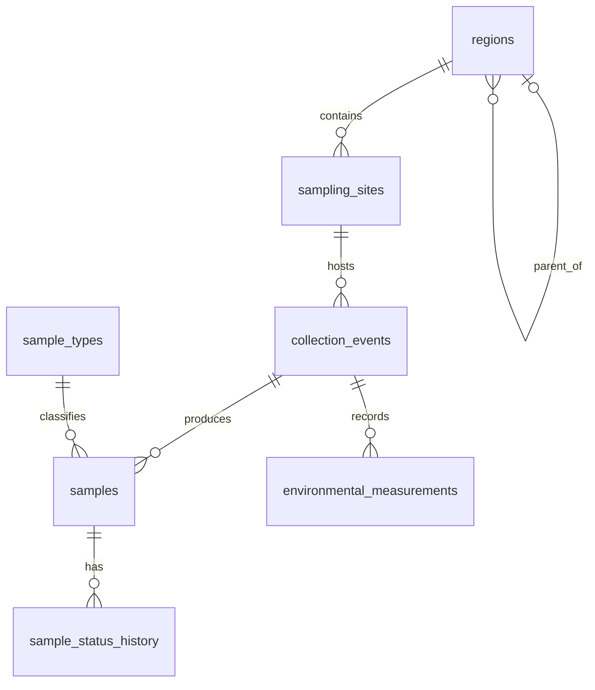

# Field & Samples

> **Owner:** D (Docs & Demo)
>
> **Related task:** T15-D, GitHub issue [#24](https://github.com/arvnd108/eBioTrack/issues/24)

This slice records where samples are collected, when collection events happen, and the basic details of each sample. The views below give API routes and pages a consistent read-only shape without repeating joins and aggregation logic.

## Views

### `v_sample_registry`

**Purpose:** one row per sample, including its collection details.

| Column | Meaning |
|---|---|
| `sample_id` | Unique database ID for the sample. |
| `sample_code` | Human-readable, unique sample code. |
| `status` | Current sample status: `collected`, `stored`, `extracted`, `sequenced`, `analyzed`, `failed`, or `discarded`. |
| `sample_type` | Sample type name, such as water, soil, sediment, or air. |
| `event_id` | ID of the collection event that produced the sample. |
| `site_id` | ID of the sampling site. |
| `site_name` | Name of the sampling site. |
| `project_id` | ID of the project associated with the collection event. |
| `project_title` | Project title. |
| `collected_at` | Collection date and time (`timestamptz`, stored in UTC). |
| `volume_ml` | Sample volume in millilitres; may be NULL if not recorded. |
| `depth_m` | Collection depth in metres; may be NULL if not recorded. |
| `storage_location` | Where the sample is stored; may be NULL if not recorded. |

**What the view hides:** it joins `samples` to `sample_types`, `collection_events`, `sampling_sites`, and `projects`. A consumer can display the sample and its related names without writing those joins again.

**Who uses it:** sample registry pages, sample API routes, and reporting/export code. It includes samples in every status, including failed samples; it does not silently filter them out.

**Expected fixture count:** 17 rows, one per seeded sample.

Example:

```sql
SELECT sample_id, sample_code, status, sample_type, site_name, project_title
FROM v_sample_registry
ORDER BY sample_id;
```

### `v_site_sample_summary`

**Purpose:** one row per sampling site, with collection activity and sample counts.

| Column | Meaning |
|---|---|
| `site_id` | Unique database ID for the site. |
| `site_name` | Sampling site name. |
| `region_id` | ID of the region containing the site. |
| `region_name` | Region name. |
| `habitat_type` | Site habitat, such as river or estuary. |
| `event_count` | Number of distinct collection events at the site. |
| `total_samples` | Total number of samples collected at the site. |
| `collected_count` | Samples currently in `collected` status. |
| `stored_count` | Samples currently in `stored` status. |
| `extracted_count` | Samples currently in `extracted` status. |
| `sequenced_count` | Samples currently in `sequenced` status. |
| `analyzed_count` | Samples currently in `analyzed` status. |
| `failed_count` | Samples currently in `failed` status. |
| `discarded_count` | Samples currently in `discarded` status. |
| `latest_collection_date` | Latest event collection timestamp; NULL if the site has no events. |

**What the view hides:** it joins sites to regions, collection events and samples, then groups the records by site and counts events and samples by status. It uses LEFT JOINs for events and samples, so a site with no collection activity still appears with zero counts.

**Who uses it:** site overview pages, dashboards and API routes that need a quick summary of collection activity.

**Expected fixture counts:** five site rows and 17 samples in total. For the current seed:

| Site | Events | Samples | Analyzed | Failed |
|---|---:|---:|---:|---:|
| Dakpathar Barrage | 2 | 5 | 4 | 1 |
| Okhla Barrage | 2 | 4 | 4 | 0 |
| Sangam Prayagraj | 2 | 4 | 4 | 0 |
| Diamond Harbour | 1 | 2 | 2 | 0 |
| Kakdwip Bay | 1 | 2 | 2 | 0 |
| **Total** | **8** | **17** | **16** | **1** |

Example:

```sql
SELECT site_name, event_count, total_samples, analyzed_count, failed_count,
       latest_collection_date
FROM v_site_sample_summary
ORDER BY site_id;
```

## Transaction scenario (T18-D)

`database/transactions/field_transaction.sql`. Scenario: **register a collection event with its samples and environmental measurements atomically**: one `collection_events` row, four `environmental_measurements` rows and three samples created through `register_sample()`, as one transaction that either commits completely or leaves no trace, audit rows and status-history rows included. This is the order `POST /api/events` follows (CONTRACT 10: event with created samples and measurements, one transaction). The script is a standalone demonstration run by hand with `psql`; `database/transactions/` is not run by the migration runner. It creates and deletes nothing: every transaction ends in `ROLLBACK`, so it can be run repeatedly and leaves the database unchanged (it asserts this itself, `audit_logs` included). Generated ids move on, since PostgreSQL never reuses a consumed identity value.

```bash
docker compose exec -T db psql -U ebiotrack -d ebiotrack -f - < database/transactions/field_transaction.sql
psql "$DATABASE_URL" -f database/transactions/field_transaction.sql
psql "$TEST_DATABASE_URL" -v keep=1 -f database/transactions/field_transaction.sql   # COMMIT Part 1 only; test database only, reset afterwards
```

Every transaction starts with `SET LOCAL app.current_user_id = '3'` (field researcher, the collector), as the backend does, and runs at the default READ COMMITTED level. Part 0 stops with a message if the fixture world is missing, or if a previous `keep=1` run left the demo event behind (reset the test database first). Each check prints one `PASS:` or `FAIL:` line.

| Part | What it does | Expected SQLSTATE | What is undone |
| --- | --- | --- | --- |
| 1, commit path | Insert the event, four measurements, three `register_sample()` calls; check rows, codes, history and audit | none | Default `ROLLBACK`: everything, including 3 history rows and 4 audit rows. With `keep=1` it is committed |
| 2, rollback A | Second `ph` measurement for the same event | `23505` (`uq_environmental_measurements_event_parameter`), then `25P02` | Event, four measurements and the event audit row |
| 3, B1 | Event for project 2 at site 1 | `23503` (`fk_collection_events_project_site`) | Nothing was written |
| 3, B2 | `collected_at` three days ahead | `23514` (`ck_collection_events_collected_at`) | Nothing was written |
| 3, B3 | Sample 1 fine, then sample type 999 | `23503` | Event, sample 1, its history row and audit rows |
| 3, B4 / B5 | Negative volume / negative depth | `23514` (raised by `register_sample`) | The event |
| 3, B6 | `UPDATE ... SET status = 'analyzed'` on a `collected` sample | `EB001` | The whole event and sample |
| 4, savepoint | Bad sample type, `ROLLBACK TO SAVEPOINT`, corrected sample | `23503` | Only the bad call; the event and sample 1 survive and the corrected sample reuses sequence `002` |
| 5, locking | Two sessions call `register_sample()` on the same event (protocol in the script comments) | none | See below |

Excerpt from a real run (default mode, development database after `npm run db:reset`; ids and codes differ per run):

```text
 event_id | project_id | site_id | collector_id |      collected_at      |         notes
     1000 |          1 |       1 |            3 | 2026-06-15 08:00:00+00 | T18-D field trip demo

 sample_id |     sample_code      |  status   | sample_type_id | volume_ml | depth_m | storage_location
      1000 | EB-20260615-1000-001 | collected |              1 |   1000.00 |    0.50 |
      1001 | EB-20260615-1000-002 | collected |              1 |    500.00 |    1.00 |
      1002 | EB-20260615-1000-003 | collected |              3 |           |         | Freezer D-1

    entity_type    | action | actor_id | rows
 collection_events | insert |        3 |    1
 samples           | insert |        3 |    3

 PASS: 4 audit rows (1 event insert + 3 sample inserts), all with actor 3
 PASS: v_site_sample_summary for site 1 gained 1 event and 3 samples
 PASS: B3 raised 23503 (sample type 999 does not exist)
 PASS: events, samples, measurements, history and audit rows all equal the baseline
```

`environmental_measurements` and `sample_status_history` have no audit trigger, so only the event and the three samples appear in the audit rows. `register_sample()` writes each sample's first history row; the update trigger adds none (three history rows for three samples).

### Two-session protocol (Part 5)

A single script cannot run two sessions, so Part 5 is a copy-paste protocol in the script. S1 runs `register_sample(1, ...)` and keeps the transaction open; S2 calls it for the same event and **blocks** on the `FOR UPDATE` lock on the event row (`pg_stat_activity` shows `wait_event_type = Lock`, `wait_event = transactionid`). When S1 commits, S2 unblocks at once and gets the next sequence number; when S1 rolls back, S2 gets the number S1 had. Never a duplicate code, never `23505` on `samples_sample_code_key`. Under READ COMMITTED S2 does not see S1's uncommitted sample. The second protocol (status against status) shows S2 blocked on the sample row until S1 commits, then refused with `EB001: Invalid sample status transition: stored -> collected`. The committed helper sample from that protocol is removed by resetting the test database (no `DELETE`, D19).

### ACID mapping

| Property | Where shown |
| --- | --- |
| Atomicity | Part 1 (event + 4 measurements + 3 samples + 3 history rows + 4 audit rows together), Parts 2 and 3 (nothing remains after the failure) |
| Consistency | Part 3 (foreign key, CHECK, procedure validation, `EB001` transition trigger) |
| Isolation | Part 5 (blocking on the event row lock, no duplicate sample codes, invisibility of uncommitted work) |
| Durability | Part 1 with `keep=1` (the committed event survives the session; a reset removes it) |

Part 4 adds a `SAVEPOINT` variant: it recovers from one bad sample without redoing the event, and is not needed for the all-or-nothing guarantee. The automated versions of these assertions are the field cases of T32 (transactions) and T34 (concurrency).

## Design notes

- Both views are read-only query interfaces; they do not replace the normalized source tables.
- View names follow the project contract's `v_<name>` convention.
- Column names use `snake_case`, consistent with the database and API contract.
- No `ORDER BY` is built into either view. A query using a view should specify its own ordering.
- The site summary uses `COUNT(DISTINCT ce.event_id)` so an event is counted once even when it has multiple samples. Sample counts are calculated from `samples`, not from event counts.
- The SQL is designed to be safely re-applied by the project's database object runner. If a future change renames or removes a view column, the existing view must be dropped before recreating it because PostgreSQL's `CREATE OR REPLACE VIEW` cannot remove or rename existing columns.

## Indexes (T19-D)

`database/indexes/field_indexes.sql` (issue #40, applied by hand and safe to run twice) creates four indexes and documents a fifth that already exists: the unique index `samples_sample_code_key`. T19-D asked for two (the unique index and `idx_collection_events_site_id_collected_at`); the follow-up PR added `idx_samples_event_id`, `idx_sample_status_history_sample_id` and `idx_samples_sample_code_pattern` after measuring them with the audit and status-history triggers enabled. The full `EXPLAIN (ANALYZE, BUFFERS)` evidence, the variants tried and the write cost are in the comment blocks of that file; the exact statements are labelled `FQ1` to `FQ6` in the T19-D section of `tests/performance/explain-benchmarks.sql`. All figures: `ebiotrack_test` (PostgreSQL 16, collation `en_US.utf8`), `npm run volume:load -- --scale medium` (20 008 events, 100 017 samples, 400 084 status-history rows) plus 80 000 generated measurements, because the volume generator creates none; median of 5 runs after one warm-up, baseline taken before each index, `VACUUM (ANALYZE)` before each plan set.

| Index | Table | Serves | Size | Before -> after |
| --- | --- | --- | --- | --- |
| `samples_sample_code_key` (`sample_code`), from the `UNIQUE` | `samples` | exact code lookup (FQ1), uniqueness of codes | 4056 kB | without it: Seq Scan, 1344 buffers, 3.095 ms; with it: Index Scan, 4 buffers, 0.007 ms (about 440x) |
| `idx_collection_events_site_id_collected_at` (site_id, collected_at) | `collection_events` | events of a site in a date range, T14 Q3 with a site, `GET /api/events?site_id=` | 632 kB | one year (78 events) 0.751 -> 0.036 ms (188 -> 66 buffers); one month 0.963 -> 0.010 ms; whole site 0.464 -> 0.039 ms; T14 Q3, one site 0.596 -> 0.168 ms |
| `idx_samples_event_id` (event_id) | `samples` | samples of one event, `GET /api/events/:id`, `GET /api/samples?event_id=`, `v_site_sample_summary`, the count inside `register_sample()` | 1152 kB | samples of one event (FQ5b) 2.092 ms, 1334 buffers -> 0.004 ms, 3 buffers; `v_site_sample_summary` for one site (FQ5d) 6.196 -> 0.219 ms; `register_sample()` count 2.034 -> 0.005 ms |
| `idx_sample_status_history_sample_id` (sample_id) | `sample_status_history` | history of one sample, Q2 (`field_event_samples_latest_status`) | 4832 kB | Q2 for one event, with `samples (event_id)`: 64.031 ms, 5160 buffers -> 0.052 ms, 13 buffers (see the table below) |
| `idx_samples_sample_code_pattern` (sample_code `text_pattern_ops`) | `samples` | `GET /api/samples?q=`, a case-insensitive prefix of the code | 3992 kB | rarest year prefix (FQ2a) 5.070 ms, 1334 buffers -> 0.011 ms, 4 buffers; one event's codes (FQ2d) 3.460 -> 0.006 ms; 12% prefix (FQ2b) 4.439 -> 2.192 ms |

Q2 (FQ5a, one event) needs both foreign-key indexes. The four combinations:

| `samples (event_id)` | `sample_status_history (sample_id)` | Time | Buffers |
| --- | --- | --- | --- |
| no | no | 64.031 ms | 5160 |
| yes | no | 61.934 ms | 3962 |
| no | yes | 2.208 ms | 1344 |
| yes | yes | 0.052 ms | 13 |

Row counts and `md5` checksums of FQ1, FQ2a-d, FQ5a-d are identical with no new index, with each one alone and with all of them. FQ2c (a prefix matching 88% of the table) and FQ5c (Q1 reads every sample) are unchanged, and FQ1 stays at 4 buffers (with both indexes present the planner may answer an exact code lookup from the pattern index; the unique index is still needed for uniqueness): the planner correctly ignores the pattern index when almost every row matches. FQ5c stays at about 40 ms and FQ2c at a Seq Scan; its time was 6.3 ms before and 8.1 ms with the indexes in place (same plan and buffers, cause not determined).

### Write cost with the triggers enabled

Measured on the real tables with `trg_samples_status_transition`, `trg_samples_status_history` and `trg_samples_audit` enabled, in rolled-back transactions (FQ6 in the benchmark file): (a) `register_sample()` for 1 000 samples spread over 20 events (1 000 samples, history rows and audit rows each), and (b) 1 000 status changes `collected -> stored`, which fire the transition, history and audit triggers. Median of 5 after one warm-up.

| Index set | (a) register 1 000 | (b) 1 000 status changes |
| --- | --- | --- |
| none | 2 267.7 ms | 41.0 ms |
| `samples (event_id)` only | 79.2 ms | 41.8 ms (+2%) |
| `sample_status_history (sample_id)` only | 2 265.8 ms | 42.3 ms (+3%) |
| pattern index only | 2 263.6 ms | 43.9 ms (+7%) |
| event + history | 81.0 ms | 42.8 ms (+4%) |
| all three | 83.8 ms | 44.8 ms (+9%) |

A status change costs about 4 microseconds more per row with all three (+9%): small next to the history and audit rows the triggers already write. Registering samples is 27 times faster, because `register_sample()` counts the event's existing samples under the event lock and that count no longer reads the whole table. Rolled-back inserts still consume identity values.

Findings:

- **The composite index helps the filter, not the sort.** After the index the plan is a Bitmap Heap Scan followed by a Sort of the 78 rows: they are spread over 64 pages, so the planner fetches them in page order and sorts. A date range without a `site_id` (FQ3d) and the T14 query for all sites (FQ4b, which reads every event) cannot use it: 0.819 ms and 24.824 ms stay unchanged.
- **PostgreSQL does not index foreign keys.** `samples.event_id` and `sample_status_history.sample_id` are foreign keys, and nothing indexed them until the follow-up; leading-column rule applies as well: the composite index serves only filters that include `site_id`.
- **Prefix search needs `text_pattern_ops` unless the column collation is `C`.** The unique index is not used for `LIKE 'EB-2025%'` under `en_US.utf8`: Seq Scan, 1334 buffers. `GET /api/samples?q=` upper-cases `q` and runs `LIKE $6 || '%' ESCAPE '\'` (`backend/src/services/samples.service.js`), a prefix search, so the pattern index is created. The route's own SQL was checked with `PREPARE`: with a custom plan (what the `pg` driver's unnamed statements get) it is an Index Scan on `idx_samples_sample_code_pattern`; a forced generic plan cannot use an index for the `($6 IS NULL OR ...)` form. The unique constraint needs the default operator class, so the pattern index is a second index on the column, not a replacement. A substring search (`LIKE '%x%'`) is served by neither; `pg_trgm` would need an extension and was not created.
- **Not part of the migration runner.** `backend/src/db/migrate.js` does not run `database/indexes/`; these indexes exist only when the file is applied by hand. Whether the runner should apply the directory is a backend decision, not changed here.

## T40-D: Schema and normalization notes

### Relation inventory

| Relation | Purpose, key and constraints |
|---|---|
| `regions` | Geographic hierarchy; PK `region_id`; optional self-FK `parent_region_id` (delete sets NULL); unique `(name, region_type)`; `name` and `region_type` (enum `region_type`) NOT NULL. |
| `sampling_sites` | Collection locations; PK `site_id`; FK `region_id`; unique `(region_id,name)`; latitude/longitude range checks; all columns except `description` NOT NULL; `habitat_type` is an enum; `created_by` references `users` (migration 090). |
| `sample_types` | Controlled sample-type vocabulary; PK `sample_type_id`; unique `type_name`; NOT NULL. |
| `collection_events` | Collection visit; PK `event_id`; FKs to site, collector and project; `project_id`, `site_id`, `collector_id`, `collected_at` NOT NULL; `project_id` and `collector_id` reference `projects` and `users`, and `(project_id, site_id)` references `project_sites` so an event can only happen at a site its project may use (all in migration 090); `collected_at` may be at most one day ahead. |
| `samples` | Physical samples; PK `sample_id`; FKs to event and type; unique `sample_code`; positive volume and nonnegative depth checks; status is the enum `sample_status` (NOT NULL, default `collected`); `volume_ml`, `depth_m` and `storage_location` are optional. |
| `environmental_measurements` | Event readings; PK `measurement_id`; FK to event; unique `(event_id,parameter)`; `parameter`, `value` and `unit` NOT NULL (`unit` is free text per reading). |
| `sample_status_history` | Status audit trail; PK `history_id`; FK to sample; stores old/new status (enum `sample_status`; `old_status` NULL for the first row), `changed_by` (nullable, references `users` in migration 090), time and note. |

### Functional dependencies and normal forms

Under the declared key constraints, each relation is in BCNF: every non-trivial determinant is a candidate key. The principal dependencies are:

- `regions`: `region_id → name, region_type, parent_region_id`; alternate `(name,region_type)` determines the row.
- `sampling_sites`: `site_id → region_id, name, coordinates, habitat, description, creator, created_at`; alternate `(region_id,name)` determines the row.
- `sample_types`: `sample_type_id → type_name`; `type_name → sample_type_id`.
- `collection_events`: `event_id → project_id, site_id, collector_id, collected_at, notes, created_at`.
- `samples`: `sample_id → event_id, sample_type_id, sample_code, volume_ml, depth_m, storage_location, status, created_at`; `sample_code` is an alternate unique key.
- `environmental_measurements`: `measurement_id → event_id, parameter, value, unit, created_at`; alternate `(event_id,parameter)` determines reading details.
- `sample_status_history`: `history_id → sample_id, old_status, new_status, changed_by, changed_at, note`.

**Exception, `environmental_measurements`:** the domain suggests `parameter → unit` (pH is always unitless, temperature always °C), but `unit` is stored on every reading and no parameters table exists. If that rule were enforced, the relation would violate 2NF (and so 3NF and BCNF), because `parameter` is only a part of the key `(event_id, parameter)`. This is a deliberate denormalization: the database does not enforce the rule, so it is not a declared dependency; the table is BCNF only under the declared keys. Adding a `parameters(parameter, unit)` table would remove the repetition at the cost of a join and a fixed vocabulary.

These claims rely on declared keys and the stated domain dependencies; they do not assume undocumented business rules. Facts are stored with their owning entity: sites reference regions, events reference sites/projects, samples reference events/types, and measurements/history are child relations. This avoids repeating descriptive parent data and avoids partial/transitive dependencies.

**Intentional duplication:** `samples.status` is the current-state field for efficient reads; `sample_status_history` preserves the audit trail. The two serve different purposes. Views are derived at query time, not persisted duplicate base facts. `sample_code` is a stable unique business identifier generated by `register_sample()` in the form `EB-YYYYMMDD-<event_id>-<sequence>`. It repeats the collection date (UTC) and the event id, and the sequence is the sample's position within the event. It is derived data, kept deliberately because the code is printed on labels and must never change, even if the event is later edited; `UNIQUE (sample_code)` is the key. The procedure writes every code the application creates; the seed inserts its 17 codes directly, in the same format, and no constraint checks the format.

The unified table-by-table analysis of this slice (candidate keys, dependencies that hold and do not hold, each normal form, the probes) is in [normalization.md, section 8.2](../normalization.md#82-field--samples-migration-020).

### ER fragment

`regions |o--o{ regions` reads "a region has zero or one parent and zero or more children" (`parent_region_id` is nullable); every other line is `||--o{` because its foreign key is NOT NULL.



### Query, view and write-path inventory

- Queries: `database/queries/field_queries.sql`: site sample counts by status; event sample listing with latest status history; time-ordered environmental readings with moving-average analysis.
- `v_sample_registry` (`database/views/field_views.sql`): one row/sample; columns `sample_id, sample_code, status, sample_type, event_id, site_id, site_name, project_id, project_title, collected_at, volume_ml, depth_m, storage_location`.
- `v_site_sample_summary`: one row/site, including sites without samples; columns `site_id, site_name, region_id, region_name, habitat_type, event_count, total_samples, collected_count, stored_count, extracted_count, sequenced_count, analyzed_count, failed_count, discarded_count, latest_collection_date`.
- Procedure `register_sample(BIGINT,BIGINT,NUMERIC,NUMERIC,TEXT,BIGINT) RETURNS BIGINT` (`database/procedures/field_procedures.sql`) validates inputs, locks the event while allocating a code, inserts the sample and its initial history row.
- `trg_samples_status_transition` rejects invalid status transitions; `trg_samples_status_history` records actual changes. Optional shared audit triggers cover samples, events and sites when the common audit function is installed. Definitions: `database/triggers/field_triggers.sql`.

### Transaction and indexes

`database/transactions/field_transaction.sql` demonstrates one atomic collection event with four measurements and three samples. By default it rolls back; test-only `keep=1` commits the happy path. Failure cases cover uniqueness, FK, CHECK, procedure validation and transition rejection; SAVEPOINT recovery and two-session event locking are demonstrated. Use only in a development/test database.

`database/indexes/field_indexes.sql` creates four indexes: `(site_id, collected_at)` on events for site/date filtering, `samples(event_id)`, `sample_status_history(sample_id)` and a `text_pattern_ops` index on `samples(sample_code)` for prefix lookup. The unique sample-code index is not created here: the `UNIQUE` constraint in migration 020 creates it, and the file only documents it. The index script is applied separately from migrations; a reset database should not be assumed to have these indexes until the script is run. The composite site/date index supports site-scoped chronological event access; event/sample and sample/history indexes support joins and history retrieval. Indexes improve reads but add storage and write maintenance.

### Source files

Schema: `database/migrations/020_field_samples.sql`; queries: `database/queries/field_queries.sql`; views: `database/views/field_views.sql`; procedure: `database/procedures/field_procedures.sql`; triggers: `database/triggers/field_triggers.sql`; transaction: `database/transactions/field_transaction.sql`; indexes: `database/indexes/field_indexes.sql`.
