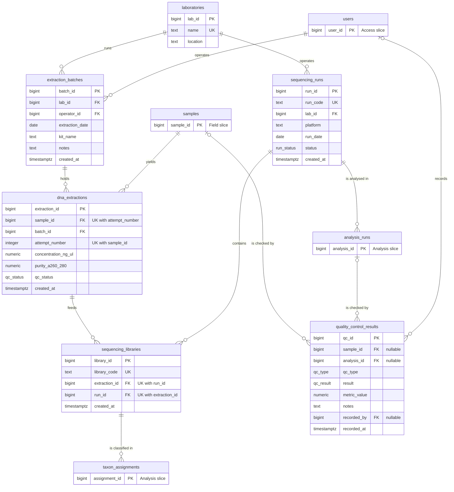

# lab

> **Owner:** B (Frontend)
>
> Slice write-up and normalization notes: Laboratory & Sequencing

## Overview

The Laboratory & Sequencing slice records what a laboratory does with a collected sample after it arrives:

1. A lab technician extracts DNA from a sample. Extractions are done in **batches** (`extraction_batches`) on one day, by one operator, in one lab, with one kit.
2. Each extracted DNA aliquot is one **extraction** (`dna_extractions`) with a measured concentration and purity. A sample can be extracted again after a poor result, so an extraction has an **attempt number** per sample.
3. The technician records **QC results** (`quality_control_results`) such as blanks, controls, concentration and contamination checks, and sets a QC verdict (`pending`, `pass` or `fail`) on the extraction.
4. Only extractions that passed QC are made into **libraries** (`sequencing_libraries`) and loaded on a **sequencing run** (`sequencing_runs`). A run belongs to a lab and moves through `planned`, `running`, `completed` or `failed`.
5. The analysis slice then processes a run (`analysis_runs.run_id`) and assigns taxa to libraries (`taxon_assignments.library_id`).

Data flow: `samples` → `dna_extractions` (in an `extraction_batches` batch) → QC (`quality_control_results`, `qc_status`) → `sequencing_libraries` → `sequencing_runs` → `analysis_runs` / `taxon_assignments`.

**Who uses it.** The lab technician (role `lab_technician`) records extractions, QC and runs; the administrator and the principal investigator (for their own projects) may do the same; analysts, field researchers and viewers read lab data (CONTRACT 9). The Lab processing page and the `/api/extraction-batches`, `/api/extractions`, `/api/qc-results` and `/api/sequencing-runs` routes work on these tables.

**Connections to the other slices.**

| Direction | Table or column | Slice | Constraint |
| --- | --- | --- | --- |
| This slice references | `samples` (`dna_extractions.sample_id`, `quality_control_results.sample_id`) | Field & Samples | `fk_dna_extractions_sample_id`, `fk_quality_control_results_sample_id` |
| This slice references | `users` (`extraction_batches.operator_id`, `quality_control_results.recorded_by`) | Access, Projects & Audit | `fk_extraction_batches_operator_id`, `fk_quality_control_results_recorded_by` |
| This slice references | `analysis_runs` (`quality_control_results.analysis_id`) | Analysis, Taxonomy & Analytics | `fk_quality_control_results_analysis_id` |
| Referenced by | `analysis_runs.run_id` → `sequencing_runs` | Analysis, Taxonomy & Analytics | `fk_analysis_runs_run_id` |
| Referenced by | `taxon_assignments.library_id` → `sequencing_libraries` | Analysis, Taxonomy & Analytics | `fk_taxon_assignments_library_id` |

These cross-slice foreign keys are added in `database/migrations/090_cross_slice_constraints.sql`, so `030_lab_sequencing.sql` applies on its own.

**Seeded data** (`database/seeds/030_seed_lab.sql`): 2 laboratories, 3 extraction batches, 17 extractions (one per seeded sample, extractions 1-16 `pass`, extraction 17 `fail`), 2 sequencing runs (both `completed`), 16 libraries (library *n* from extraction *n*) and 23 QC results.

## Schema

All six tables are in `database/migrations/030_lab_sequencing.sql`. Identity columns are `GENERATED BY DEFAULT AS IDENTITY (START WITH 1000)`, so seed rows use explicit ids below 1000 (D6). Every foreign key inside the slice is `ON DELETE RESTRICT`: scientific records are never hard-deleted (D19). The cross-slice foreign keys added in 090 have no `ON DELETE` clause, which in PostgreSQL means `NO ACTION`: deleting the referenced row is refused as well.

### `laboratories`

One row is one physical laboratory that runs extraction batches and sequencing runs.

| Column | Type | Null? | Default | Rule / notes |
| --- | --- | --- | --- | --- |
| `lab_id` | bigint | no | identity from 1000 | Primary key |
| `name` | text | no | | Unique; not blank |
| `location` | text | yes | | Free text, for example a city |

**Keys.** Primary key `pk_laboratories` (`lab_id`). Candidate key `uq_laboratories_name` (`name`). No foreign keys.

**Constraints.** `ck_laboratories_name_not_blank`: `length(btrim(name)) > 0`, the name is not empty or only spaces.

### `extraction_batches`

One row is one extraction session: a set of extractions done in one lab by one operator on one date.

| Column | Type | Null? | Default | Rule / notes |
| --- | --- | --- | --- | --- |
| `batch_id` | bigint | no | identity from 1000 | Primary key |
| `lab_id` | bigint | no | | Lab that ran the batch |
| `operator_id` | bigint | no | | Technician who ran it; FK added in 090 |
| `extraction_date` | date | no | | Day of the extraction |
| `kit_name` | text | yes | | Extraction kit used |
| `notes` | text | yes | | Free text |
| `created_at` | timestamptz | no | `now()` | Row creation time |

**Keys.** Primary key `pk_extraction_batches` (`batch_id`). No other candidate key. Foreign keys: `fk_extraction_batches_lab_id` (`lab_id` → `laboratories`, `ON DELETE RESTRICT`); `fk_extraction_batches_operator_id` (`operator_id` → `users`, added in 090, `NO ACTION`).

**Constraints.** None besides keys and `NOT NULL`.

### `dna_extractions`

One row is one DNA extraction attempt for one sample, inside one batch, with its measurements and QC verdict.

| Column | Type | Null? | Default | Rule / notes |
| --- | --- | --- | --- | --- |
| `extraction_id` | bigint | no | identity from 1000 | Primary key |
| `sample_id` | bigint | no | | Extracted sample; FK added in 090 |
| `batch_id` | bigint | no | | Batch of this extraction |
| `attempt_number` | integer | no | `1` | 1 for the first extraction of the sample, 2 for the first re-extraction, and so on |
| `concentration_ng_ul` | numeric(10,3) | yes | | DNA concentration in ng/uL |
| `purity_a260_280` | numeric(5,2) | yes | | A260/280 absorbance ratio |
| `qc_status` | qc_status | no | `'pending'` | `pending`, `pass` or `fail` |
| `created_at` | timestamptz | no | `now()` | Row creation time |

**Keys.** Primary key `pk_dna_extractions` (`extraction_id`). Candidate key `uq_dna_extractions_sample_attempt` (`sample_id`, `attempt_number`). Foreign keys: `fk_dna_extractions_batch_id` (`batch_id` → `extraction_batches`, `ON DELETE RESTRICT`); `fk_dna_extractions_sample_id` (`sample_id` → `samples`, added in 090, `NO ACTION`).

**Constraints.** `ck_dna_extractions_attempt_number`: `attempt_number >= 1`. `ck_dna_extractions_concentration`: `concentration_ng_ul >= 0` (NULL, a missing measurement, passes). `ck_dna_extractions_purity`: `purity_a260_280 >= 0` (NULL passes).

### `sequencing_runs`

One row is one run of a sequencing instrument in one lab.

| Column | Type | Null? | Default | Rule / notes |
| --- | --- | --- | --- | --- |
| `run_id` | bigint | no | identity from 1000 | Primary key |
| `run_code` | text | no | | Business identifier, `RUN-<run_id>`; unique; not blank |
| `lab_id` | bigint | no | | Lab that operates the run |
| `platform` | text | no | | Instrument or platform name; not blank |
| `run_date` | date | yes | | Date of the run; may be unknown |
| `status` | run_status | no | `'planned'` | `planned`, `running`, `completed` or `failed` |
| `created_at` | timestamptz | no | `now()` | Row creation time |

**Keys.** Primary key `pk_sequencing_runs` (`run_id`). Candidate key `uq_sequencing_runs_run_code` (`run_code`). Foreign key `fk_sequencing_runs_lab_id` (`lab_id` → `laboratories`, `ON DELETE RESTRICT`). Referenced by `sequencing_libraries.run_id` and `analysis_runs.run_id`.

**Constraints.** `ck_sequencing_runs_run_code_not_blank`: `length(btrim(run_code)) > 0`. `ck_sequencing_runs_platform_not_blank`: `length(btrim(platform)) > 0`.

### `sequencing_libraries`

One row is one library: the DNA of one extraction loaded on one sequencing run. The table resolves the many-to-many relationship between extractions and runs.

| Column | Type | Null? | Default | Rule / notes |
| --- | --- | --- | --- | --- |
| `library_id` | bigint | no | identity from 1000 | Primary key |
| `library_code` | text | no | | Business identifier, `LIB-<library_id>`; unique; not blank |
| `extraction_id` | bigint | no | | Source extraction |
| `run_id` | bigint | no | | Run that sequences it |
| `created_at` | timestamptz | no | `now()` | Row creation time |

**Keys.** Primary key `pk_sequencing_libraries` (`library_id`). Candidate keys `uq_sequencing_libraries_library_code` (`library_code`) and `uq_sequencing_libraries_extraction_run` (`extraction_id`, `run_id`). Foreign keys: `fk_sequencing_libraries_extraction_id` (`extraction_id` → `dna_extractions`, `ON DELETE RESTRICT`); `fk_sequencing_libraries_run_id` (`run_id` → `sequencing_runs`, `ON DELETE RESTRICT`). Referenced by `taxon_assignments.library_id`.

**Constraints.** `ck_sequencing_libraries_library_code_not_blank`: `length(btrim(library_code)) > 0`. The same extraction may be on many runs over time, but at most once per run (`uq_sequencing_libraries_extraction_run`).

### `quality_control_results`

One row is one QC check, recorded against a sample, an analysis run, or both.

| Column | Type | Null? | Default | Rule / notes |
| --- | --- | --- | --- | --- |
| `qc_id` | bigint | no | identity from 1000 | Primary key |
| `sample_id` | bigint | yes | | Sample the check is about; FK added in 090 |
| `analysis_id` | bigint | yes | | Analysis run the check is about; FK added in 090 |
| `qc_type` | qc_type | no | | `extraction_blank`, `negative_control`, `positive_control`, `concentration`, `contamination_check` or `read_quality` |
| `result` | qc_result | no | | `pass`, `warn` or `fail` |
| `metric_value` | numeric | yes | | Measured value, if the check has one |
| `notes` | text | yes | | Free text |
| `recorded_by` | bigint | yes | | User who recorded it; FK added in 090 |
| `recorded_at` | timestamptz | no | `now()` | When it was recorded |

**Keys.** Primary key `pk_quality_control_results` (`qc_id`). No other candidate key. Foreign keys, all added in 090 with `NO ACTION`: `fk_quality_control_results_sample_id` (`sample_id` → `samples`); `fk_quality_control_results_analysis_id` (`analysis_id` → `analysis_runs`); `fk_quality_control_results_recorded_by` (`recorded_by` → `users`).

**Constraints.** `ck_quality_control_results_target`: `sample_id IS NOT NULL OR analysis_id IS NOT NULL`, every result names a sample, an analysis run, or both.

## ER diagram

Tables of the other slices (`samples`, `users`, `analysis_runs`, `taxon_assignments`) appear as stubs with their key only. Cross-slice relationships are the ones added in 090.



A QC result has zero or one sample and zero or one analysis run (at least one of the two, `ck_quality_control_results_target`), so each `|o--o{` line is "a sample (or analysis run) has zero or more QC results, and a QC result has at most one of each".

## Normalization

**Notation.** `{A, B} → {C}` reads "A and B together determine C": two rows with the same A and B always have the same C. A **candidate key** is a minimal set of columns that determines every column of the table; the **primary key** is the one chosen. A column is **prime** if it belongs to some candidate key, otherwise **non-prime**. A **determinant** is the left side of a functional dependency (FD). `{key} → {all other columns}` is written out in full for each table.

**Normal forms used.** 1NF: every value is atomic and there are no repeating groups. 2NF: 1NF and no non-prime column depends on only a part of a composite candidate key. 3NF: 2NF and no non-prime column depends on another non-prime column. BCNF: every determinant of every non-trivial FD is a candidate key.

**How the FDs were checked.** They were derived from the meaning of the columns and the constraints in `database/migrations/030_lab_sequencing.sql`. Data cannot prove an FD but can refute one, so the seeded database (2 laboratories, 3 batches, 17 extractions, 2 runs, 16 libraries, 23 QC results) was queried for violations of each claimed FD; none was found.

**Result.** All six tables are in BCNF. Three design choices that a reader might take for a violation (the stored QC verdict, the generated codes, the either/or QC target) are explained under their tables.

### `laboratories` (`lab_id`, `name`, `location`)

- **Candidate keys:** `{lab_id}` (primary key) and `{name}` (`uq_laboratories_name`).
- **Functional dependencies:** `{lab_id} → {name, location}`; `{name} → {lab_id, location}`. `location` determines nothing: two laboratories can be in the same city.
- **1NF:** `name` and `location` are single text values. `location` is free text, not a list.
- **2NF:** both candidate keys are single columns, so no partial dependency is possible.
- **3NF:** the only non-prime column is `location`, and it determines no other column.
- **BCNF:** the determinants are `lab_id` and `name`, both candidate keys. **Highest form: BCNF.**
- **Anomalies avoided:** a laboratory's name and location are stored once, so renaming a laboratory is one `UPDATE` and batches and runs cannot show two spellings of it. A laboratory with batches or runs cannot be deleted (`ON DELETE RESTRICT` on `fk_extraction_batches_lab_id` and `fk_sequencing_runs_lab_id`).

### `extraction_batches` (`batch_id`, `lab_id`, `operator_id`, `extraction_date`, `kit_name`, `notes`, `created_at`)

- **Candidate keys:** `{batch_id}` only. No natural key exists: one lab can run several batches on the same day with the same operator and kit.
- **Functional dependencies:** `{batch_id} → {lab_id, operator_id, extraction_date, kit_name, notes, created_at}`. No other column determines another: an operator can work in several laboratories, a laboratory uses several kits, and a kit name says nothing about date or operator.
- **1NF:** all columns are atomic. `notes` is free text, not a list.
- **2NF:** the only candidate key is a single column.
- **3NF:** no non-prime column determines another non-prime column. In particular `kit_name` is a single descriptive attribute of the batch.
- **BCNF:** the only determinant is `batch_id`, the candidate key. **Highest form: BCNF.**
- **Design choice, no `kits` table.** A kit is not an entity here: only its name is recorded, with no kit-level attributes (supplier, lot, expiry). A `kits` table would hold one column besides its key. If kit attributes are needed later, `kit_name` becomes a foreign key. The cost of keeping it as text is that two batches can spell the same kit differently.
- **Anomalies avoided:** the laboratory is stored on the batch and not repeated on each extraction, so moving a batch to another laboratory is one update. A batch with extractions cannot be deleted (`ON DELETE RESTRICT` on `fk_dna_extractions_batch_id`).

### `dna_extractions` (`extraction_id`, `sample_id`, `batch_id`, `attempt_number`, `concentration_ng_ul`, `purity_a260_280`, `qc_status`, `created_at`)

- **Candidate keys:** `{extraction_id}` (primary key) and `{sample_id, attempt_number}` (`uq_dna_extractions_sample_attempt`). Prime columns: `extraction_id`, `sample_id`, `attempt_number`. Non-prime columns: `batch_id`, `concentration_ng_ul`, `purity_a260_280`, `qc_status`, `created_at`.
- **Functional dependencies:**
  - `{extraction_id} → {sample_id, batch_id, attempt_number, concentration_ng_ul, purity_a260_280, qc_status, created_at}`
  - `{sample_id, attempt_number} → {extraction_id, batch_id, concentration_ng_ul, purity_a260_280, qc_status, created_at}`
  - Dependencies that do **not** hold, and why: `{sample_id} → {batch_id}` fails because a re-extraction can be done in another batch; `{batch_id} → {sample_id}` fails because a batch holds many samples; `{concentration_ng_ul, purity_a260_280} → {qc_status}` fails because the verdict is a decision by the laboratory (thresholds, blanks, contamination checks), not a stored formula.
- **1NF:** all columns are atomic. `qc_status` is an enumerated type (`pending`, `pass`, `fail`), not a repeating group.
- **2NF:** the composite candidate key is `{sample_id, attempt_number}`. No non-prime column depends on `sample_id` alone or on `attempt_number` alone: the batch, measurements and verdict differ between attempts of one sample, and attempt number 1 means nothing without the sample.
- **3NF:** no non-prime column determines another non-prime column. `batch_id` leads to the batch's laboratory, date and kit, but those are stored in `extraction_batches`, not here.
- **BCNF:** the only determinants are the two candidate keys. **Highest form: BCNF.**
- **Deliberate redundancy: `qc_status` and `quality_control_results`.** A concentration check is also recorded as a `quality_control_results` row, so the same fact can be stored twice. This is not an FD violation: the verdict is not determined by any other column of this table, and the QC row is not determined by the extraction. It is a deliberate copy of the verdict as a flag on the extraction, because the trigger `trg_sequencing_libraries_qc_pass` and the procedures read it on every booking, and "can this be sequenced?" must be a lookup on one row, not an interpretation of QC rows. The consequence is that the two can disagree: the schema has no constraint tying an extraction's `qc_status` to the result of its concentration check, and `quality_control_results` names the sample, not the extraction. Keeping them consistent is the application's job.
- **Project and site are not stored.** They follow from `sample_id` through `samples` and `collection_events` (Field & Samples slice). `v_lab_pipeline_status`, `v_failed_qc` and queries Q2 and Q3 join to them. Storing them here would put the dependency `{sample_id} → {project_id, site_id}` in the wrong table.
- **No `lab_id` copy.** The laboratory is reached through the batch (`batch_id` → `extraction_batches.lab_id`). Copying it onto the extraction would add the dependency `{batch_id} → {lab_id}` to this table and break 3NF.
- **Anomalies avoided:** the attempt number is part of a key, so a sample cannot have two attempts with the same number (`23505`). A row cannot be deleted while a library uses it (`ON DELETE RESTRICT` on `fk_sequencing_libraries_extraction_id`), so no library can lose its source.

### `sequencing_runs` (`run_id`, `run_code`, `lab_id`, `platform`, `run_date`, `status`, `created_at`)

- **Candidate keys:** `{run_id}` (primary key) and `{run_code}` (`uq_sequencing_runs_run_code`).
- **Functional dependencies:** `{run_id} → {run_code, lab_id, platform, run_date, status, created_at}`; `{run_code} → {run_id, lab_id, platform, run_date, status, created_at}`. No other column determines another: a platform is used by many laboratories and runs, and `status` and `run_date` are independent.
- **1NF:** all columns are atomic. `status` is an enumerated type.
- **2NF:** both candidate keys are single columns.
- **3NF:** no non-prime column determines another. `platform` is a single descriptive attribute; no platform-level data (vendor, read length) is recorded, so there is no `platforms` table.
- **BCNF:** the determinants are `run_id` and `run_code`, both candidate keys. **Highest form: BCNF.**
- **Deliberate redundancy: `run_code`.** The procedure `create_sequencing_run` writes `run_code` as `RUN-` followed by `run_id` padded to at least 3 digits, so the code is derived from the key. It is kept as its own column because it is the business identifier shown to users, and it is a candidate key, so it creates no FD with a non-key determinant. The rule `run_code = 'RUN-' || lpad(run_id, 3)` is a convention of the procedure, not something the schema enforces or relies on: a run inserted with plain SQL may use any unique non-blank code.
- **No FD between the run's laboratory and the batch's laboratory.** `sequencing_runs.lab_id` (where the run happens) and `extraction_batches.lab_id` (where the DNA was extracted) are independent: samples can be extracted in one laboratory and sequenced in another. The seed shows it: run 2 belongs to laboratory 2 and holds libraries from batch 2 (laboratory 1) and batch 3 (laboratory 2). So `lab_id` is not redundant on either table.
- **Anomalies avoided:** a run with libraries cannot be deleted (`ON DELETE RESTRICT` on `fk_sequencing_libraries_run_id`), and neither can a run with analyses (`fk_analysis_runs_run_id`), so a library cannot be orphaned.

### `sequencing_libraries` (`library_id`, `library_code`, `extraction_id`, `run_id`, `created_at`)

- **Candidate keys:** `{library_id}` (primary key), `{library_code}` (`uq_sequencing_libraries_library_code`) and `{extraction_id, run_id}` (`uq_sequencing_libraries_extraction_run`). Non-prime column: `created_at`.
- **Functional dependencies:**
  - `{library_id} → {library_code, extraction_id, run_id, created_at}`
  - `{library_code} → {library_id, extraction_id, run_id, created_at}`
  - `{extraction_id, run_id} → {library_id, library_code, created_at}`
  - Dependencies that do **not** hold: `{extraction_id} → {run_id}` fails because an extraction can be sequenced again on a later run; `{run_id} → {extraction_id}` fails because a run holds many libraries.
- **1NF:** all columns are atomic; there is no array of extractions on the run.
- **2NF:** the composite candidate key is `{extraction_id, run_id}`. The only non-prime column, `created_at`, depends on the whole key (one library per pair), not on `extraction_id` or `run_id` alone.
- **3NF:** there is a single non-prime column, so no dependency between non-prime columns is possible.
- **BCNF:** every determinant above is a candidate key. **Highest form: BCNF.** This follows from listing the determinants, not from the table having a surrogate key.
- **Associative entity.** The table resolves the many-to-many relationship between extractions and runs (an extraction can be on many runs over time, a run holds many extractions). It has its own identifier and attributes (`library_code`, `created_at`), and another table references it (`taxon_assignments.library_id`), which is why it has a surrogate key and not only the composite key.
- **Deliberate redundancy: `library_code`.** As with `run_code`, the procedures write `LIB-` followed by `library_id` padded to at least 4 digits. The code is a candidate key and the user-facing identifier. The derivation is a convention, not a dependency the schema relies on, and it does not break BCNF because `library_code` is a candidate key.
- **The booking rule is not an FD.** "An extraction is on at most one `planned` or `running` run" depends on the `status` of another table, so no key or FD of this table can express it. It is enforced by the procedures and a trigger.
- **Anomalies avoided:** the pair `{extraction_id, run_id}` cannot be inserted twice, so a library is not duplicated on a run; the run and the extraction cannot be deleted while the library exists.

### `quality_control_results` (`qc_id`, `sample_id`, `analysis_id`, `qc_type`, `result`, `metric_value`, `notes`, `recorded_by`, `recorded_at`)

- **Candidate keys:** `{qc_id}` only. The same sample can have several results of the same `qc_type` (a check can be repeated), so `{sample_id, qc_type}` is not a key.
- **Functional dependencies:** `{qc_id} → {sample_id, analysis_id, qc_type, result, metric_value, notes, recorded_by, recorded_at}`. No other FD holds. In particular `{metric_value} → {result}` does not hold: the pass or fail threshold depends on `qc_type`, thresholds are not stored, and some checks have no metric (the seeded `contamination_check` has `metric_value` NULL).
- **1NF:** all columns are atomic. `qc_type` and `result` are enumerated types.
- **2NF:** the only candidate key is a single column.
- **3NF:** no non-prime column determines another non-prime column (see `metric_value` and `result` above).
- **BCNF:** the only determinant is `qc_id`. **Highest form: BCNF.**
- **Either/or target.** A result is about a sample, an analysis run, or both, so `sample_id` and `analysis_id` are both nullable, with `ck_quality_control_results_target` requiring at least one. NULL here means "does not apply", not "unknown": a concentration check has a sample and no analysis; a read-quality check of an analysis has an analysis and no sample. This causes no FD or anomaly problem: `{qc_id} → {sample_id}` and `{qc_id} → {analysis_id}` hold whether or not the value is NULL, and the two columns do not determine each other. The alternative is two tables (sample QC and analysis QC) that repeat `qc_type`, `result`, `metric_value`, `notes`, `recorded_by` and `recorded_at` and must be combined with `UNION` to list all QC. One table with a `CHECK` keeps those columns once.
- **Limitation: no link to the extraction.** A result names the sample, not the extraction attempt, so for a re-extracted sample the table does not say which attempt a concentration check measured (only `recorded_at` hints at it).
- **Anomalies avoided:** a result cannot be inserted, or updated, into a row with no target (`23514`).

## Business rules and where they are enforced

The slice uses all four layers: the schema (keys, `CHECK`), triggers, stored procedures and the application. A rule is put in the lowest layer that can express it, because that layer also protects plain SQL.

| Rule | Enforced by | Object | Raises |
| --- | --- | --- | --- |
| Each re-extraction of a sample has its own attempt number, at least 1 | Schema | `uq_dna_extractions_sample_attempt`, `ck_dna_extractions_attempt_number` | `23505`, `23514` |
| The next attempt number is chosen (max + 1) | Application | `backend/src/services/extractions.service.js`, under `SELECT ... FOR UPDATE` on the sample row; no database object assigns it | n/a |
| Concentration and purity are not negative | Schema | `ck_dna_extractions_concentration`, `ck_dna_extractions_purity` | `23514` |
| An extraction is on a run at most once | Schema | `uq_sequencing_libraries_extraction_run` | `23505` |
| Run and library codes are unique and not blank | Schema | `uq_sequencing_runs_run_code`, `uq_sequencing_libraries_library_code`, `ck_sequencing_runs_run_code_not_blank`, `ck_sequencing_libraries_library_code_not_blank` | `23505`, `23514` |
| Laboratory name and run platform are not blank | Schema | `ck_laboratories_name_not_blank`, `ck_sequencing_runs_platform_not_blank` | `23514` |
| A QC result belongs to a sample, an analysis run, or both | Schema | `ck_quality_control_results_target` | `23514` |
| QC type, QC result, QC status and run status take only listed values | Schema (enumerated types) | `qc_type`, `qc_result`, `qc_status`, `run_status` | `22P02` |
| Nothing in the slice is hard-deleted | Schema and roles | `ON DELETE RESTRICT` on the in-slice foreign keys; `NO ACTION` on the cross-slice ones; the application role has no `DELETE` on these tables (`database/roles/grants.sql`) | `23503`, `42501` |
| A library is built only from an extraction that passed QC | Trigger and procedure | `trg_sequencing_libraries_qc_pass`; `fn_lab_check_bookable`, called by `create_sequencing_run` and `assign_extraction_to_run` | `EB002` |
| An extraction is on at most one `planned` or `running` run | Procedure with a row lock | `create_sequencing_run`, `assign_extraction_to_run` (`SELECT ... FOR UPDATE` in ascending id order) | `EB002` |
| Booking is refused under REPEATABLE READ | Procedure | `fn_lab_require_safe_isolation` | `EB002` |
| A run changes status only along `planned` → `running` → `completed` or `failed`, and `planned` → `failed` | Trigger | `trg_sequencing_runs_status` | `EB001` |
| A QC verdict is decided once (`pending` → `pass` or `fail`) | Trigger | `trg_dna_extractions_qc_status` | `EB001` |
| Recording an extraction moves its sample from `stored` to `extracted` | Trigger | `trg_dna_extractions_sample_status` | n/a |
| Changes to extractions, libraries, runs and QC results are audited with the acting user | Trigger | `trg_dna_extractions_audit`, `trg_sequencing_libraries_audit`, `trg_sequencing_runs_audit`, `trg_quality_control_results_audit`; the user comes from `app.current_user_id` | n/a |
| Who may record or read lab data | Application | CONTRACT 9 permission matrix, applied by the lab routes (`backend/src/routes/extractions.routes.js`, `backend/src/routes/sequencing.routes.js`) | HTTP 403 |

The booking rule cannot be a `UNIQUE` constraint or a partial unique index, because the `status` it depends on is in `sequencing_runs` and the key is in `sequencing_libraries`; a constraint cannot span two tables. That is why it is a procedure with a row lock (see Procedures, and the two-session protocol under Transaction).

## Queries

`database/queries/lab_queries.sql` (T14-B). Each is a prepared statement with `$1` parameters; expected results for the seed are in the file.

| Name | Question | Parameter |
| --- | --- | --- |
| `q1_extraction_qc_by_batch` | Extractions per batch with QC pass rate | `lab_id` (NULL = all) |
| `q2_run_libraries_with_samples` | Libraries per run with their source samples | `run_id` (NULL = all) |
| `q3_samples_with_qc_problems` | Samples with failed or contaminated QC, with every reason | `project_id` (NULL = all) |

## Views

`database/views/lab_views.sql` (T15-B). Names fixed by CONTRACT 7.

### `v_lab_pipeline_status`

One row per sample (every sample, including ones not yet extracted). Collapses a sample's history to its latest extraction attempt and, for that extraction, the library on its most recent run (latest `run_date`, then newest `created_at`). Written for the Lab processing page, the lab routes and the dashboard; no API route reads it yet (the T22 routes and the T27 page work from the tables directly), so it serves ad hoc queries and reports for now.

| Column | Type | Meaning |
| --- | --- | --- |
| `sample_id` | bigint | Sample |
| `sample_code` | text | `EB-YYYYMMDD-EEEE-NNN` |
| `project_id` | bigint | Project of the sample's collection event (for access filtering) |
| `site_id` | bigint | Sampling site |
| `site_name` | text | Site name |
| `collected_at` | timestamptz | When the sample was collected |
| `sample_status` | sample_status | Current status from `samples` |
| `extraction_attempts` | bigint | Number of extraction attempts (0 if none) |
| `latest_extraction_id` | bigint | Latest attempt, NULL if not extracted |
| `latest_attempt_number` | integer | Attempt number of the latest extraction |
| `latest_qc_status` | qc_status | `pending`, `pass`, or `fail` for the latest extraction |
| `latest_concentration_ng_ul` | numeric(10,3) | Concentration of the latest extraction |
| `latest_purity_a260_280` | numeric(5,2) | A260/280 of the latest extraction |
| `batch_id` | bigint | Batch of the latest extraction |
| `lab_name` | text | Lab that ran that batch |
| `library_id` | bigint | Library from the latest extraction on its most recent run (by `run_date`), NULL if none |
| `library_code` | text | `LIB-NNNN` |
| `run_id` | bigint | That library's run |
| `run_code` | text | `RUN-NNN` |
| `run_status` | run_status | `planned`, `running`, `completed`, or `failed` |
| `run_date` | date | Run date |
| `pipeline_stage` | text | Derived stage, first match wins: `sample_failed` (sample `failed`/`discarded`), `not_extracted`, `extraction_qc_pending`, `extraction_failed`, `awaiting_library`, `run_planned`, `sequencing`, `sequenced`, `run_failed` |

**Pipeline stages** (`pipeline_stage`, first matching row of the table wins):

| `pipeline_stage` | Condition |
| --- | --- |
| `sample_failed` | the sample's status is `failed` or `discarded` |
| `not_extracted` | the sample has no extraction |
| `extraction_qc_pending` | the latest extraction's `qc_status` is `pending` |
| `extraction_failed` | the latest extraction's `qc_status` is `fail` |
| `awaiting_library` | the latest extraction passed QC and has no library |
| `run_planned` | its library's run is `planned` |
| `sequencing` | its library's run is `running` |
| `sequenced` | its library's run is `completed` |
| `run_failed` | its library's run is `failed` |

Seeded data: 17 rows; samples 1–16 `sequenced` (8 on `RUN-001`, 8 on `RUN-002`), sample 17 `sample_failed`.

### `v_failed_qc`

One row per QC problem on a sample or extraction: extractions whose `qc_status` is `fail`, `quality_control_results` rows with result `fail` or `warn` that name a sample, and those recorded against an analysis only (no `sample_id`), which are applied to every sample whose library is in that analysis's run (the same rule as Q3). Passing QC and pending extractions are left out. History is kept, so a failed attempt still appears after a later re-extraction passes. Used by the Lab processing page's QC list (T27) and QC reporting. For one row per sample, see Q3.

| Column | Type | Meaning |
| --- | --- | --- |
| `sample_id` | bigint | Sample with the problem |
| `sample_code` | text | Sample code |
| `project_id` | bigint | Project (for access filtering) |
| `site_name` | text | Site name |
| `extraction_id` | bigint | Failed extraction; NULL for rows from `quality_control_results` |
| `source` | text | `extraction`, `qc_result`, or `analysis_qc` (analysis-only QC applied to the samples of its run) |
| `qc_type` | qc_type | QC check type; NULL for `extraction` rows |
| `severity` | text | `fail` or `warn` |
| `metric_value` | numeric | Measured value (concentration for failed extractions), may be NULL |
| `reason` | text | QC notes, or a generated sentence for failed extractions |
| `recorded_by` | bigint | User who recorded it (batch operator for extractions) |
| `recorded_at` | timestamptz | When it was recorded |

Seeded data: 4 rows (no analysis-only QC is seeded). Sample 17: failed extraction 17, `concentration` fail (0.35 ng/µL), `contamination_check` fail. Sample 12: `negative_control` warn.

## Procedures

`database/procedures/lab_procedures.sql` (T16-B). The file is safe to run again (`CREATE OR REPLACE`). It holds the two procedures named in CONTRACT 7 and four helper functions. Both procedures are plain PL/pgSQL functions (not `SECURITY DEFINER`) and run in the caller's transaction, so the caller's `COMMIT` or `ROLLBACK` decides whether the run, its libraries and the audit rows are kept.

### `create_sequencing_run(p_lab_id bigint, p_platform text, p_run_date date, p_extraction_ids bigint[], p_actor_id bigint) RETURNS bigint`

Creates a `planned` run with code `RUN-<run_id>` and one library per extraction with code `LIB-<library_id>`; returns the new `run_id`.

1. Refuses REPEATABLE READ (`fn_lab_require_safe_isolation`).
2. Sets `app.current_user_id` to `p_actor_id` for the audit triggers, only if the caller has not already set it (`fn_lab_set_actor`; the setting is local to the transaction).
3. Refuses an empty list, and a list with a repeated or NULL id (`EB002`). The ids are sorted and de-duplicated.
4. Locks every extraction `FOR UPDATE` in **ascending `extraction_id` order** and checks each one with `fn_lab_check_bookable`.
5. Raises `23503` if an extraction id does not exist.
6. Inserts the run, then one library per extraction.

### `assign_extraction_to_run(p_run_id bigint, p_extraction_id bigint, p_actor_id bigint) RETURNS bigint`

Adds one extraction to an existing run as a new library with code `LIB-<library_id>`; returns the new `library_id`. It performs steps 1 and 2 above, then locks the run row `FOR UPDATE` first (so the run cannot start while a library is added), then the extraction row, and checks it with `fn_lab_check_bookable`.

### Errors

| Code | Raised when |
| --- | --- |
| `EB001` | `assign_extraction_to_run`: the run is not `planned` |
| `EB002` | the extraction has not passed QC; the extraction is already booked on a `planned` or `running` run; the id list is empty or has a repeated or NULL id; the call is made under REPEATABLE READ |
| `23503` | the laboratory, run or an extraction does not exist |

### Locking and isolation

Locking the extraction rows in one fixed order means two callers booking overlapping lists cannot wait on each other in a cycle, so there is no deadlock (`40P01`). A second caller that wants the same extraction blocks until the first commits or rolls back. Under READ COMMITTED (PostgreSQL's default, and what the backend uses) its next statement then sees the first caller's new library, and the booking check refuses it with `EB002`: exactly one wins. REPEATABLE READ would keep the old snapshot and miss that library, so the procedures refuse to run at that level. SERIALIZABLE is safe, because PostgreSQL aborts one of two conflicting transactions.

### Helper functions

| Function | Purpose |
| --- | --- |
| `fn_lab_code(p_prefix text, p_id bigint, p_width integer) RETURNS text` | Builds `RUN-001` or `LIB-0001`: zero-pads to at least `p_width` digits and never cuts a longer number |
| `fn_lab_require_safe_isolation() RETURNS void` | Raises `EB002` under REPEATABLE READ |
| `fn_lab_set_actor(p_actor_id bigint) RETURNS void` | Sets `app.current_user_id` for the transaction if it is unset |
| `fn_lab_check_bookable(p_extraction dna_extractions) RETURNS void` | For a row the caller has already locked: raises `EB002` if `qc_status` is not `pass`, or if the extraction is on a `planned` or `running` run |

### Usage

```sql
-- the backend passes these values as $1 to $5
SELECT create_sequencing_run(1, 'Illumina MiSeq', DATE '2026-06-01', ARRAY[1, 2, 3]::bigint[], 4);
-- a new planned run, libraries LIB-1000, LIB-1001, LIB-1002 on the first call after a reset
SELECT assign_extraction_to_run(1000, 4, 4);
-- ERROR EB001 if run 1000 is not planned; ERROR EB002 if extraction 4 is already booked or failed QC
SELECT create_sequencing_run(1, 'Illumina MiSeq', DATE '2026-06-01', ARRAY[17]::bigint[], 4);
-- ERROR EB002: Extraction 17 has not passed QC (qc_status fail)
```

The transaction scenario below shows the procedures with commit, rollback and two competing sessions.

## Triggers

`database/triggers/lab_triggers.sql` (T17-B). The file is safe to run again (`CREATE OR REPLACE FUNCTION`, `DROP TRIGGER IF EXISTS`). Triggers fire on plain SQL as well as through the procedures, so these rules hold for any writer.

| Trigger | On | Fires | Rule | Raises |
| --- | --- | --- | --- | --- |
| `trg_sequencing_libraries_qc_pass` (function `fn_sequencing_libraries_qc_pass`) | `sequencing_libraries` | `BEFORE INSERT OR UPDATE OF extraction_id` | A library may only be built from an extraction whose `qc_status` is `pass`. A missing extraction is left to `fk_sequencing_libraries_extraction_id` | `EB002` |
| `trg_sequencing_runs_status` (function `fn_sequencing_runs_status`) | `sequencing_runs` | `BEFORE UPDATE OF status` | Allowed: `planned` → `running`, `running` → `completed`, `running` → `failed`, `planned` → `failed`. Setting the status to its current value, or updating other columns, is allowed | `EB001` |
| `trg_dna_extractions_qc_status` (function `fn_dna_extractions_qc_status`) | `dna_extractions` | `BEFORE UPDATE OF qc_status` | A verdict is decided once: only `pending` → `pass` and `pending` → `fail`. A wrong verdict is corrected by recording a new attempt, so a booked extraction can never be marked `fail` under its library | `EB001` |
| `trg_dna_extractions_sample_status` (function `fn_dna_extractions_sample_status`) | `dna_extractions` | `AFTER INSERT` | Recording an extraction moves its sample from `stored` to `extracted` (the sample status history row is written by the Field & Samples trigger). Samples in any other status are left unchanged | none |
| `trg_dna_extractions_audit` | `dna_extractions` | `AFTER INSERT OR UPDATE OR DELETE` | Writes an `audit_logs` row through `audit_row_change('extraction_id')` | none |
| `trg_sequencing_libraries_audit` | `sequencing_libraries` | `AFTER INSERT OR UPDATE OR DELETE` | `audit_row_change('library_id')` | none |
| `trg_sequencing_runs_audit` | `sequencing_runs` | `AFTER INSERT OR UPDATE OR DELETE` | `audit_row_change('run_id')` | none |
| `trg_quality_control_results_audit` | `quality_control_results` | `AFTER INSERT OR UPDATE OR DELETE` | `audit_row_change('qc_id')` | none |

The four audit triggers use `audit_row_change()`, which belongs to the Access, Projects & Audit slice and takes the acting user from `current_setting('app.current_user_id')` (the backend sets it with `SET LOCAL` at the start of each transaction). `laboratories` and `extraction_batches` have no audit trigger. The audit block of the trigger file prints a notice and skips if `audit_row_change()` does not exist yet, so the file is run again once it does.

Two of these triggers, `trg_dna_extractions_qc_status` and `trg_dna_extractions_sample_status`, were added to the file by the lab routes task (T22); they are part of the slice's behaviour and are listed here for that reason.

## Transaction (T18-B)

`database/transactions/lab_transaction.sql` (issue #34). Scenario: **batch extraction entry, with row locking so two users cannot assign the same extraction to a run.** It is a standalone demonstration run by hand with `psql`; `database/transactions/` is not run by the migration runner. It creates and deletes nothing: every transaction ends in `ROLLBACK`, so it can be run repeatedly and leaves the database unchanged (it asserts this itself, `audit_logs` included). Generated ids move on, since PostgreSQL never reuses a consumed identity value.

```bash
docker compose exec -T db psql -U ebiotrack -d ebiotrack -f - < database/transactions/lab_transaction.sql
psql "$TEST_DATABASE_URL" -v keep=1 -f database/transactions/lab_transaction.sql   # COMMIT Parts 1 and 4; test database only, reset afterwards
```

The scenario re-extracts samples 6, 12 and 17 (all seeded samples already have an extraction, so batch entry is modelled as attempt 2 or later). Every transaction starts with `SET LOCAL app.current_user_id = '4'` (lab technician), as the backend does, and runs at the default READ COMMITTED level. Part 0 stops with a message if the fixture world is missing.

| Case | What it does | Expected SQLSTATE | What is undone |
| --- | --- | --- | --- |
| Part 1, commit path | Lock samples, insert batch, 3 extractions, 3 QC rows, set verdicts, `create_sequencing_run` for the 2 passing extractions | none | Default `ROLLBACK`: everything, including the audit rows. With `keep=1` it is committed and visible from another connection |
| Part 2, rollback A | Third extraction has a negative concentration | `23514` (`ck_dna_extractions_concentration`), then `25P02` for later statements | Batch and the two good extractions, with their audit rows |
| Part 3 B1 | Book a list that includes a failed extraction | `EB002` (has not passed QC) | Batch, extractions, QC rows and verdicts entered earlier in the same transaction |
| Part 3 B2 | Book an extraction on a second new run | `EB002` (already booked on run RUN-n) | The second run is refused; the whole transaction, including the first run and its libraries, is rolled back |
| Guard rail 1 | Call the procedure under `REPEATABLE READ` | `EB002` | Nothing was written |
| Guard rail 2 | Plain `INSERT INTO sequencing_libraries` for failed extraction 17 | `EB002` (`trg_sequencing_libraries_qc_pass`) | Nothing was written |
| Part 4, savepoint | Bad purity row, `ROLLBACK TO SAVEPOINT`, corrected row | `23514` | Only the bad row and its audit row; the batch and the good row survive |
| Part 5, locking | Two sessions book the same extraction (protocol in the script comments) | `EB002` for the second session after the first commits | The second session's attempt; one active run holds the extraction |

### Two-session protocol

A single script cannot run two sessions, so Part 5 is a copy-paste protocol in the script (S1, S2 and an observer S3): S1 `BEGIN` + `create_sequencing_run` for extraction X and keeps the transaction open; S2 books X and **blocks** on the procedure's `SELECT ... FOR UPDATE` (`pg_stat_activity` shows `wait_event_type = Lock`, `wait_event = transactionid`; `pg_locks` shows an ungranted `ShareLock`); S1 `COMMIT` makes S2 fail with `EB002` because, under READ COMMITTED, S2 then sees S1's library; exactly one planned/running run contains X. If S1 rolls back instead, S2 succeeds. Two sessions booking `[a, b]` and `[b, a]` do not deadlock, because the procedures lock in ascending id order; locking in the caller's order would end with `40P01`. Committed runs from this protocol are removed by `npm run db:reset` (no `DELETE`, D19). The automated version is `tests/concurrency/run-assignment.test.js` (T34).

### What each part demonstrates

- **Atomicity:** one transaction writes five tables (and the audit log); an error anywhere undoes all of it (Parts 2, 3), a savepoint undoes only part of it (Part 4).
- **Consistency:** check constraints (`23514`), the QC trigger and the procedures' booking rules (`EB002`) hold even when the batch is half entered.
- **Isolation:** row locks serialise two writers of the same extraction; at READ COMMITTED the second writer re-reads after the first commits (Part 5). `REPEATABLE READ` is refused (`EB002`).
- **Durability:** after `COMMIT` (`keep=1`) the rows are visible to a second connection and survive the session; they also survive a server restart because of the write-ahead log.

### Attempt numbers

No database object assigns `dna_extractions.attempt_number`; the table only has `uq_dna_extractions_sample_attempt`. The scenario computes `max(attempt_number) + 1` per sample inside the transaction after locking the sample rows `FOR UPDATE` in ascending id order. Without the lock, two technicians re-extracting the same sample would get `23505` on the unique constraint (safe, but a noisy failure). The backend service should follow the same pattern.

## Indexes (T19-B)

`database/indexes/lab_indexes.sql` (issue #38). Applied by hand with `psql -f` (the migration runner does not run `database/indexes/`, so the unindexed baseline stays available for benchmarks) and safe to run twice. Exactly two indexes, each chosen from measured `EXPLAIN (ANALYZE, BUFFERS)` plans on volume data.

| Index | Serves | Before | After | Size |
| --- | --- | --- | --- | --- |
| `idx_sequencing_libraries_run_id` on `sequencing_libraries (run_id)` | Q2, `GET /api/sequencing-runs/:id`, `RESTRICT` check on runs | Seq Scan, 2138 buffers, 3.273 ms | Index Scan, 1207 buffers, 0.300 ms (about 11x) | 688 kB |
| `idx_dna_extractions_batch_id` on `dna_extractions (batch_id)` | `GET /api/extractions?batch_id=`, one batch in Q1, FK check | Seq Scan, 1032 buffers, 2.407 ms | Index Scan, 3 buffers, 0.007 ms (about 340x) | 712 kB |

### Measurement

Test database `ebiotrack_test` loaded with `npm run volume:load -- --scale medium`: 100 017 extractions, 100 016 libraries, 1 002 runs, 2 003 batches (about 100 libraries per run, 50 extractions per batch). `ANALYZE` after loading and after creating the indexes. One session with `max_parallel_workers_per_gather = 0`, `jit = off` and `plan_cache_mode = force_custom_plan` (a prepared statement with `($1 IS NULL OR col = $1)` gets a generic plan that cannot use an index, so it was planned for its actual parameter, like the backend's literal-sized lookups); one warm-up, then the median of 5 runs; no `enable_*` setting changed. All pages were in shared buffers, so `Buffers: shared hit` is the fairer comparison than time. Benchmark queries, with ids looked up from the data:

- BQ1: `EXECUTE q2_run_libraries_with_samples(1000500)`
- BQ2a: `SELECT * FROM dna_extractions WHERE batch_id = 1000700`
- BQ2b: `EXECUTE q1_extraction_qc_by_batch(1)`
- BQ3a: `SELECT * FROM dna_extractions WHERE sample_id = 1040000`
- BQ3b: `SELECT * FROM v_lab_pipeline_status WHERE sample_id = 1040000`

| Query | Before: node, buffers, ms | After: node, buffers, ms | Factor |
| --- | --- | --- | --- |
| BQ1 | Seq Scan on `sequencing_libraries`, 2138, 3.273 | Index Scan using `idx_sequencing_libraries_run_id`, 1207, 0.300 | 10.9x |
| BQ2a | Seq Scan on `dna_extractions`, 1032, 2.407 | Index Scan using `idx_dna_extractions_batch_id`, 3, 0.007 | about 340x |
| BQ2b | Seq Scan + Hash Right Join, 1050, 16.099 | unchanged plan, 1050, 16.344 | none |
| BQ3a | Index Scan using `uq_dna_extractions_sample_attempt`, 3, 0.004 | unchanged, 3, 0.004 | none |
| BQ3b | Index (Only) Scans on `uq_dna_extractions_sample_attempt`, 27, 0.029 | unchanged, 27, 0.035 | none (noise) |

Abridged plans (BQ1 libraries scan and BQ2a):

```
before  Seq Scan on sequencing_libraries lib (actual time=1.496..2.942 rows=100)
          Rows Removed by Filter: 99916   Buffers: shared hit=935
after   Index Scan using idx_sequencing_libraries_run_id on sequencing_libraries lib (actual rows=100)
          Buffers: shared hit=4

before  Seq Scan on dna_extractions (rows=50)  Rows Removed by Filter: 99967
          Buffers: shared hit=1032   Execution Time: 2.407 ms
after   Index Scan using idx_dna_extractions_batch_id (rows=50)
          Buffers: shared hit=3      Execution Time: 0.007 ms
```

The results do not change: `Q1` for lab 1 (1 002 rows), `Q2` for run 1000500 (100 rows) and for all runs (100 016 rows), and `BQ2a` (50 rows) have identical row counts and `md5` checksums with and without the indexes.

### Already indexed by a constraint

PostgreSQL creates an index for every `PRIMARY KEY` and `UNIQUE` constraint, but not for foreign keys.

| Existing index | Leading column | Already serves |
| --- | --- | --- |
| `uq_dna_extractions_sample_attempt (sample_id, attempt_number)` | `sample_id` | `sample_id` lookups and `ORDER BY attempt_number DESC LIMIT 1` (the lateral in `v_lab_pipeline_status`) |
| `uq_sequencing_libraries_extraction_run (extraction_id, run_id)` | `extraction_id` | `extraction_id` lookups (booking check); **not** `run_id` alone |
| primary keys, `uq_sequencing_libraries_library_code`, `uq_sequencing_runs_run_code`, `uq_laboratories_name` | their own columns | their own lookups |

### Not indexed, and why

- **`dna_extractions (sample_id)` (named in the role document): redundant.** It is the leading column of `uq_dna_extractions_sample_attempt`, and BQ3a and BQ3b above show the planner already using that index, so a second index would add only write cost. `dna_extractions (batch_id)` replaces it as the second index.
- `sequencing_libraries (extraction_id)`: leading column of `uq_sequencing_libraries_extraction_run`.
- `extraction_batches (lab_id)`, `sequencing_runs (lab_id)`: 2 003 and 1 002 rows, and one lab owns about half of them. A sequential scan (17 and 12 buffers, about 0.4 ms) is the right plan.
- `quality_control_results (sample_id)`: the volume generator creates no QC rows, so there was nothing honest to measure.

### Trade-offs

Each index takes about 0.7 MB at this scale. Inserting about 100 000 rows into a temporary copy of the table (primary and unique indexes only, rolled back) took 181 ms without and 206 ms with `idx_sequencing_libraries_run_id` (+14%), and 97 ms without and 120 ms with `idx_dna_extractions_batch_id` (+24%). Real writes are a few rows at a time (booking a run, entering a batch), so the cost is small against the read gain. An index does not always win: Q1 as written reads every extraction to build the per-batch counts, so a sequential scan stays correct for it (BQ2b), and the same holds for any query that returns a large share of a table.

## Object inventory

Every database object of the slice, with the file that defines it.

| Type | Name | File | Purpose |
| --- | --- | --- | --- |
| Table | `laboratories` | `database/migrations/030_lab_sequencing.sql` | Physical laboratories |
| Table | `extraction_batches` | `database/migrations/030_lab_sequencing.sql` | Extraction sessions (lab, operator, date, kit) |
| Table | `dna_extractions` | `database/migrations/030_lab_sequencing.sql` | One DNA extraction attempt per sample, with measurements and QC verdict |
| Table | `sequencing_runs` | `database/migrations/030_lab_sequencing.sql` | Sequencing instrument runs |
| Table | `sequencing_libraries` | `database/migrations/030_lab_sequencing.sql` | Extraction-on-run link (associative entity) |
| Table | `quality_control_results` | `database/migrations/030_lab_sequencing.sql` | QC checks on samples or analysis runs |
| Cross-slice constraints | `fk_extraction_batches_operator_id`, `fk_dna_extractions_sample_id`, `fk_quality_control_results_sample_id`, `fk_quality_control_results_analysis_id`, `fk_quality_control_results_recorded_by` | `database/migrations/090_cross_slice_constraints.sql` | Foreign keys from this slice to `users`, `samples`, `analysis_runs` |
| Seed | lab fixture world | `database/seeds/030_seed_lab.sql` | 2 laboratories, 3 batches, 17 extractions, 2 runs, 16 libraries, 23 QC results |
| Query | `q1_extraction_qc_by_batch` | `database/queries/lab_queries.sql` | Extractions per batch with QC pass rate |
| Query | `q2_run_libraries_with_samples` | `database/queries/lab_queries.sql` | Libraries per run with their source samples and sites |
| Query | `q3_samples_with_qc_problems` | `database/queries/lab_queries.sql` | Samples with failed or contaminated QC and every reason |
| View | `v_lab_pipeline_status` | `database/views/lab_views.sql` | One row per sample with its latest extraction, library, run and pipeline stage |
| View | `v_failed_qc` | `database/views/lab_views.sql` | One row per QC problem on a sample or extraction |
| Procedure | `create_sequencing_run` | `database/procedures/lab_procedures.sql` | Creates a planned run and its libraries under row locks |
| Procedure | `assign_extraction_to_run` | `database/procedures/lab_procedures.sql` | Adds one extraction to a planned run |
| Helper function | `fn_lab_code` | `database/procedures/lab_procedures.sql` | Zero-padded `RUN-` and `LIB-` codes |
| Helper function | `fn_lab_require_safe_isolation` | `database/procedures/lab_procedures.sql` | Refuses REPEATABLE READ |
| Helper function | `fn_lab_set_actor` | `database/procedures/lab_procedures.sql` | Sets the acting user for the audit triggers |
| Helper function | `fn_lab_check_bookable` | `database/procedures/lab_procedures.sql` | QC and booking-rule check on a locked extraction |
| Trigger | `trg_sequencing_libraries_qc_pass` | `database/triggers/lab_triggers.sql` | Library only from a QC-passing extraction |
| Trigger | `trg_sequencing_runs_status` | `database/triggers/lab_triggers.sql` | Run status transitions |
| Trigger | `trg_dna_extractions_qc_status` | `database/triggers/lab_triggers.sql` | QC verdict decided once |
| Trigger | `trg_dna_extractions_sample_status` | `database/triggers/lab_triggers.sql` | Sample `stored` → `extracted` on a new extraction |
| Trigger | `trg_dna_extractions_audit`, `trg_sequencing_libraries_audit`, `trg_sequencing_runs_audit`, `trg_quality_control_results_audit` | `database/triggers/lab_triggers.sql` | Audit rows through `audit_row_change()` |
| Trigger function | `fn_sequencing_libraries_qc_pass`, `fn_sequencing_runs_status`, `fn_dna_extractions_qc_status`, `fn_dna_extractions_sample_status` | `database/triggers/lab_triggers.sql` | Bodies of the four rule triggers |
| Transaction scenario | batch extraction entry with rollback, savepoint and locking | `database/transactions/lab_transaction.sql` | Atomicity, rollback cases and the two-session locking protocol |
| Index | `idx_sequencing_libraries_run_id` | `database/indexes/lab_indexes.sql` | Libraries of one run |
| Index | `idx_dna_extractions_batch_id` | `database/indexes/lab_indexes.sql` | Extractions of one batch |

Slice totals: 6 tables, 3 queries, 2 views, 2 procedures (and 4 helper functions), 8 triggers (4 rules, 4 audit), 1 transaction scenario, 2 indexes. Tests of these objects are in `tests/integrity/lab.integrity.test.js`, `tests/queries/lab.queries.test.js`, `tests/concurrency/run-assignment.test.js` and `tests/performance/explain-benchmarks.sql`.

## Design decisions and known limitations

- **No database object assigns `attempt_number`.** The table only has `uq_dna_extractions_sample_attempt`. The service `backend/src/services/extractions.service.js` computes `max(attempt_number) + 1` inside a transaction after locking the sample row `FOR UPDATE`. Another client that inserts extractions directly must do the same, or the loser gets `23505`.
- **`run_code` and `library_code` are generated by the procedures** (`RUN-<run_id>`, `LIB-<library_id>`). The schema requires only that they are unique and not blank, so a row inserted by plain SQL can use another code.
- **The QC verdict is stored twice.** It is a flag on `dna_extractions.qc_status` and (for concentration checks) a row in `quality_control_results`. No constraint links them, and `quality_control_results` has no `extraction_id`, so for a re-extracted sample a QC row cannot be tied to one attempt.
- **The database does not decide the verdict.** `qc_status` is sent by the lab user through `backend/src/routes/extractions.routes.js` (`pass` or `fail`); no threshold is stored. The database only guarantees that a verdict is decided once (`trg_dna_extractions_qc_status`) and that a library needs `pass`.
- **`dna_extractions(sample_id)` has no index of its own.** `uq_dna_extractions_sample_attempt` has `sample_id` as its first column and the planner uses it (see Indexes).
- **Indexes are applied by hand.** The migration runner does not run `database/indexes/`, so the unindexed baseline stays available for benchmarks; applying them for the running application is open for the backend owner.
- **Cross-slice foreign keys use `NO ACTION`**, not `RESTRICT`: the effect (the delete is refused) is the same, but the two differ when a constraint is deferred.
- **`platform` and `kit_name` are free text.** No `platforms` or `kits` table exists because no attribute beyond the name is recorded. Different spellings of the same platform or kit are possible.
- **The one-active-run booking rule is not a constraint.** It spans `sequencing_runs.status` and `sequencing_libraries`, so only `create_sequencing_run` and `assign_extraction_to_run` enforce it. Plain SQL that inserts a library for a passing extraction on a second `planned` or `running` run is not refused; `trg_sequencing_libraries_qc_pass` checks QC only. All application writes go through the procedures.
