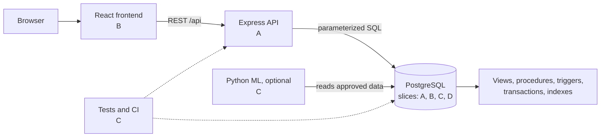

# eBioTrack — Architecture and File Ownership

This document lives in `planning/` and describes how the repository is organized and **who owns which folder and file**. It is generated from the same list that created the folder skeleton, so every file below exists in the repo as a stub with an `Owner` header.

## Team key

| Member | Discipline | Database slice |
|---|---|---|
| **A** — Dhruve | Backend (incl. platform/DevOps) | Access, Projects & Audit |
| **B** — Bhumi | Frontend | Laboratory & Sequencing |
| **C** — Arvind | Testing & QA | Analysis, Taxonomy & Analytics |
| **D** — Krishna | Docs & Demo | Field & Samples |

See [TEAM_ROLES.md](TEAM_ROLES.md) for the full responsibilities of each role.

## System architecture



**Layering rules**

- The frontend talks only to `/api`; it never touches the database.
- Controllers contain no SQL. Services call parameterized queries, views, and stored procedures.
- Business rules that must always hold (status transitions, approval locking, audit) live **in the database** as constraints, triggers, and procedures, not only in application code.
- Every protected route goes through `auth` and `authorize` middleware.

## Folder overview

```text
ebiotrack/
├── backend/        # A  - API, platform, middleware
├── frontend/       # B  - React app
├── database/       # A, B, C, D - one set of files per slice
│   ├── migrations/ procedures/ triggers/ views/
│   ├── queries/ indexes/ transactions/ seeds/
│   └── roles/ backup/                 # A
├── tests/          # C  - integrity, transactions, concurrency, auth, queries, performance, recovery
├── ml/             # C  - optional
├── datasets/       # C (data), D (README)
├── docs/           # D  - plus slice write-ups from A, B, C, D
├── planning/       # D  - architecture, team roles, workflow, contract, original spec
└── .github/        # C  - CI
```

| Folder | Primary owner | Notes |
|---|---|---|
| `backend/` | A | All API code |
| `frontend/` | B | All UI code |
| `database/` | Split by slice (A, B, C, D) | File name prefix shows the slice |
| `tests/` | C | Covers all slices |
| `ml/` | C | Optional |
| `datasets/` | C / D | C data files, D documentation |
| `docs/` | D | Slice write-ups by slice owners |
| `planning/` | D | Project planning documents (this file, team roles, workflow, contract, original spec) |
| `.github/` | C | CI |

## Database slice map

| Slice | Owner | Migration | Tables |
|---|---|---|---|
| Access, Projects & Audit | A | `010_access_projects_audit.sql` | `users`, `roles`, `user_roles`, `projects`, `project_members`, `project_sites`, `audit_logs` |
| Field & Samples | D | `020_field_samples.sql` | `regions`, `sampling_sites`, `collection_events`, `sample_types`, `samples`, `environmental_measurements`, `sample_status_history` |
| Laboratory & Sequencing | B | `030_lab_sequencing.sql` | `laboratories`, `extraction_batches`, `dna_extractions`, `sequencing_runs`, `sequencing_libraries`, `quality_control_results` |
| Analysis, Taxonomy & Analytics | C | `040_analysis_taxonomy.sql` | `dna_markers`, `analysis_runs`, `taxa`, `taxon_assignments`, `data_exports` |

Migrations run in numeric order. Slices reference earlier slices' tables only through `090_cross_slice_constraints.sql`, so each slice can be developed independently.

## Where each person works

**A — Backend + Access slice:** `backend/**`, `database/*/access_*`, `database/migrations/001_*`, `database/migrations/090_*`, `database/roles/`, `database/backup/`, root config files, `docs/slices/access.md`

**B — Frontend + Lab slice:** `frontend/**`, `database/*/lab_*` and `030_*` files, `docs/slices/lab.md`

**C — Testing + Analysis slice:** `tests/**`, `ml/**`, `datasets/sample_detections.csv`, `.github/`, `database/*/analysis_*` and `040_*` files, `docs/slices/analysis.md`

**D — Docs + Field slice:** `docs/**` (except slice write-ups), `README.md`, `datasets/README.md`, `database/*/field_*` and `020_*` files, `docs/slices/field.md`

## File-by-file ownership

### Root files

Repository-level configuration.

| File | Owner | Purpose |
|---|---|---|
| `.gitignore` | A | Ignore node_modules, .env, build output, Python caches |
| `.env.example` | A | Template for DB URL, session secret, ports (no real secrets) |
| `docker-compose.yml` | A | Local PostgreSQL (and optional PostGIS) for development and tests |
| `.github/workflows/ci.yml` | C | CI: lint, run migrations on a test DB, run test suites |
| `README.md` | D | Project overview (already written) |

### backend

Node.js + Express API. Layering: **routes** (URL and validation) → **controllers** (HTTP) → **services** (business logic, SQL calls). Owned entirely by **A**; slice owners supply the SQL objects in `database/` that the services call.

| File | Owner | Purpose |
|---|---|---|
| `backend/package.json` | A | Backend dependencies and scripts |
| `backend/src/server.js` | A | Process entry point: load config, start HTTP server |
| `backend/src/app.js` | A | Express app: middleware stack and route mounting |
| `backend/src/config/env.js` | A | Read and validate environment variables |
| `backend/src/db/pool.js` | A | PostgreSQL connection pool |
| `backend/src/db/query.js` | A | Parameterized query and transaction helpers |
| `backend/src/db/migrate.js` | A | Migration runner for database/migrations |
| `backend/src/middleware/auth.js` | A | Session check; attaches the current user |
| `backend/src/middleware/authorize.js` | A | Role and project-level permission checks |
| `backend/src/middleware/validate.js` | A | Request body/query validation |
| `backend/src/middleware/pagination.js` | A | Page and limit parsing |
| `backend/src/middleware/errorHandler.js` | A | Consistent error response format |
| `backend/src/utils/passwordHash.js` | A | Password hashing and verification |
| `backend/src/utils/csv.js` | A | CSV parsing and validation for analysis import; CSV export |
| `backend/src/utils/response.js` | A | Standard success/paginated response helpers |
| `backend/src/routes/auth.routes.js` | A | Route definitions: login, logout, current session |
| `backend/src/controllers/auth.controller.js` | A | Request handling: login, logout, current session |
| `backend/src/services/auth.service.js` | A | Business logic and calls to SQL objects: login, logout, current session |
| `backend/src/routes/projects.routes.js` | A | Route definitions: projects and members |
| `backend/src/controllers/projects.controller.js` | A | Request handling: projects and members |
| `backend/src/services/projects.service.js` | A | Business logic and calls to SQL objects: projects and members |
| `backend/src/routes/audit.routes.js` | A | Route definitions: authorized audit history |
| `backend/src/controllers/audit.controller.js` | A | Request handling: authorized audit history |
| `backend/src/services/audit.service.js` | A | Business logic and calls to SQL objects: authorized audit history |
| `backend/src/routes/sites.routes.js` | A | Route definitions: regions and sampling sites |
| `backend/src/controllers/sites.controller.js` | A | Request handling: regions and sampling sites |
| `backend/src/services/sites.service.js` | A | Business logic and calls to SQL objects: regions and sampling sites |
| `backend/src/routes/events.routes.js` | A | Route definitions: collection events and environmental measurements |
| `backend/src/controllers/events.controller.js` | A | Request handling: collection events and environmental measurements |
| `backend/src/services/events.service.js` | A | Business logic and calls to SQL objects: collection events and environmental measurements |
| `backend/src/routes/samples.routes.js` | A | Route definitions: samples, detail and status history |
| `backend/src/controllers/samples.controller.js` | A | Request handling: samples, detail and status history |
| `backend/src/services/samples.service.js` | A | Business logic and calls to SQL objects: samples, detail and status history |
| `backend/src/routes/extractions.routes.js` | A | Route definitions: extraction batches and DNA extractions |
| `backend/src/controllers/extractions.controller.js` | A | Request handling: extraction batches and DNA extractions |
| `backend/src/services/extractions.service.js` | A | Business logic and calls to SQL objects: extraction batches and DNA extractions |
| `backend/src/routes/sequencing.routes.js` | A | Route definitions: sequencing libraries and runs |
| `backend/src/controllers/sequencing.controller.js` | A | Request handling: sequencing libraries and runs |
| `backend/src/services/sequencing.service.js` | A | Business logic and calls to SQL objects: sequencing libraries and runs |
| `backend/src/routes/analyses.routes.js` | A | Route definitions: analysis runs, CSV import, transactional approval |
| `backend/src/controllers/analyses.controller.js` | A | Request handling: analysis runs, CSV import, transactional approval |
| `backend/src/services/analyses.service.js` | A | Business logic and calls to SQL objects: analysis runs, CSV import, transactional approval |
| `backend/src/routes/taxa.routes.js` | A | Route definitions: taxa and detection history |
| `backend/src/controllers/taxa.controller.js` | A | Request handling: taxa and detection history |
| `backend/src/services/taxa.service.js` | A | Business logic and calls to SQL objects: taxa and detection history |
| `backend/src/routes/analytics.routes.js` | A | Route definitions: richness and biodiversity analytics |
| `backend/src/controllers/analytics.controller.js` | A | Request handling: richness and biodiversity analytics |
| `backend/src/services/analytics.service.js` | A | Business logic and calls to SQL objects: richness and biodiversity analytics |
| `backend/src/routes/exports.routes.js` | A | Route definitions: CSV report exports |
| `backend/src/controllers/exports.controller.js` | A | Request handling: CSV report exports |
| `backend/src/services/exports.service.js` | A | Business logic and calls to SQL objects: CSV report exports |

### frontend

React + TypeScript app. Owned entirely by **B**.

| File | Owner | Purpose |
|---|---|---|
| `frontend/package.json` | B | Frontend dependencies and scripts |
| `frontend/index.html` | B | HTML entry |
| `frontend/src/main.tsx` | B | React entry point |
| `frontend/src/App.tsx` | B | App shell and layout |
| `frontend/src/routes.tsx` | B | Route table with protected routes |
| `frontend/src/styles/index.css` | B | Global styles (Tailwind entry) |
| `frontend/src/types/index.ts` | B | Shared TypeScript types mirroring API responses |
| `frontend/src/context/AuthContext.tsx` | B | Current user and role state |
| `frontend/src/services/apiClient.ts` | B | Fetch wrapper: base URL, errors, credentials |
| `frontend/src/services/authService.ts` | B | API calls for auth |
| `frontend/src/services/projectsService.ts` | B | API calls for projects |
| `frontend/src/services/sitesService.ts` | B | API calls for sites |
| `frontend/src/services/eventsService.ts` | B | API calls for events |
| `frontend/src/services/samplesService.ts` | B | API calls for samples |
| `frontend/src/services/labService.ts` | B | API calls for lab |
| `frontend/src/services/analysesService.ts` | B | API calls for analyses |
| `frontend/src/services/taxaService.ts` | B | API calls for taxa |
| `frontend/src/services/analyticsService.ts` | B | API calls for analytics |
| `frontend/src/services/auditService.ts` | B | API calls for audit |
| `frontend/src/hooks/useAuth.ts` | B | Hook: access auth context |
| `frontend/src/hooks/useFetch.ts` | B | Hook: data fetching with loading/error state |
| `frontend/src/hooks/usePagination.ts` | B | Hook: pagination state |
| `frontend/src/components/layout/Navbar.tsx` | B | top navigation |
| `frontend/src/components/layout/Sidebar.tsx` | B | section navigation by role |
| `frontend/src/components/layout/ProtectedRoute.tsx` | B | redirect when not signed in or not permitted |
| `frontend/src/components/common/DataTable.tsx` | B | sortable, paginated table |
| `frontend/src/components/common/FormField.tsx` | B | labelled input with validation message |
| `frontend/src/components/common/LoadingState.tsx` | B | loading indicator |
| `frontend/src/components/common/ErrorState.tsx` | B | error display |
| `frontend/src/components/common/CaveatBanner.tsx` | B | eDNA caveat: detection is not abundance; non-detection is not absence |
| `frontend/src/components/charts/RichnessChart.tsx` | B | Richness by site/period (Recharts) |
| `frontend/src/components/charts/DetectionTrendChart.tsx` | B | Detection history chart (Recharts) |
| `frontend/src/components/maps/SiteMap.tsx` | B | Sampling sites map (Leaflet + OpenStreetMap) |
| `frontend/src/pages/LoginPage.tsx` | B | Sign in |
| `frontend/src/pages/DashboardPage.tsx` | B | Projects, sites, samples, recent activity |
| `frontend/src/pages/ProjectsPage.tsx` | B | Create, edit, manage collaborators |
| `frontend/src/pages/SamplingMapPage.tsx` | B | Interactive site map and filters |
| `frontend/src/pages/CollectionEventsPage.tsx` | B | Field event forms and measurements |
| `frontend/src/pages/SamplesPage.tsx` | B | Searchable sample registry |
| `frontend/src/pages/SampleDetailPage.tsx` | B | Sample detail and status timeline |
| `frontend/src/pages/LabProcessingPage.tsx` | B | Extraction, QC, sequencing workflow |
| `frontend/src/pages/AnalysisImportPage.tsx` | B | Upload CSV, preview errors, validate, commit |
| `frontend/src/pages/SpeciesExplorerPage.tsx` | B | Taxonomy and detection history |
| `frontend/src/pages/BiodiversityAnalyticsPage.tsx` | B | Site/time comparisons and exports |
| `frontend/src/pages/AdministrationPage.tsx` | B | Users, roles, audit records |
| `frontend/src/pages/MlInsightsPage.tsx` | B | Optional: anomalies with limitations |

### database

All SQL. Files are split **by slice**, and each slice owner writes their own migration, seeds, views, procedures, triggers, queries, indexes, and transaction scenario. `090_cross_slice_constraints.sql` is applied last and holds foreign keys that cross slice boundaries.

| File | Owner | Purpose |
|---|---|---|
| `database/migrations/001_extensions_and_enums.sql` | A | Extensions and shared enum types (agreed by all) |
| `database/migrations/010_access_projects_audit.sql` | A | Tables, keys, CHECK/UNIQUE constraints: Access, Projects & Audit |
| `database/migrations/020_field_samples.sql` | D | Tables, keys, CHECK/UNIQUE constraints: Field & Samples |
| `database/migrations/030_lab_sequencing.sql` | B | Tables, keys, CHECK/UNIQUE constraints: Laboratory & Sequencing |
| `database/migrations/040_analysis_taxonomy.sql` | C | Tables, keys, CHECK/UNIQUE constraints: Analysis, Taxonomy & Analytics |
| `database/migrations/090_cross_slice_constraints.sql` | A | Foreign keys across slices, applied last; reviewed by all |
| `database/seeds/010_seed_access.sql` | A | Seed rows: Access, Projects & Audit |
| `database/seeds/020_seed_field.sql` | D | Seed rows: Field & Samples |
| `database/seeds/030_seed_lab.sql` | B | Seed rows: Laboratory & Sequencing |
| `database/seeds/040_seed_analysis.sql` | C | Seed rows: Analysis, Taxonomy & Analytics |
| `database/views/access_views.sql` | A | 2 views: Access, Projects & Audit |
| `database/procedures/access_procedures.sql` | A | 1 stored procedure/function: Access, Projects & Audit |
| `database/triggers/access_triggers.sql` | A | 1 trigger: Access, Projects & Audit |
| `database/queries/access_queries.sql` | A | 3 complex queries: Access, Projects & Audit |
| `database/indexes/access_indexes.sql` | A | 2 justified indexes: Access, Projects & Audit |
| `database/transactions/access_transaction.sql` | A | 1 transaction scenario with rollback case: Access, Projects & Audit |
| `database/views/field_views.sql` | D | 2 views: Field & Samples |
| `database/procedures/field_procedures.sql` | D | 1 stored procedure/function: Field & Samples |
| `database/triggers/field_triggers.sql` | D | 1 trigger: Field & Samples |
| `database/queries/field_queries.sql` | D | 3 complex queries: Field & Samples |
| `database/indexes/field_indexes.sql` | D | 2 justified indexes: Field & Samples |
| `database/transactions/field_transaction.sql` | D | 1 transaction scenario with rollback case: Field & Samples |
| `database/views/lab_views.sql` | B | 2 views: Laboratory & Sequencing |
| `database/procedures/lab_procedures.sql` | B | 1 stored procedure/function: Laboratory & Sequencing |
| `database/triggers/lab_triggers.sql` | B | 1 trigger: Laboratory & Sequencing |
| `database/queries/lab_queries.sql` | B | 3 complex queries: Laboratory & Sequencing |
| `database/indexes/lab_indexes.sql` | B | 2 justified indexes: Laboratory & Sequencing |
| `database/transactions/lab_transaction.sql` | B | 1 transaction scenario with rollback case: Laboratory & Sequencing |
| `database/views/analysis_views.sql` | C | 2 views: Analysis, Taxonomy & Analytics |
| `database/procedures/analysis_procedures.sql` | C | 1 stored procedure/function: Analysis, Taxonomy & Analytics |
| `database/triggers/analysis_triggers.sql` | C | 1 trigger: Analysis, Taxonomy & Analytics |
| `database/queries/analysis_queries.sql` | C | 3 complex queries: Analysis, Taxonomy & Analytics |
| `database/indexes/analysis_indexes.sql` | C | 2 justified indexes: Analysis, Taxonomy & Analytics |
| `database/transactions/analysis_transaction.sql` | C | 1 transaction scenario with rollback case: Analysis, Taxonomy & Analytics |
| `database/roles/grants.sql` | A | Database roles and grants |
| `database/backup/backup.sh` | A | pg_dump backup script |
| `database/backup/restore.sh` | A | Restore script |

### tests

All automated tests. Owned entirely by **C**, who writes tests for every slice. Slice owners help by supplying expected behavior.

| File | Owner | Purpose |
|---|---|---|
| `tests/setup/testDb.js` | C | Create, migrate, seed, and tear down the test database |
| `tests/fixtures/README.md` | C | Fixture conventions: known values, real vs synthetic labeling |
| `tests/fixtures/detections_valid.csv` | C | Valid detection import fixture |
| `tests/fixtures/detections_invalid_row.csv` | C | Import fixture with a bad row to force rollback |
| `tests/integrity/access.integrity.test.js` | C | Constraint and trigger tests: Access, Projects & Audit |
| `tests/queries/access.queries.test.js` | C | Query results vs known fixtures: Access, Projects & Audit |
| `tests/integrity/field.integrity.test.js` | C | Constraint and trigger tests: Field & Samples |
| `tests/queries/field.queries.test.js` | C | Query results vs known fixtures: Field & Samples |
| `tests/integrity/lab.integrity.test.js` | C | Constraint and trigger tests: Laboratory & Sequencing |
| `tests/queries/lab.queries.test.js` | C | Query results vs known fixtures: Laboratory & Sequencing |
| `tests/integrity/analysis.integrity.test.js` | C | Constraint and trigger tests: Analysis, Taxonomy & Analytics |
| `tests/queries/analysis.queries.test.js` | C | Query results vs known fixtures: Analysis, Taxonomy & Analytics |
| `tests/transactions/import-rollback.test.js` | C | Injected import error rolls back everything |
| `tests/transactions/project-create.test.js` | C | Project plus members atomic creation |
| `tests/concurrency/double-approval.test.js` | C | Simultaneous approval attempts |
| `tests/concurrency/run-assignment.test.js` | C | Same extraction assigned to two runs at once |
| `tests/authorization/project-access.test.js` | C | Unauthorized users cannot read or edit restricted projects |
| `tests/performance/explain-benchmarks.sql` | C | EXPLAIN (ANALYZE, BUFFERS) before and after indexes |
| `tests/recovery/restore.test.js` | C | Restore a backup and verify key records |

### ml and datasets

Optional ML module and starter datasets.

| File | Owner | Purpose |
|---|---|---|
| `ml/README.md` | C | Optional ML module scope and caveats |
| `ml/requirements.txt` | C | Python dependencies |
| `ml/anomaly_detection.py` | C | Optional anomaly detection on approved richness data |
| `datasets/README.md` | D | Dataset sources, licenses, real vs synthetic notes |
| `datasets/sample_detections.csv` | C | Curated starter dataset for import |

### docs

Project documentation. **D** owns and compiles it; slice owners write the `docs/slices/*.md` inputs.

| File | Owner | Purpose |
|---|---|---|
| `docs/er-diagram.md` | D | Combined ER/EER diagram |
| `docs/normalization.md` | D | Normalization report compiled from slice write-ups |
| `docs/api.md` | D | API reference (from backend routes) |
| `docs/dbms-demonstration.md` | D | Each view/procedure/trigger/transaction/index mapped to a DBMS concept |
| `docs/user-guide.md` | D | How to use the application |
| `docs/backup-recovery.md` | D | Backup and restore procedure |
| `docs/query-plan-report.md` | D | Benchmark report compiled from the tests |
| `docs/data-sources.md` | D | Data sourcing, attribution, and licenses |
| `docs/demo-script.md` | D | Final demo script and presenters |
| `docs/slices/access.md` | A | Slice write-up and normalization notes: Access, Projects & Audit |
| `docs/slices/field.md` | D | Slice write-up and normalization notes: Field & Samples |
| `docs/slices/lab.md` | B | Slice write-up and normalization notes: Laboratory & Sequencing |
| `docs/slices/analysis.md` | C | Slice write-up and normalization notes: Analysis, Taxonomy & Analytics |

### Planning

Project-planning documents, kept apart from the deliverable documentation in `docs/`. Owned by **D**.

| File | Owner | Purpose |
|---|---|---|
| `planning/TEAM_ROLES.md` | D | Team roles and work split |
| `planning/ARCHITECTURE.md` | D | This file: architecture and file ownership |
| `planning/CONTRACT.md` | D | T00 contract: decisions, columns, enums, seed IDs, procedure signatures, endpoints (needs sign-off from all four) |
| `planning/WORKFLOW.md` | D | How the team works: task dependencies, parallel work, gates, order of work |
| `planning/roles/ROLE_A_BACKEND.md` | D | Member A guide: role, files, workflow, start-now and blocked tasks |
| `planning/roles/ROLE_B_FRONTEND.md` | D | Member B guide: role, files, workflow, start-now and blocked tasks |
| `planning/roles/ROLE_C_TESTING.md` | D | Member C guide: role, files, workflow, start-now and blocked tasks |
| `planning/roles/ROLE_D_DOCS.md` | D | Member D guide: role, files, workflow, start-now and blocked tasks |
| `planning/eBioTrack_README.md` | D | Original project specification |

## Rules for working in someone else's area

- Do not edit a file owned by another member without telling them; open a pull request and request their review; Arvind merges it.
- The `database/migrations/090_cross_slice_constraints.sql` file is the one shared exception: A maintains it, but every member adds their own cross-slice foreign keys through a pull request.
- New files go in the folder that matches the layer (route, controller, service, page, etc.) and the author becomes the owner; add a row to the table above.
- Slice owners provide the SQL (views, procedures, triggers); A calls them from services; C tests them; D documents them; B displays the results.

## Typical feature flow (example: register a sample)

1. **D** writes `register_sample()` and the status trigger in `database/procedures/field_procedures.sql` and `database/triggers/field_triggers.sql`.
2. **A** exposes it in `routes/samples.routes.js`, `controllers/samples.controller.js`, `services/samples.service.js`.
3. **B** builds `SamplesPage.tsx` and `services/samplesService.ts`.
4. **C** adds `tests/integrity/field.integrity.test.js` and `tests/queries/field.queries.test.js`.
5. **D** documents it in `docs/api.md` and `docs/dbms-demonstration.md`.
