# eBioTrack — Team Workflow

How the four of us work together: what can start immediately, what has to wait for something else, and where the hand-offs happen.

Member key (see [TEAM_ROLES.md](TEAM_ROLES.md)):

| Member | Discipline | Database slice |
|---|---|---|
| **A** — Arvind | Backend (incl. platform/DevOps, optional ML) | Analysis, Taxonomy & Analytics |
| **B** — Bhumi | Frontend | Laboratory & Sequencing |
| **C** — Dhruve | Testing & QA | Access, Projects & Audit |
| **D** — Krishna | Docs & Demo | Field & Samples |

Ownership of each file is in [ARCHITECTURE.md](ARCHITECTURE.md).

---

## 1. How the project is sequenced

Work moves through **gates**. A gate is a checkpoint that must pass before the tasks after it are considered unblocked for integration. Many tasks can still be *started* early using the agreed contract (see section 6).

| Gate | Meaning | Passes when |
|---|---|---|
| **G0** Contracts agreed | Everyone builds against the same names | Table list, PK/FK names, enums and status values, seed ID ranges, and the endpoint list with response shapes are written down and approved by all four |
| **G1** Schema complete | The database builds from scratch | All four migrations plus `090_cross_slice_constraints.sql` run cleanly on an empty database |
| **G2** Seeded database | Everyone has realistic data to work with | All four seed files load after G1; the test harness can reset and reseed in one command |
| **G3** Foundation ready | Backend and frontend skeletons work | API foundation, auth, and the app shell run; login works end to end |
| **G4** Feature complete | Every user-facing feature works | All routes and pages integrated for all slices |
| **G5** Database objects verified | Every DBMS deliverable exists and is tested | Views, procedures, triggers, transactions, and indexes exist for every slice and the tests for them pass |
| **G6** Demo ready | Ready to present | Benchmarks, recovery test, docs, and rehearsal are finished |

---

## 2. Task list with dependencies

**Reading the table:** a task can start when everything in *Needs* is done. "Draft" means the person can start from the contract before the prerequisite is finished, and finalize after. Tasks with *Needs* of "T00" only can run in parallel with each other.

Each member's database items are listed once per member (rows marked "each") but are separate tasks for each person's own slice.

### Phase 0 — Contracts

| ID | Task | Owner | Needs |
|---|---|---|---|
| T00 | Contract workshop: review and sign off [CONTRACT.md](CONTRACT.md) (tables, keys, enums, statuses, seed ID ranges, procedure signatures, endpoints) | All | — |

### Phase 1 — Foundations

| ID | Task | Owner | Needs |
|---|---|---|---|
| T01 | Repo setup: `.env`, docker-compose, DB pool, query helpers, migration runner | A | — |
| T02 | Access migration (`010`) and DB roles/grants | C | T00 |
| T03 | Field migration (`020`) | D | T00 |
| T04 | Lab migration (`030`) | B | T00 |
| T05 | Analysis migration (`040`) | A | T00 |
| T06 | Cross-slice FK constraints (`090`) | A | T02, T03, T04, T05 |
| T07 | ER diagram draft (final version after T06) | D | T00 |
| T08 | Frontend scaffold: app shell, routing, API client with mock mode | B | T00 |
| T09 | Test harness and CI (draft early; runs against DB after T01) | C | T00; T01 to execute |
| T10 | API foundation: validation, error format, pagination, response helpers | A | T01 |
| **G1** | Schema complete | — | T06 |

### Phase 2 — Data and database objects

Every member works on their own slice through this order: **seed → queries → views → procedure → trigger → transaction → indexes**.

| ID | Task | Owner | Needs |
|---|---|---|---|
| T11 | Seed rows for own slice (each, using agreed ID ranges) | A, B, C, D | Own migration (T02–T05); load after G1 |
| T12 | CSV import fixtures, starter dataset, volume-data generator | C | T00; sample and library codes from T11 (B, D) |
| T13 | Auth: sessions, password hashing, authorize middleware | A | T02 (C), T01, T10 |
| T14 | 3 complex queries (each, own slice) | A, B, C, D | Own seed (T11). **A's queries join across all slices, so they also need G2** |
| T15 | 2 views (each, own slice) | A, B, C, D | T14 (own). A also needs G2 |
| T16 | Stored procedure (each, own slice) | A, B, C, D | Own migration. A's `approve_analysis()` also needs T06 and the audit function (T17-C) |
| T17 | Trigger (each, own slice). **C's audit trigger function comes first**; A, B, D attach it to their tables | A, B, C, D | Own migration; A, B, D attach after T17-C |
| T18 | Transaction scenario with rollback case (each, own slice) | A, B, C, D | T16 (own) |
| T19 | 2 indexes with `EXPLAIN` before/after (each, own slice) | A, B, C, D | T14 (own) and volume data (T12) |
| T37 | Backup and restore scripts | C | T06, T11 |
| **G2** | Seeded database | — | T11 (all four) |

### Phase 3 — API and UI

| ID | Task | Owner | Needs |
|---|---|---|---|
| T20 | Projects and audit routes | A | T13, T16-C |
| T21 | Sites, events, samples routes | A | T13, T16-D |
| T22 | Extractions and sequencing routes | A | T13, T16-B |
| T23 | Analyses import/approve, taxa, analytics, export routes | A | T13, T16-A, T12 (fixtures for CSV validation) |
| T24 | Shared components, auth context, login page | B | T08; real login after T13 |
| T25 | Projects and Administration pages | B | T24; integrate after T20 |
| T26 | Sampling map, Events, Samples pages | B | T24; integrate after T21 |
| T27 | Lab processing page | B | T24; integrate after T22 |
| T28 | Analysis import, Species explorer, Analytics pages, caveat banner | B | T24; integrate after T23 |
| T29 | Dashboard page | B | T25–T28 |
| **G3** | Foundation ready | — | T10, T13, T24 |
| **G4** | Feature complete | — | T20–T23, T25–T29 |

### Phase 4 — Testing

C can write tests from the specification before the code exists (test-first), then run them when prerequisites land.

| ID | Task | Owner | Needs |
|---|---|---|---|
| T30 | Integrity tests (constraints, duplicate codes, illegal transitions) | C | G1; each slice's triggers (T17) |
| T31 | Query-correctness tests against fixtures | C | T14 (per slice), G2 |
| T32 | Transaction tests (import rollback, project creation) | C | T18 |
| T33 | Authorization tests | C | T13, T20 |
| T34 | Concurrency tests (double approval, run assignment) | C | T16-B, T16-A, T18 |
| T35 | Performance benchmarks (indexed vs. not) | C | T19 (all), T12 volume data |
| T36 | Recovery test (restore and verify) | C | T37 |
| T38 | Optional: anomaly-detection experiment | A | Approved detections (G2 plus T23) |
| **G5** | Database objects verified | — | T14–T19 for all slices, T30–T36 |

### Phase 5 — Documentation (drafted continuously, finalized once the features land)

| ID | Task | Owner | Needs |
|---|---|---|---|
| T40 | Slice write-up and normalization notes (each, own slice) | A, B, C, D | Own migration; finalize after own objects |
| T41 | `normalization.md`: compile and unify | D | T40 (all four) |
| T42 | `api.md` (draft from contract, finalize from routes) | D | T00; finalize after T20–T23 |
| T43 | `dbms-demonstration.md` | D | T14–T18 (all slices) |
| T44 | `backup-recovery.md` | D | T36, T37 |
| T45 | `query-plan-report.md` | D | T35 |
| T46 | User guide and screenshots | D | T25–T29 |
| T47 | `data-sources.md` and `datasets/README.md` | D | T12 |
| T48 | Demo script and slides | D | G5 |

### Phase 6 — Integration and demo

| ID | Task | Owner | Needs |
|---|---|---|---|
| T50 | End-to-end run: register a site/event/sample, record extraction, import detections, approve, trace in explorer | All | G4, G5 |
| T51 | Fix list from T50, then code freeze | All | T50 |
| T52 | Demo rehearsal, each person presents their segment | All | T48, T51 |
| **G6** | Demo ready | — | T41–T48, T52 |

---

## 3. Dependency diagram

Colors show the owner. Arrows mean "must finish before". Dashed arrows mean "can draft early, finalize after".

```mermaid
flowchart TD
    T00([T00 Contracts, all])

    subgraph P1[Phase 1 - Foundations]
        T01[T01 Repo setup, A]
        T02[T02 Access migration, C]
        T03[T03 Field migration, D]
        T04[T04 Lab migration, B]
        T05[T05 Analysis migration, A]
        T06[T06 Cross-slice FKs, A]
        T08[T08 Frontend scaffold, B]
        T09[T09 Test harness and CI, C]
        T10[T10 API foundation, A]
    end

    subgraph P2[Phase 2 - Data and DB objects]
        T11[T11 Seeds, each slice]
        T12[T12 Fixtures and volume data, C]
        T13[T13 Auth, A]
        T14[T14 Queries, each]
        T16[T16 Procedures, each]
        T17[T17 Triggers, each]
        T18[T18 Transactions, each]
        T19[T19 Indexes, each]
        T37[T37 Backup scripts, C]
    end

    subgraph P3[Phase 3 - API and UI]
        T20[T20 Projects API, A]
        T21[T21 Samples API, A]
        T22[T22 Lab API, A]
        T23[T23 Analysis API, A]
        T24[T24 Shared UI and login, B]
        T25[T25 to T28 Pages, B]
    end

    subgraph P4[Phase 4 - Testing]
        T30[T30 Integrity tests, C]
        T31[T31 Query tests, C]
        T32[T32 Transaction tests, C]
        T33[T33 Authorization tests, C]
        T34[T34 Concurrency tests, C]
        T35[T35 Benchmarks, C]
        T36[T36 Recovery test, C]
    end

    subgraph P5[Phase 5 - Docs]
        T40[T40 Slice write-ups, each]
        T41[T41 Normalization report, D]
        T43[T43 DBMS demonstration, D]
        T45[T45 Query-plan report, D]
        T46[T46 User guide, D]
        T48[T48 Demo script, D]
    end

    T50([T50 End-to-end run, all])
    T52([T52 Demo rehearsal, all])

    T00 --> T01 & T02 & T03 & T04 & T05 & T08 & T09
    T01 --> T10
    T02 & T03 & T04 & T05 --> T06
    T06 --> T11
    T02 --> T13
    T10 --> T13
    T11 --> T12
    T11 --> T14
    T14 --> T16
    T16 --> T17
    T16 --> T18
    T14 --> T19
    T12 --> T19
    T06 --> T37

    T13 --> T20 & T21 & T22 & T23
    T16 --> T20 & T21 & T22 & T23
    T08 --> T24
    T24 --> T25
    T20 & T21 & T22 & T23 -.integrate.-> T25

    T17 --> T30
    T14 --> T31
    T18 --> T32
    T13 --> T33
    T20 --> T33
    T16 & T18 --> T34
    T19 --> T35
    T37 --> T36

    T02 & T03 & T04 & T05 -.draft early.-> T40
    T40 --> T41
    T14 & T16 & T17 & T18 --> T43
    T35 --> T45
    T25 --> T46

    T25 & T30 & T31 & T32 & T33 & T34 --> T50
    T41 & T43 & T45 & T46 --> T48
    T50 --> T52
    T48 --> T52

    classDef A fill:#dbeafe,stroke:#1d4ed8,color:#0f172a
    classDef B fill:#dcfce7,stroke:#15803d,color:#0f172a
    classDef C fill:#fef3c7,stroke:#b45309,color:#0f172a
    classDef D fill:#fae8ff,stroke:#a21caf,color:#0f172a
    classDef all fill:#e5e7eb,stroke:#374151,color:#0f172a
    class T01,T05,T06,T10,T13,T20,T21,T22,T23 A
    class T04,T08,T24,T25 B
    class T02,T09,T12,T30,T31,T32,T33,T34,T35,T36,T37 C
    class T03,T41,T43,T45,T46,T48 D
    class T00,T11,T14,T16,T17,T18,T19,T40,T50,T52 all
```

Blue = A, green = B, yellow = C, purple = D, grey = shared or each member for their own slice.

---

## 4. What can run in parallel

### Can start immediately (right after T00)

These do not depend on anything except the contract and can all proceed at the same time:

| Person | Can start immediately |
|---|---|
| **A** | T01 repo setup; T05 Analysis migration; T10 API foundation (after T01 commits) |
| **B** | T04 Lab migration; T08 frontend scaffold with mock API |
| **C** | T02 Access migration (do this first, A's auth and the audit function depend on it); T09 test harness and CI (draft) |
| **D** | T03 Field migration; T07 ER diagram; T40 slice write-up draft; T42 `api.md` draft from the contract |

### Independent across members (no waiting on each other)

- The four migrations (T02–T05).
- Each member's seeds, queries, views, procedures, triggers, transactions, and indexes for **their own slice**, except where marked below.
- Frontend scaffold and shared components (B) while the backend is being built, using mock responses.
- Test writing (C) from specifications while code is still in progress.
- Docs drafting (D) while features are in progress.

### Needs another member's work

| Waiting person | Waiting for | Why |
|---|---|---|
| Everyone | A: T01 migration runner and DB setup | To run migrations locally |
| B, C, D | A: T13 auth | Real login, authorization tests, authenticated API calls |
| A | C: T02 Access migration (users and roles tables) | Auth middleware reads them |
| A | C: T17-C audit function | `approve_analysis()` writes an audit event |
| A | B, D: lab and field seeds | A's queries trace detections back through libraries, extractions, samples, events, and sites |
| A | C, D, B: stored procedures (T16) | Routes call them; A can start with agreed signatures and stub implementations |
| B | A: routes | B can use mock responses until the real route exists, then integrates |
| C | Everyone's objects | Tests need the thing they test; write from the spec first |
| D | Everyone's finished work | Final docs reflect the finished system; draft early |
| All | Each other at T50 | End-to-end run needs every layer |

---

## 5. Critical path

The longest chain of dependent work. Delays here delay the demo:

**T00 → T02–T05 → T06 → T11 (G2) → T14/T15 (A, needs all slices) → T16-A `approve_analysis` → T23 analysis API → T28 analysis pages → T50 end-to-end → T52 rehearsal**

Second chain to watch: **T01 → T10 → T13 auth → T20–T23 → T25–T29 → T50**.

Because A's analysis work sits at the end of the data chain, A's slice is intentionally the smallest in table count. C's Access migration (T02) and audit function (T17-C) sit at the start of the chain and block A's auth, so C does those first. If either falls behind, the others should help with seed data and fixtures first.

---

## 6. Working without being blocked

When a prerequisite is not finished, use the contract from T00 instead of waiting:

- **Frontend (B) waiting for a route:** call the mock API client with the agreed response shape; switch to the real route when it lands.
- **Backend (A) waiting for a procedure:** call it by its agreed name and signature; use a stub that returns fixture data until the real one is merged.
- **Testing (C) waiting for code:** write tests from the specification and mark them pending; enable them when the task lands.
- **Docs (D) waiting for features:** write structure, diagrams, and descriptions from the plan; fill in screenshots and final details at the end.
- **Cross-slice data:** use the agreed seed ID ranges so each person's seeds line up without seeing each other's files.

**Rule:** if the contract needs to change, tell everyone, update it in one pull request, and re-check the tasks that depend on it. Do not change a name or signature quietly.

---

## 7. Order of work

The project advances by **phase and gate**, not by calendar. Move to the next step when its prerequisites are done, not when a date arrives.

| Step | Focus | Main tasks | Gate |
|---|---|---|---|
| 1 | Contracts and schema drafts | T00, T01–T05, T07, T08, T09 | G0 |
| 2 | Schema complete, foundation | T06, T10, T11, T13, T37 | G1, G2 |
| 3 | Slice SQL and first APIs | T14–T17, T12, T20–T21, T24 | G3 |
| 4 | Remaining APIs, pages, SQL objects | T18, T19, T22–T23, T25–T27, T30–T31 | — |
| 5 | Analysis features, tests, docs | T28–T29, T32–T34, T40, T42, T43 | G4 |
| 6 | Benchmarks, recovery, docs | T35, T36, T41, T44–T47 | G5 |
| 7 | Integration and demo | T48, T50–T52 | G6 |

Steps overlap: anyone whose prerequisites are done keeps going, even if others are still on an earlier step.

---

## 8. How we work day to day

- **Branches:** one branch per task, named `<member>/<task-id>-<short-name>` (for example `a/t13-auth`, `d/t03-field-migration`).
- **Pull requests:** one PR per task, linking the task ID. Arvind (A, repo owner) is the only reviewer: Arvind reviews and merges every PR, and no other member's approval is needed or counted. If a PR touches another member's files, say so in the description. Arvind's own PRs are merged by Arvind once CI passes.
- **Merging:** only Arvind merges into `main` (enforced by a GitHub ruleset). Arvind merges when CI passes and the review is done. Nobody pushes directly to `main`. Keep `main` runnable at all times.
- **Migrations:** numbered, never edited after merge. Add a new migration to fix an old one.
- **Syncs:** hold a short sync whenever a gate is reached or someone is blocked: show what merged, check which tasks are now unblocked, and decide who picks them up. Post blockers in the group chat as soon as they appear, naming the task ID.
- **Definition of done** for a task: code merged, tests added or updated, own-slice docs updated, task ID ticked in the tracker below.

## 9. Progress tracker

Copy this into your issue board or tick it here.

- [x] G0 Contracts agreed (T00)
- [ ] G1 Schema complete (T01–T06)
- [ ] G2 Seeded database (T11)
- [ ] G3 Foundation ready (T10, T13, T24)
- [ ] G4 Feature complete (T20–T23, T25–T29)
- [ ] G5 Database objects verified (T14–T19, T30–T36)
- [ ] G6 Demo ready (T41–T48, T52)
